# Tài liệu tổng thể hệ thống MaiHub

> Tài liệu mô tả hệ thống theo mã nguồn tại repository này, không phải cam kết về môi trường production. Những nội dung chỉ suy ra từ mã nhưng chưa được chạy kiểm chứng được gắn nhãn **Cần xác nhận vận hành**.

## 0. Kiểm soát tài liệu

| Thuộc tính | Giá trị |
|---|---|
| Tên hệ thống | MaiHub (trước 26.9.0: AHV Connect) |
| Phiên bản ứng dụng được khảo sát | `26.32.0` (khảo sát gốc trên 26.8.5; các mục 4.9–4.12 cập nhật theo bản mới; 26.17.0 thêm hủy Đăng Facebook dừng ngay, sandbox có điều kiện và các bản sửa port từ Deplao 26.9–26.10); 26.18.0 thêm API điều khiển cho bot AI (MaiHub Control Protocol v1); 26.19.0 thêm ghép nối bot một lệnh, thông báo Telegram (`watch`) và kiểm tra đăng nhập Facebook; 26.20.0 thêm Nghiên cứu chủ đề; 26.21.0 thêm tự thử lại khi đăng lỗi và theo dõi hiệu quả bài đăng (lấy link bài chờ duyệt, đo tương tác); 26.22.0 thêm chiến dịch và biến thể A/B cho Đăng Facebook; 26.23.0 thêm chấm điểm nhóm và gợi ý giờ đăng; 26.24.0 thêm khách tiềm năng từ bình luận; 26.25.0 thêm sản xuất video bán hàng (máy chủ render HyperFrames); 26.26.0 cho bot tải video đã xong về và gửi kèm video vào tin Telegram; 26.27.0 giúp bot tự chạy vòng làm việc (chờ sự kiện, hướng dẫn, gợi ý lỗi, trạng thái thu bình luận); 26.28.0 làm Đăng Facebook ổn định hơn (dừng khi checkpoint, ảnh chẩn đoán khi lỗi, nghỉ ngắn sau lỗi chưa đăng, việc phụ nhường giờ đăng); 26.29.0 hướng dẫn bot viết video HTML đúng quy ước HyperFrames (máy chủ render cấp GSAP, kiểm lint, ghép khung thẳng vào video); 26.30.0 sửa nút Xem của thư viện video và lỗi render khi HTML gọi GSAP từ CDN; 26.31.0 thêm video quảng cáo AI nhiều cảnh (engine `ahv_ad`, task `ad_video` của AHV AI) vào Video Studio; 26.32.0 thêm đề xuất bài hằng ngày (bot tự học Page, `research.trending`, timer `brief-tick`), nền tảng vận hành Page và chiến dịch Page tự động (quyền tự đăng thật vẫn tắt), chạy nền độc lập (tối đa 2 lượt Đăng Facebook cùng lúc, `runs.active`/`runs.cancel` theo `runId`, giao diện theo từng lượt, thoát app chờ việc dừng an toàn kèm lựa chọn "Thoát ngay") |
| Phiên bản tài liệu | `1.2` |
| Ngày lập | 2026-09-18, cập nhật 2026-10-03, cập nhật 2026-10-12, cập nhật 2026-10-14, cập nhật 2026-10-27 |
| Trạng thái | Theo mã nguồn `main` bản 26.32.0, phát hành 31/10/2026 qua CI; kiểm chứng live/vận hành (app thật, Facebook thật, quyền tự đăng của chiến dịch) còn chờ |
| Chủ sở hữu | Maiychrus (dự án cá nhân) |
| Độc giả | Ban vận hành, BA/PM, đội CNTT, phát triển, kiểm thử, hỗ trợ người dùng |
| Nguồn sự thật | Mã nguồn, cấu hình build và tài liệu nội bộ trong repository |

### Ghi chú kiểm chứng local Task 8 — 29/10/2026

Bổ sung duy nhất integration suite `src/__tests__/dailyBrief/pageCampaignAutonomy.integration.test.ts` và tài liệu/status; không đổi production API/wiring, dependency, version hoặc gate thật. Suite nối registry/authorization/store/operations/scheduler/post task thật với SQLite tạm, pinned loopback HTTPS và Python bridge thật. Browser và authenticated sender là boundary giả lập. Cases kiểm 50 contender/một slot (draft sở hữu sẵn là fixture synthetic, không né daily draft cap trong production), 100 replay + 100 cancel, 7 ngày qua mở lại SQLite/khởi tạo module mới, lease cũ, DST cùng zone, đổi zone giả lập, transaction/submit/result faults, quota/event projection và manual owner path.

Phân loại bằng chứng: **existing-behavior characterization**, không tạo lỗi production giả để gọi là RED. Runtime current-publish tạo target null/unconfirmed; collect giữ unavailable và không mở research session; autonomous first comment bị chặn. Fixture 10 observation confirmed riêng kiểm 5 mẫu/A + 5 mẫu/B, report/one-factor optimization/latest-decision/Python dedup; không phải chứng minh publisher/collector thật. Receiver send uncertain giữ journal qua process restart. Compile/bundle chỉ vào scratch; không phải installer/native/E2EE certification, không nhận obfuscator parity khi filter `dist/assets` không khớp. UI giữ nguyên, hai vòng render N/A và phải đối chiếu hash.

**Chưa nghiệm thu tổng thể:** Tasks 1–8 đã qua review local; broad review và scoped re-review F1 kết thúc, không còn finding trong diff sửa lỗi. Các cổng sau vẫn BLOCKED: Make build/test/lint thiếu targets (exit 2), TypeScript không thay cho lint/build pass; full randomized Jest seeds 2707/3707 có lỗi legacy `groupContactType` do fixture phụ thuộc thứ tự, không sửa/skip để che. Runtime gate false, current-publish/firstComment, live identity/collector, receiver isolation, fresh-HOME auth và packaging vẫn blocked. Bình luận độc lập chưa triển khai; doanh thu/ROI unavailable vì thiếu nguồn tài chính. Không Facebook/Telegram/provider/CLI thật, không deploy hoặc migration DB khách.

**Bằng chứng hai vòng local trước final review (lịch sử):** matrix mới 28/28 ở seeds 2707 và 3707 (`TZ=America/New_York`); full Jest chuẩn 125 suites/3156 tests; Python 361 tests; cả hai TypeScript, docs-check và diff-check exit 0 ở mỗi vòng. Full Jest randomized mỗi seed vẫn 1 failed/3155 passed tại `src/__tests__/database/groupContactType.test.ts:48`; Make build/test/lint mỗi lệnh exit 2. Hai compile scratch exit 0; transformer strip-console thật xử lý 12/262 JS, không lỗi parse, không source map; hai renderer bundle exit 0 nhưng có cảnh báo crypto externalized, lottie eval và chunk lớn. Filter obfuscator không khớp đường output scratch: không nhận parity production. Native/output repo không đổi; 291 file UI/design/icon giữ hash. Suite bổ sung fault `SQLITE_IOERR` tại adapter trước transaction, cùng checkpoint trước promotion, sau reservation và mất response sau commit; đây là fault fixture tạm, không thay adapter production. Không gọi all-green/completion.

**Sau final review F1 — 29/10/2026, chưa phát hành:** sửa public receiver poll khi mixed events chứa campaign hint không có `workId`; chỉ thêm hai dòng phân loại, không đổi production TypeScript/API/schema hoặc cơ chế recovery. Unit và composition qua pinned HTTPS/public Python poll tái hiện `KeyError` trước sửa; scoped re-review xác nhận resolved, không còn finding trong diff sửa lỗi. Hai vòng sau sửa (2707/3707) mỗi vòng matrix 29/29, Python 363 và Jest chuẩn 125 suites/3157 tests; full randomized mỗi seed 1 failed/3156 passed ở cùng legacy test. Cả hai TS/docs/diff exit 0; Make mỗi lệnh exit 2. Controller kiểm chứng độc lập cùng kết quả; full Jest vẫn có 12 console.error và 2 console.warn blocks của các đường được kiểm thử, không nhận output pristine. Qua verification không source/HEAD/index drift; 538 native/output và 291 UI files giữ hash. Không cần compile lại TypeScript không đổi; build scratch ở mốc trước không trở thành chứng nhận installer/live. Giữ các blocker nghiệm thu tổng thể nêu trên.

### Bổ sung kiểm chứng và phạm vi — 30/10/2026

Sau khi chủ sở hữu duyệt ngoại lệ sửa fixture, `src/__tests__/database/groupContactType.test.ts` tự tạo contact group riêng trong test kiểm tra loại rỗng, thay vì phụ thuộc contact do test trước tạo. Giữ cả 7 tests, bổ sung assertion precondition, không sửa `DatabaseService` hoặc đổi kỳ vọng nghiệp vụ. RED chạy riêng thất bại đúng Expected group/Received user; sau sửa chạy riêng và cả file đạt. Full Jest chuẩn (`TZ=UTC`) và hai stress rounds full randomized (`2707`, `TZ=America/New_York`; `3707`, `TZ=Asia/Ho_Chi_Minh`) đều **125 suites/3157 tests đạt, không skip, exit 0**. Hai TypeScript configs kiểm `--noEmit` exit 0. 731 source/config files giữ hash trong lúc chạy verification; production DatabaseService không đổi. Đây là sửa test isolation, không phải thay đổi schema hoặc hành vi ứng dụng.

Lỗi Jest nêu trong bằng chứng 29/10 phía trên đã được xử lý ở mốc này; các số liệu cũ vẫn giữ nguyên như lịch sử. Output full Jest còn 12 console.error và 2 console.warn blocks như baseline, gồm cảnh báo migration index/media library trong SQLite fixture; chưa xử lý các cảnh báo đó và không nhận output pristine. `make build`, `make test`, `make lint` vẫn exit 2 vì thiếu target; TypeScript không thay cho build/lint. Không chạy lại Python standalone hoặc build installer trong đợt sửa fixture; composition thuộc full Jest vẫn chạy. UI không đổi, desktop/mobile rendered checks N/A. Gate live, receiver isolation, auth, current-publish/collector/firstComment và packaging vẫn chặn nghiệm thu tổng thể.

**Phạm vi mới của chủ sở hữu:** không triển khai doanh thu/ROI; không xóa các trường financial unavailable legacy. Ưu tiên tách tác vụ đăng để làm việc khác đồng thời, rồi thiết kế chế độ AI tự vận hành các chức năng trong quyền đã cấu hình, không cần giao từng lệnh bot. Spec `docs/specs/2026-10-30-independent-background-jobs.md` đã được chủ sở hữu duyệt ngày 2026-10-30. Kế hoạch `docs/plans/2026-10-30-independent-background-jobs.md` chia 8 task: quyền profile/queue, coordinator, side jobs, scheduler, lifecycle, API/bridge, UI và kiểm chứng tích hợp; chủ sở hữu đã duyệt kế hoạch và yêu cầu triển khai bằng subagent ngày 2026-10-30. Phát hành trong 26.32.0 (31/10/2026) sau review từng task và review toàn nhánh; kiểm chứng bằng Jest/harness, chưa kiểm trên app thật hoặc Facebook thật. Bình luận độc lập và bằng chứng publish/metrics có gate riêng, chưa làm trong bản này. Không thêm dependency, bật gate hoặc migrate DB khách.

**Kiểm chứng baseline trong lượt lập plan:** chạy lại hai full Jest randomized seeds 2707/New York và 3707/Ho Chi Minh, mỗi vòng 125 suites/3157 tests đạt; hai TypeScript checks exit 0. Output vẫn có 12 console.error/2 console.warn blocks mỗi vòng; ba lệnh Make vẫn thiếu target, exit 2. Đây chỉ là kiểm chứng baseline ứng dụng desktop, không phải bằng chứng tính năng concurrency đã hoạt động. Đối chiếu working tree phát hiện các thay đổi đồng thời ngoài phạm vi tại `sites/ahv-modnix-hero`; giữ nguyên, không nhận toàn repository giữ hash. Không chạy lại Python standalone hoặc kiểm UI render trong lượt chỉ sửa tài liệu này.

### 0.1 Phạm vi

Tài liệu bao phủ ứng dụng desktop MaiHub: kiến trúc Electron/React, IPC, các dịch vụ nghiệp vụ, SQLite, bridge Go cho Facebook E2EE, các module Chat, CRM, ERP, Workflow, AI, Integrations và Workspace; đồng thời mô tả chức năng, phân quyền, giao diện chính, dữ liệu, tích hợp, bảo mật, vận hành và bộ 15 sản phẩm BA.

Ngoài phạm vi:

- Hạ tầng hoặc SLA thực tế của từng nhà cung cấp bên ngoài.
- Quy trình nghiệp vụ chưa có dấu vết trong repository.
- Kết quả tải, bảo mật xâm nhập, UAT hoặc tương thích thiết bị thực tế. Các mục này được ghi **Cần xác nhận vận hành**.
- Cấu trúc nội bộ của thư mục sinh tự động/vendor `src/bridge-e2ee/build` và `src/bridge-e2ee/meta`.

### 0.2 Nguyên tắc đọc

| Nhãn | Ý nghĩa |
|---|---|
| Xác nhận từ mã nguồn | Có cấu trúc, kiểu dữ liệu, nhánh xử lý hoặc cấu hình tương ứng trong repository |
| Cần xác nhận vận hành | Mã cho thấy chủ đích nhưng chưa có bằng chứng chạy thật/UAT trong phạm vi khảo sát |
| Khoảng trống | Chưa đủ bằng chứng để xem là năng lực đã bàn giao |

## 1. Tổng quan hệ thống

MaiHub là ứng dụng desktop nội bộ, hợp nhất vận hành nhiều tài khoản Zalo, Facebook và Telegram với CRM, ERP, workflow tự động, trợ lý AI và tích hợp nghiệp vụ. Renderer chạy React; Electron main process nắm quyền hệ điều hành, kết nối kênh, IPC và dữ liệu; SQLite lưu dữ liệu cục bộ trong thư mục `userData` của ứng dụng.

Các chế độ vận hành được mã hóa gồm:

- `standalone`: một máy vận hành độc lập.
- `boss`: máy chủ nội bộ giữ kết nối tài khoản và relay cho nhân viên.
- `employee`: workspace từ xa kết nối máy boss, không tự giữ kết nối Zalo trực tiếp.

Một cài đặt hỗ trợ tối đa 5 workspace loại `local` hoặc `remote`. Workspace mặc định trỏ tới `deplao-tool.db`; workspace bổ sung có database và thư mục media riêng. Nguồn: `src/utils/AppModeManager.ts`, `src/utils/WorkspaceManager.ts`.

### 1.1 Mục tiêu nghiệp vụ

1. Giảm số ứng dụng/tab mà nhân viên cần dùng để chăm sóc liên hệ.
2. Chuẩn hóa chat đa kênh và lưu dấu vết tương tác cục bộ.
3. Quản lý liên hệ, nhãn, ghi chú và chiến dịch gửi tin.
4. Quản lý công việc, lịch, ghi chú và nhân sự nội bộ.
5. Tự động hóa phản hồi và kết nối dữ liệu với AI, POS, thanh toán, vận chuyển.
6. Phân tách dữ liệu/quyền truy cập theo workspace, nhân viên, tài khoản và vai trò ERP.

### 1.2 Thuật ngữ miền nghiệp vụ

| Thuật ngữ | Định nghĩa trong hệ thống |
|---|---|
| Account | Tài khoản kênh Zalo/Facebook/Telegram được ứng dụng quản lý |
| Conversation/Thread | Cuộc hội thoại với một liên hệ hoặc nhóm |
| Contact | Cá nhân/nhóm được đồng bộ hoặc quản lý trong Chat/CRM |
| Campaign | Đợt thực hiện gửi tin, kết bạn, mời nhóm hoặc tổ hợp hành động tới danh sách liên hệ |
| Workflow | Đồ thị node/edge gồm trigger, xử lý và hành động đầu ra |
| Workflow run | Một lần thực thi workflow, có trạng thái, kết quả từng node và lỗi |
| Integration | Cấu hình adapter kết nối POS, thanh toán, vận chuyển hoặc Telegram Bot |
| Workspace local | Không gian dữ liệu cục bộ; có thể bật relay để làm máy boss |
| Workspace remote | Không gian nhân viên kết nối máy boss qua URL/token và có cache cục bộ |
| Boss | Actor quản trị kết nối, nhân viên và dữ liệu chia sẻ |
| Employee | Nhân viên đăng nhập workspace remote, bị giới hạn module và tài khoản được gán |
| ERP role | Vai trò `owner`, `admin`, `manager`, `member` hoặc `guest` dùng cho quyền hành động ERP |
| Project | Nhóm công việc ERP, có trạng thái active/archived |
| Task | Công việc ERP có trạng thái, ưu tiên, người thực hiện, checklist, bình luận và tệp |
| Relay | Dịch vụ HTTP/socket trên máy boss để workspace nhân viên truy cập dữ liệu/hành động |
| Bridge E2EE | Tiến trình Go giao tiếp JSON-line qua stdin/stdout để xử lý Facebook Messenger E2EE |

## 2. Kiến trúc hệ thống

### 2.1 Sơ đồ thành phần

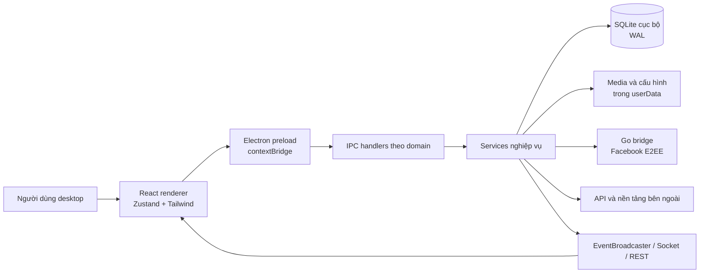

### 2.2 Trách nhiệm theo lớp

| Lớp | Trách nhiệm | Nguồn chính |
|---|---|---|
| Renderer | Điều hướng, màn hình, store UI, responsive desktop/mobile, nhận sự kiện | `src/ui/App.tsx`, `src/ui/components/layout/Sidebar.tsx`, `src/ui/store/` |
| Preload | Chỉ công khai API được định nghĩa qua `contextBridge`, chuyển lời gọi thành IPC | `electron/preload.ts` |
| IPC | Validation/ủy quyền tại biên main process, điều phối service theo domain | `electron/ipc/` |
| Services | Kết nối kênh, CRM queue, workflow engine, AI, ERP, integrations, relay | `src/services/` |
| Persistence | Schema/migration/truy vấn SQLite; cấu hình và media cục bộ | `src/services/database/DatabaseService.ts`, `src/services/file/FileStorageService.ts` |
| Facebook E2EE | Binary Go độc lập, RPC JSON-line, phát sự kiện bất đồng bộ | `src/bridge-e2ee/README.md`, `src/bridge-e2ee/main.go` |
| Build/runtime | Tạo BrowserWindow, lifecycle, startup, đóng gói đa nền tảng | `electron/main.ts`, `package.json`, `scripts/` |

### 2.3 Ranh giới tin cậy

- Renderer không có Node.js trực tiếp (`nodeIntegration: false`) và chạy với `contextIsolation: true`.
- Preload là hợp đồng duy nhất được renderer sử dụng để gọi quyền main process.
- IPC/service là biên cần kiểm tra input và quyền; riêng ERP dùng `ErpAuthContext` để suy ra actor phía main, không tin `employeeId` do renderer gửi.
- SQLite, file/media và credential nằm trên máy; an toàn phụ thuộc quyền tài khoản hệ điều hành và cơ chế mã hóa của OS.
- API/webhook/tunnel và nền tảng chat là biên ngoài không tin cậy.

Lưu ý: BrowserWindow hiện đặt `sandbox: false` (sandbox của cửa sổ Electron; khác sandbox Chromium của trình duyệt profile ở mục 4.9); CSP production tồn tại nhưng cho phép ảnh/media/connect qua `http:`, `https:` và `wss:` để hỗ trợ CDN/API. Đây là bề mặt cần được security review định kỳ. Nguồn: `electron/main.ts`.

## 3. Luồng khởi động và luồng dữ liệu

### 3.1 Luồng khởi động

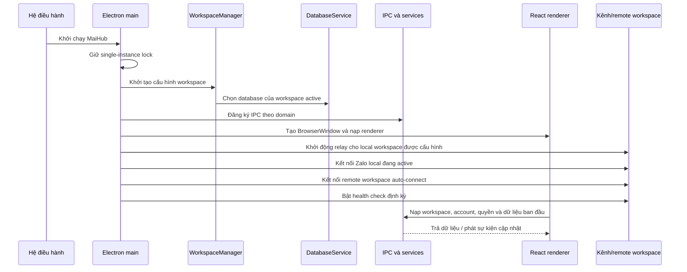

Thứ tự `startupAllWorkspaces` là: relay local trước, kết nối Zalo local sau, rồi mới kết nối workspace remote để máy boss sẵn sàng trước employee. **Cần xác nhận vận hành** về thời gian khởi động, phục hồi mạng và hành vi khi nhiều workspace cùng lỗi. Nguồn: `electron/main.ts`.

Từ đợt port Deplao 26.9.0–26.10.0 (12/10/2026, phát hành trong 26.17.0), khởi động có thêm các bước sau:

- **Điểm vào là `electron/bootstrap.ts`** (`package.json` `main` = `dist-electron/electron/bootstrap.js`, script `dev` cũng chạy tệp này). Tệp đặt `WS_NO_BUFFER_UTIL=1` và `WS_NO_UTF_8_VALIDATE=1` rồi `require('./main')`, để `ws` dùng bản JavaScript thuần thay cho addon native từng gây crash trên Windows (`electron/bootstrap.ts:9-12`).
- **Renderer báo sẵn sàng.** `src/ui/App.tsx:202` gọi `ipc.app?.rendererReady?.()` (preload `electron/preload.ts:336`, kênh `app:rendererReady`); main chỉ nhận từ `mainWindow.webContents` (`electron/main.ts:1140`).
- **Kết nối kênh chạy sau đó**, trong `startConnectorServices` (`electron/main.ts:1188`, đúng một lần): kết nối lại Facebook và Telegram, health check bot Telegram, `startupAllWorkspaces` sau 500 ms (`:1203`), và CRM `resumeActiveCampaigns` sau 3 s tính từ lúc connector bắt đầu (`:1207`) để chiến dịch Telegram không bị đánh dấu lỗi khi Telegram chưa kết nối. Nếu renderer không báo, hàm vẫn chạy sau 30 s (`:1211`). Scheduler Đăng Facebook, ERP, Workflow Engine, Integration Registry, auto-update và chuyển dữ liệu AHV Connect không gắn vào renderer.
- **Dự phòng màn hình trắng.** Sau `ready-to-show`, hẹn giờ 8 s: nếu cửa sổ chưa hiện thì `show()` rồi nạp lại renderer một lần; nếu cửa sổ đã hiện (`isVisible()`) thì bỏ qua (`electron/main.ts:279-301`).
- **Chuyển `local_paths` sang đường dẫn tương đối** chạy 30 s sau khi `startConnectorServices` bắt đầu (`electron/main.ts:1089-1102`, gọi tại `:1191`).
- **Zalo kết nối thất bại** trong `startupAllWorkspaces` thì ghi cảnh báo "cần đăng nhập lại" và bỏ qua tài khoản đó (`electron/main.ts:870-878`).

### 3.2 Luồng chat và lưu dữ liệu

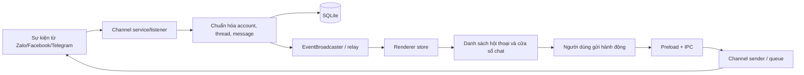

### 3.3 Luồng workflow

Trigger tin nhắn, lịch, webhook, thanh toán hoặc thao tác thủ công gọi `executeWorkflow`. Engine sắp xếp đồ thị, thực thi node, dùng queue gửi theo account, gọi IntegrationRegistry khi cần, lưu `workflow_run_logs` và phát sự kiện. Node hiện bao phủ Zalo/Facebook/Telegram, logic/dữ liệu, Google Sheets, AI, HTTP, email/Discord/Notion, POS, thanh toán và vận chuyển. Nguồn: `src/services/workflow/WorkflowEngineService.ts`.

### 3.4 Luồng workspace employee

Workspace remote lưu URL boss, token, employee identity và cache quyền/account. Renderer khởi tạo REST accessor sớm, sau đó nhận dữ liệu/sự kiện từ boss; các hành động nhạy cảm vẫn phải được kiểm tra phía main/server. **Cần xác nhận vận hành** về reconnect, xung đột cache và hành vi offline. Nguồn: `src/utils/WorkspaceManager.ts`, `src/services/http/`, `src/ui/App.tsx`.

## 4. Mô tả module

### 4.1 Chat đa kênh

- Quản lý nhiều account, chuyển account và hội thoại.
- Nhận/gửi tin nhắn, ảnh, file, voice và các hành động phụ thuộc khả năng từng kênh.
- Hỗ trợ reply, reaction, ghim, nhãn, draft, quick message, tìm kiếm và thông báo.
- Zalo dùng `zca-js`; Telegram có user và bot; Facebook có service thường và bridge E2EE; Page Facebook là tài khoản con gửi qua Business Suite (mục 4.11).
- UI hợp nhất trải nghiệm nhưng capability thực tế khác nhau theo kênh; cần kiểm tra `CRMChannelCapabilityService` và handler kênh trước khi cam kết một hành động.

- Zalo gửi ảnh/tệp: IPC `zalo:sendImage`, `zalo:sendImages`, `zalo:sendFile` truyền `p.type ?? p.threadType` nên media gửi vào nhóm đi đúng hội thoại nhóm (`electron/ipc/zaloIpc.ts:189-197`). `ZaloService.sendImage` chuẩn hóa `threadType`/`threadId`, ném lỗi khi thiếu hội thoại hoặc tệp không tồn tại, và gửi tệp `.gif` như đính kèm (`attachments: [filePath]`) thay vì Buffer ảnh (`src/services/zalo/ZaloService.ts:1439-1448`; `sendImages` tại `:1509-1514`). Không có bước từ chối ảnh theo đuôi tệp hay kích thước. `sendFile` chỉ được sửa ở phần truyền loại hội thoại.
- Tin nhóm Zalo: trước khi phát `broadcastMessage`, chờ thông tin nhóm tối đa 3 s (`GROUP_INFO_WAIT_MS`, `src/utils/ZaloLoginHelper.ts:14`) để `$trigger.groupName` có sẵn ở lần chạy workflow đầu tiên. Tin của cùng một nhóm được xếp hàng tuần tự bằng `enqueuePerKey` (`src/utils/ZaloLoginHelper.ts:787`, `src/utils/enqueuePerKey.ts`), nên tin đến sau không vượt tin đang chờ. Sự kiện `undo`, `chat.delete` và `reaction` của nhóm đi qua cùng hàng đợi (`runInGroupOrder`, `ZaloLoginHelper.ts:221`; gọi ở `:747`, `:897`, `:941`) nên không vượt tin nhóm đang chờ tối đa 3 s; sự kiện không thuộc nhóm chạy ngay (sửa sau review cuối, 12/10/2026). Khi lấy thông tin nhóm mới, `fetchGroupInfoIfMissing` lưu nhóm mới với `contact_type = 'group'` (`:404`). Hàng nhóm đã bị phiên bản cũ lưu là `user` nay được sửa theo hai lớp (12/10/2026): migration một lần `migration_zalo_group_contact_type_v1` (`src/services/database/DatabaseService.ts:1638`; `repairZaloGroupContactTypes` định nghĩa ở `src/services/database/DatabaseService.ts:431`, gọi trong `migrate()` ở `:1641`) đổi sang `group` mọi contact Zalo có tin `thread_type = 1`; và `fetchGroupInfoIfMissing` tự sửa `contact_type` ngay khi gặp hàng chưa là `group`, trước khi thoát sớm (`:375`). `EventBroadcaster.broadcastMessage` bổ sung `groupName` từ tên nhóm đã lưu trong DB, không gọi mạng (`src/services/event/EventBroadcaster.ts:585-597`).
- Lệnh thu hồi Zalo có thể đến dưới dạng tin thường mang payload điều khiển; `getUndoControlPayload` nhận diện (cần `globalMsgId`/`cliMsgId` kèm `deleteMsg`/`srcId`/`destId`) và `broadcastMessage` chuyển thành `broadcastUndo`, không lưu bong bóng JSON (riêng luồng lịch sử `silent` chỉ đánh dấu tin đã thu hồi trong DB, không phát `event:undo` nên workflow `trigger.undo` và relay không chạy lại với recall cũ; sửa sau review cuối, 12/10/2026) (`src/services/event/undoControlPayload.ts:7`, `src/services/event/EventBroadcaster.ts:240`). Lỗi trong các hook trước khi gửi được ghi log kèm tên event và event vẫn được gửi tiếp (`src/services/event/EventBroadcaster.ts:144`, `:179`).

Nguồn: `src/services/zalo/`, `src/services/facebook/`, `src/services/telegram/`, `src/ui/components/chat/`.

### 4.2 CRM

- Danh bạ/liên hệ, tag, note, yêu cầu kết bạn và dữ liệu quét Facebook.
- Campaign loại `message`, `friend_request`, `mixed`, `invite_to_group`.
- Contact trong campaign đi qua `pending`, `sending`, `sent`, `failed`.
- Queue áp dụng token bucket, khoảng delay, giờ bắt đầu ngày và giới hạn gửi/ngày khi được cấu hình.
- Form cho phép nhập delay tùy chỉnh từ 5 giây, nhưng queue ép `MIN_DELAY_MS = 30 giây`; vì vậy delay hiệu lực giữa hai contact không thấp hơn 30 giây. Preset 5–15 giây hiện không phản ánh thời gian gửi thực tế.
- Kênh campaign được snapshot trên bản ghi mới; bản ghi cũ có fallback về channel của account.

Chênh lệch tài liệu: README/NOTICE ghi chưa có giới hạn ngày/giờ im lặng, nhưng model, UI và `CRMQueueService` hiện có `daily_send_limit` và `daily_start_time`, đồng thời thực thi hai kiểm tra này. Thực tế mã nguồn được ưu tiên; README/NOTICE cần được hòa giải. `daily_start_time` là giờ bắt đầu, không phải một khoảng “quiet hours”; chưa thấy cơ chế opt-out thống nhất. **Cần xác nhận vận hành** trước khi gửi cho học viên thật.

Nguồn: `src/models/crm.ts`, `src/services/crm/CRMQueueService.ts`, `src/ui/components/crm/campaigns/CampaignCreateModal.tsx`.

### 4.3 ERP

- Dự án và task Kanban/inbox; task có assignee, watcher, checklist, comment, attachment, dependency, activity log.
- Lịch cá nhân/đội nhóm và reminder.
- Ghi chú, thư mục, tag, phiên bản và chia sẻ.
- Hồ sơ nhân sự, phòng ban, chức vụ, chấm công và nghỉ phép.
- Thông báo và báo cáo ERP.
- Hai tầng quyền: module employee và action-level ERP role/override.

Nguồn: `src/models/erp/`, `src/services/erp/`, `electron/ipc/erp*`, `src/ui/features/erp/`.

### 4.4 Workflow

- Danh sách, template store, import/export JSON, editor React Flow và chạy thử.
- Workflow có kênh, danh sách account áp dụng, node, edge, cờ enabled và log chạy.
- Trigger gồm message, friend request, group event, reaction, undo, schedule, manual, label, webhook, payment và trigger theo Facebook/Telegram.
- Action gồm chat, logic, transform dữ liệu, Sheets, AI, notification, HTTP, POS, thanh toán, vận chuyển.
- Run có `success`, `error`, `partial`; node có `success`, `error`, `skipped`.
- Node `zalo.addReaction` gọi `api.addReaction(reaction, { data: { msgId, cliMsgId }, threadId, type })` theo chữ ký của `zca-js`; tham số dựng bởi `buildZaloReactionCall` (`src/services/workflow/zaloReaction.ts:35`, gọi ở `src/services/workflow/WorkflowEngineService.ts:1476`). Lấy `msgId`/`threadId`/`threadType`/`cliMsgId` từ cấu hình, rồi `$trigger`, rồi tin trong DB; thiếu một trong ba giá trị bắt buộc thì ném lỗi `[zalo.addReaction]`. Cảm xúc cũ `'1'`–`'6'` vẫn chạy. Dữ liệu trigger tin nhắn có thêm `cliMsgId` (`WorkflowEngineService.ts:1009`).

Nguồn: `src/models/workflow.ts`, `src/services/workflow/WorkflowEngineService.ts`, `src/ui/components/workflow/`.

### 4.5 AI Assistant

- Quản lý assistant, file, hội thoại, message, usage log và liên kết assistant theo account.
- Hỗ trợ provider cấu hình theo kiểu OpenAI-compatible và provider tùy chỉnh; assistant có thể dùng trực tiếp hoặc từ workflow.
- API key/endpoint/model là dữ liệu nhạy cảm và phụ thuộc nhà cung cấp.
- Màn Đăng Facebook không còn panel AI (giao diện soạn nội dung/tạo ảnh bằng AI đã gỡ ở 26.16.0; `src/ui/features/facebookPoster/` không có lời gọi `ai:`). Backend `ai:generateImage` vẫn còn (`electron/ipc/aiAssistantIpc.ts:244`, `AIAssistantService.generateImage`) nhưng hiện không giao diện nào gọi.
- **Cần xác nhận vận hành** về model thực có quyền truy cập, chi phí, quota, lưu trữ dữ liệu tại provider và chất lượng đầu ra.

Nguồn: `src/services/ai/AIAssistantService.ts`, `src/models/ai.ts`, `src/ui/components/integration/AIAssistantPage.tsx`.

### 4.6 Integrations

Registry hiện tạo adapter cho:

| Nhóm | Hệ thống |
|---|---|
| POS/bán hàng | KiotViet, Haravan, Sapo, Nhanh, Pancake |
| Thanh toán | Casso, SePay |
| Vận chuyển | GHN, GHTK |
| Tin nhắn | Telegram Bot |

Credential được mã hóa bằng Electron `safeStorage` khi OS hỗ trợ và bị mask khi trả về UI. Registry có server webhook nhúng, mặc định port 9888, route theo integration ID/type. Chữ ký request được đọc và phát trong event nhưng `IntegrationRegistry` chưa xác minh chữ ký; từng adapter hoặc lớp biên phải bổ sung/kiểm chứng trước khi public webhook. Không bật public tunnel nếu chưa có xác thực, allowlist và giám sát.

Nguồn: `src/services/integrations/IntegrationRegistry.ts`, `src/services/integrations/adapters/`, `src/ui/components/integration/IntegrationPage.tsx`.

### 4.7 Workspace và nhân viên

- Tạo/sửa/xóa/chuyển workspace; workspace mặc định không được xóa và hệ thống phải còn ít nhất một workspace.
- Local workspace có DB, relay port và auto-start; remote workspace có boss URL, token, employee và auto-connect.
- Quản lý employee/group, mật khẩu băm, trạng thái active, quyền module và account được gán.
- Cache remote giữ quyền/account/profile để UI có dữ liệu trước khi đồng bộ.
- Tối đa 5 workspace là ràng buộc mã hiện tại.

Nguồn: `src/utils/WorkspaceManager.ts`, `src/models/employee.ts`, `src/services/employee/EmployeeService.ts`, `electron/ipc/workspaceIpc.ts`, `electron/ipc/employeeIpc.ts`.

### 4.8 Dashboard, Analytics và Settings

- Dashboard tổng hợp trạng thái và lối tắt nghiệp vụ.
- Analytics/Báo cáo hiển thị số liệu hoạt động và KPI nhân viên.
- Settings gồm hội thoại, giao diện, thông báo, tài khoản, proxy, bảo mật, webhooks, nhân viên, workspace, lưu trữ, giới thiệu, log phiên bản và nhật ký.
- **Cần xác nhận vận hành** về định nghĩa KPI, chu kỳ tổng hợp và đối soát báo cáo với dữ liệu nguồn.

Nguồn: `src/ui/components/dashboard/`, `src/ui/components/analytics/`, `src/ui/components/settings/Settings.tsx`.

### 4.9 Trình duyệt (Browser Profiles)

- Mỗi profile là một trình duyệt Chromium antidetect riêng (nhân `fingerprint-chromium` 148.0.7778.215) với fingerprint cố định, thư mục dữ liệu riêng và proxy riêng lấy từ kho proxy hiện có.
- Nhân trình duyệt không nằm trong bộ cài; người dùng tải lần đầu (khoảng 190 MB), có kiểm SHA-256, lưu tại `<userData>/browser-engine/`.
- Profile có proxy đi qua một proxy chuyển tiếp cục bộ trên `127.0.0.1` do main process chạy; proxy lỗi thì trình duyệt nhận `502`, không chuyển sang kết nối trực tiếp.
- Tối đa 30 profile tổng, tính hợp các ID đang mở tay, pending open, automation và reservation nội bộ; reservation và browser cùng ID chỉ chiếm một slot. Trạng thái chỉ nằm trong bộ nhớ. <!-- docs-check: src/services/browser/BrowserProfileService.ts#MAX_RUNNING_PROFILES = 30 -->
- **Nền tảng independent background jobs — Task 1, dev; coordinator/lifecycle xem Tasks 2–5, UI chưa tích hợp:** `tryReserveAutomation` cấp token chỉ có hiệu lực bằng object identity; `openForAutomation(id, token?)` giữ caller một tham số nhưng không vượt reservation của job khác. Lease giữ quyền giữa các lần mở session; token giả/cũ không nhả owner mới. `releaseAutomationReservation` khi browser còn sống chỉ đánh dấu chờ release. `closeAll` hủy pending launch nhưng giữ entry tới cleanup; close timeout/reject không nhả slot, chỉ close thành công, sự kiện close hoặc process exit xác nhận mới nhả. `isIdle`/`waitUntilIdle` và `onAvailabilityChanged` phản ánh authority này. Giới hạn chờ close là 5.000 ms; SIGINT/SIGKILL, forwarder và sandbox giữ nguyên. <!-- docs-check: src/services/browser/BrowserProfileService.ts#FORCE_KILL_DELAY_MS = 5000 -->
- `ProfileJobQueue` ràng buộc owner `{workspaceId, generation, jobId}`; cấp đồng bộ, ưu tiên `scheduled` → `interactive` → `background`, FIFO trong mỗi mức, không chặn profile độc lập và không preempt browser. Deadline cố định là min(deadline yêu cầu, enqueue + **7.200.000 ms**); dùng availability event và timer deadline/defer gần nhất, không poll. Timeout/cancel có code `profile_wait_timeout`/`profile_wait_cancelled`, lỗi launch/quyền stale vẫn tách biệt. `acquire` trả lease có thể mở lại, giữ ownership khi một lần launch lỗi để worker retry mà không bị caller khác chen vào; chỉ worker cleanup mới release. `open` tiện ích một session vẫn tự release khi close/error. Abort sau grant không tự đóng critical session; `pause` chỉ ngừng cấp (waiter giữ deadline gốc, chỉ rời hàng khi job của chính nó abort, hết hạn hoặc `retire`), `resume` chỉ cùng generation và pump lại, `retire` vĩnh viễn nhưng cleanup lease cũ vẫn được phép. Busy bao gồm lease đã release nhưng browser chưa xác nhận dừng. <!-- docs-check: src/services/browser/ProfileJobQueue.ts#PROFILE_JOB_WAIT_MS = 7200000 -->
- **Independent background jobs — Task 2, dev:** `FacebookPosterCoordinator` giữ tối đa **2 lượt sống** (`post`, `scan_groups`, `join`, `collect_comments`), gồm cả chờ profile và admission đang tạo worker; từ chối lượt thứ ba trước factory/store/effect. Snapshot params/media bằng `structuredClone`; `active`/`current` sắp `startedAt`, rồi `runId`. `cancel(id)` không fallback sang lượt khác: ID lạ `NOT_FOUND`, lượt xong `false`, bỏ ID khi hai lượt sống `CONFLICT`. `pause` chặn admission, `whenIdle` đợi settlement; shutdown hai worker song song trong grace 45.000 ms + force 10.000 ms, không nhân timeout. Coordinator đã nối production và side services trong Task 3; chính sách scheduler đa lượt, lifecycle đầy đủ và API/UI thuộc Tasks 4–7. <!-- docs-check: src/services/facebookPoster/FacebookPosterCoordinator.ts#MAX_ACTIVE_POSTER_RUNS = 2 -->
- Worker `start(params, scheduleId?, {priority?, deadlineAt?})` nhận `acquireProfile(profileId, ProfileTaskContext)` bắt buộc, giữ một lease suốt profile plan và mọi lần join/retry reopen. `ProfileProgress.waitingReason?:string` chỉ trong lúc đợi; chuyển `running` sau grant hợp lệ, abort waiter bằng AbortController riêng, không đóng browser critical khi cancel. Cleanup toàn bộ session rồi mới release; wait error không retry launch 10 giây. Adapter IPC capture DB/store/browser/queue/workspace/generation và config/observer/detector, kiểm current trước admission/open/critical; settlement ghi DB đã capture dù generation hết hạn, notification cũ không đánh thức scheduler mới. Login observer đã cache dùng store/name lookup của composition gốc trước retirement; sau retirement observer không ghi nữa, kể cả A→B→A. Các callback UI/control/progress/finished kiểm generation riêng, không đọc store workspace mới hoặc phát sự kiện stale. Native browser store façade/lifecycle được nối trong Task 5 bên dưới; chưa phát hành.
- **Independent background jobs — Task 3, dev:** composition tạo worker thật cho từng `runId` (factory buộc `newId()` trả đúng mã đó), dùng một `ProfileJobQueue` đã capture DB/workspace/generation. Poster dùng `acquire`; LoginChecker, PostTracker, CommentCollector, PageLearner và Research dùng `open` với `ProfileTaskContext` chứa ID thật của check/job/scan và AbortController riêng. Mỗi side service chỉ nhận một job, kể cả đang chờ profile, giữ admission trước callback/ID/chọn rows; khác profile được chạy đồng thời, cùng profile phải chờ, hủy waiter không mở browser. Không còn global slot giữa các service. Research giữ chữ ký `openSession(id, assertCurrent, context)`, ưu tiên profile eligible đang rảnh; explicit/pinned busy vẫn đợi trong tập được phép, không bỏ excluded/login/daily-cap checks. PageLearner không khóa Research nhưng giữ freshness, pause và guard quyền sau await.
- Store/config/profile lookup/diagnostics/detector/login observer đều capture composition; terminal scan và settlement effect ghi store cũ, còn UI/control/scheduler notifications kiểm current độc lập. Manual leads và AI-failure state thuộc closure từng worker, chỉ flush theo đúng finished `runId`. Tập campaign-managed run chỉ nhận ID sau start thành công; revoke chỉ dừng các worker của tập này, không dừng manual run khác. Prune diagnostics giữ mọi active run ID; danh sách profile là union mọi active plan; xóa lịch kiểm mọi active worker, không chỉ lượt `current`. Aggregate shutdown pause coordinator trước khi dừng; scheduler startup resume coordinator. Native DB façade/retirement-drain được bổ sung trong Task 5 bên dưới; guard Task 3 riêng lẻ không đủ bảo đảm native lifecycle. `current` IPC rỗng vẫn `{run:null,progress:null}`; chưa thêm endpoint active-list/cancel theo ID hay mở rộng scoped allowlist.
- **Independent background jobs — Task 6, dev, chưa phát hành:** API active/cancel theo lượt. IPC `facebookPoster:active` → `{success:true,runs}`; `facebookPoster:cancel` nhận `{runId?}` (preload `cancel(runId?)` chỉ gửi object khi có ID) và trả `{success,cancelled}`; `PosterRunSelectionError` (`CONFLICT`/`NOT_FOUND`) thành `{success:false,error:<tiếng Việt>}`, không ném. Control API thêm `runs.active` (không tham số, kết quả là mảng `RunSnapshot`) và `runs.cancel` nhận `runId?`; không `runId` giữ xác nhận cũ `{cancelled:true}` cho 0/1 lượt, từ 2 lượt sống `CONFLICT` (409); `runId` đã xong `{cancelled:false}`, lạ hoặc thuộc workspace khác `NOT_FOUND` (404); `runId` rỗng/sai kiểu `INVALID_PARAMS`. Cả hai chỉ dành cho owner/legacy, không thêm vào allowlist scoped (runner/receiver), không dùng quyền owner làm fallback. `runs.current` và `system.status.currentRun` vẫn là view tương thích (lượt cũ nhất), không dùng để biết MaiHub bận. Hủy `true` chỉ là xác nhận đã gửi lệnh, không phải bằng chứng đã dừng; hủy vẫn được phép khi admission đang tạm dừng cho chuyển workspace/thoát/cập nhật và không resume admission hay chạm coordinator đã retire. Bridge Python sinh tool từ `describe` nên chỉ đổi hướng dẫn (`GUIDE`: tối đa 2 lượt, `maihub_runs_active`, `runId`, `CONFLICT`); cần làm mới danh mục tool để thấy method mới. UI theo từng lượt thuộc Task 7 (`RunPanel` vẫn gọi `cancel()` không ID, nhận lỗi chọn lượt khi có 2 lượt sống).
- **Independent background jobs — Task 7, dev, chưa phát hành:** renderer theo từng lượt. `src/ui/features/facebookPoster/runState.ts` là reducer thuần (`reconcile`/`select`/`log`/`progress`/`finished`) giữ `runs`, `logs` theo `runId` và `selectedRunId`: tối đa 500 dòng nhật ký mỗi lượt, chỉ cache các lượt sống cùng lượt đang xem (tối đa 3), đóng view là giải phóng; lượt đã kết thúc là tombstone, snapshot muộn không đưa về `running`; event của lượt khác không đổi lựa chọn. `FacebookPosterView` đăng ký event trước khi gọi `facebookPoster:active`, buffer event trong đúng request bootstrap đó rồi reconcile snapshot và replay theo thứ tự; response cũ sau unmount, thử lại hoặc `workspace:switched` bị bỏ. Lượt chỉ biết qua event/lựa chọn được lấy metadata theo ID (`active` rồi `getRun`), không tự đổi lựa chọn. `onStarted(runId)` dùng ID do `start` trả về, không suy từ `current`. Composer, Tham gia nhóm, Thu bình luận không bị khóa vì lượt khác: chỉ tắt nút đang gửi (chặn bấm đúp bằng ref), dữ liệu chưa hợp lệ hoặc đủ 2 lượt sống (gợi ý UI, coordinator vẫn quyết định). "Quét lại nhóm" có cờ riêng theo profile, giữ composer mở và tải lại danh sách nhóm khi lượt kết thúc mà không ghi đè nội dung đang soạn; lượt quét kết thúc trước khi `start` trả về cũng nhả cờ, và lý do đủ lượt hiện bằng chữ cạnh nút. `RunPanel` liệt kê lượt (loại việc, profile, trạng thái chữ — "Đang chờ" khi mọi profile còn chờ, kèm lý do cho trình đọc màn hình — tiến độ), hiện `waitingReason` từng profile, trạng thái tải/lỗi/thử lại; mỗi mục có "Hủy" riêng, hộp xác nhận nêu loại việc và profile, ID lấy từ chính mục trước `await showConfirm` rồi gọi `cancel(runId)`, báo lỗi hoặc "đã kết thúc" khi `cancelled:false`. `LoginCheckControls` bỏ cổng theo lượt đăng (`current`/progress/runFinished) vì backend kiểm tra đăng nhập chỉ chịu admission lifecycle và giới hạn một job của chính nó; nút chỉ tắt khi đang kiểm tra. Kiểm chứng: Jest reducer thuần Node và render harness Vite + Playwright với IPC giả (không phải app Electron thật). <!-- docs-check: src/ui/features/facebookPoster/runState.ts#MAX_LOGS_PER_RUN = 500 --> <!-- docs-check: src/ui/features/facebookPoster/runState.ts#MAX_LIVE_RUNS = 2 -->
- **Independent background jobs — Task 4, dev, chưa phát hành:** scheduler xét snapshot toàn bộ queue, giữ lịch có mọi profile bận để lịch dùng profile độc lập nhận capacity còn lại; không tạo run/attempt chỉ để chờ khi tất cả profile bận. `isBusy` là hết coordinator capacity hoặc lifecycle không hợp lệ; `canStart` chỉ là hint ít nhất một profile rảnh, coordinator/native queue vẫn quyết định admission cuối cùng. Mỗi occurrence giữ deadline `enqueuedAt + 7.200.000 ms` qua mọi resource notification, retry và chờ profile tiếp theo; worker nhận `priority:'scheduled'`. Timeout xảy ra ngay khi bằng deadline, timer lấy deadline nhỏ nhất mọi item, giữ grace 60.000 ms, backoff lỗi, missed reasons, recurring/once và tối đa 200 lịch. Update/delete/draft/revoke được kiểm lại lúc pump; authority/media được kiểm lại trước admission/effect, autonomy vẫn fail-closed và owner bypass chỉ áp dụng owner.
- Resource/capacity và thay đổi lịch đánh thức queue/scheduler đã capture workspace/generation; callback cũ không pump workspace mới. Khi scheduler lỗi, notification không xóa hay dời timer retry đã đặt; lần fire kế tiếp kiểm lại store/queue. Scheduler publication vẫn đánh thức profile queue, nên occurrence bị bỏ lỡ sau recovery nhả waiter đang defer ngay, không bắt đợi hết giới hạn một giờ. Background reads chỉ nhường lịch queued/sắp tới trong **10 phút trên cùng profile**, tối đa **1 giờ cho waiter liên tục**, không poll; lỗi đọc hint không chặn side job. Interactive không bị future-schedule deferral, scheduled waiter vẫn ưu tiên, không preempt session đang giữ lease. Login/tracking/comments timers chỉ xét own job và lifecycle; research/campaign collection không còn poster-busy/global schedule gate, giữ single-job/authority riêng. Native DB/lifecycle xem Task 5 bên dưới; Task 6 API và Task 7 UI chưa triển khai trong thay đổi này. <!-- docs-check: electron/ipc/facebookPosterIpc.ts#SIDE_JOB_YIELD_MS = 600000 --> <!-- docs-check: electron/ipc/facebookPosterIpc.ts#SIDE_JOB_MAX_YIELD_MS = 3600000 -->
- Chỉ dùng được ở chế độ Boss/Standalone, trên Windows và Linux. Persona luôn trùng hệ điều hành máy thật.
- Dữ liệu trình duyệt (cookie, phiên đăng nhập) nằm tại `<thư mục DB của workspace>/browser-profiles/<id>/` và **chưa được mã hóa**.
- **Independent background jobs — Task 5, dev, chờ review độc lập, chưa phát hành:** native facade capture DB/path/directory/service identity; profile/proxy/opened-write/status không theo singleton mới. Pause chặn cả manual open và automation reservation/open nhưng không vô hiệu hóa cleanup. `closeAllBrowserProfilesAndWait` luôn để admission paused sau true/false. Failed drain giữ generation; confirmed transition retire vĩnh viễn trước DB retarget, nên A→B→A không revive reference/token/callback cũ. Chỉ tạo native service mới sau khi owner/pending open/close/proxy shutdown cũ đã idle. Native automation close bị reject có thể retry; timeout không phải xác nhận đã đóng.
- Aggregate pause/drain capture coordinator, mọi managed worker, checker/learner/tracker/campaign tracker/collector/research và queue, kể cả waiter/pending-release lease. Side chờ 45.000 ms; worker giữ grace/force 45.000 + 10.000 ms; queue chỉ bắt đầu giới hạn 45.000 ms của mình sau khi owner đã settle (worker dừng ở force close không làm drain đầu tiên thất bại); research 20.000 ms; native confirmation riêng tối đa 45.000 ms. Các pha có thể nối tiếp, không phải tổng timeout 55 giây. False/rejection không đóng DB. Coordinator/queue retirement terminal; observer/timer/event cũ không tác động composition mới. <!-- docs-check: electron/ipc/facebookPosterIpc.ts#CHECK_STOP_GRACE_MS = 45000 --> <!-- docs-check: electron/ipc/researchIpc.ts#STOP_GRACE_MS = 20000 --> <!-- docs-check: electron/main.ts#NATIVE_DRAIN_TIMEOUT_MS = 45000 -->
- `pauseFacebookJobAdmission` và native pause phải được lấy đồng bộ trước await đầu tiên; không phải lock đếm tham chiếu. Workspace loại trừ bằng `isWorkspaceSwitchInProgress` và `isFacebookJobAdmissionPaused`; main giữ owner quit/update và coalesce cùng operation. Chỉ owner đã lấy pause mới resume. Failed drain phục hồi retained DB/generation và scheduler; lỗi DB switch phải khôi phục workspace identity trước khi bind scheduler lại. Không giữ transaction SQLite qua await.
- **Independent background jobs — Task 8, dev, chưa phát hành:** integration suite `src/__tests__/facebookPoster/backgroundJobs.integration.test.ts` ghép `facebookPosterIpc`/`browserProfileIpc`/`videoIpc` thật (coordinator, worker, `ProfileJobQueue`, `BrowserProfileService`, scheduler, side services, IPC handler registry, store SQLite tạm trên đĩa). Giả: native launch/process, trang Playwright, render/AI transport, persona host và nhịp human/clock. Stub: `researchIpc` (ResearchService do test dựng với `openSession` riêng qua binding queue thật, `retireResearchService` no-op), `WorkspaceManager`, `AppModeManager`, `workspaceIpc`. Ca: 2 lượt + từng side service khác profile (giới hạn 1 job riêng), cùng profile phải chờ, 50 start/50 cancel một profile, 30 profile manual+automation, 100+ event xen kẽ theo runId, token/callback cũ, close chưa xác nhận, mutation params sau start cùng draft/schedule/video không giữ khóa browser, envelope IPC 0/1/2 lượt và thứ tự `startedAt` rồi `runId` khi trùng mili giây, lịch X/Y theo profile rảnh, deadline occurrence 2 giờ, đổi danh tính workspace khi chờ (thu hồi grant/lease khi chờ chỉ có ở unit `FacebookPosterScheduler.test.ts` `queuedAutonomyRechecksAuthorityAfterBusyAwait` và `pageCampaignExecution.test.ts` `revocationDuringIdentityAwaitPreventsSubmit`), A→B→A, restart lượt tay trước/sau submit và occurrence owner once/recurring bị ngắt sau submit không bị bắn lại sau restart (đã chứng minh bằng đột biến tạm re-arm occurrence làm ca đỏ). Quan sát: `postToTargets` chờ `ctx.close()` không giới hạn nên khi browser không xác nhận đóng, lượt giữ cả profile lẫn một chỗ trong 2 lượt sống tới khi native exit (fail-closed, đúng nguyên tắc không nhả khi chưa biết phiên cũ kết thúc). `pageCampaignAutonomy.integration.test.ts` thêm hai Page campaign chạy đồng thời và retirement drain hai managed worker; ca đồng thời lộ lỗi quota chéo Page ở `PageCampaignExecutionStore` (cả hai run bị `LIMIT_EXCEEDED`, fail-closed) và đã sửa cục bộ như ghi chú quota Task 4 bên dưới; thêm ca owner + campaign cùng Page đến hạn cùng lúc, kể cả hai profile khác nhau cùng một Page (`duplicate`): chỉ đăng đúng hạn mức ngày, campaign nhận `LIMIT_EXCEEDED`. Fixture `facebookPosterIpcWiring.test.ts` phụ thuộc thứ tự đã sửa test-only, không đổi assertion: test tự dựng worker generation hiện tại; deferral dùng profile riêng; ba test scheduler thật xóa lịch còn sót trước khi chạy; `afterEach` nhóm PageLearner drain rồi retire và dựng generation đang nhận việc như `beforeAll`, thay vì để admission tạm dừng. Full Jest cuối (fix-3) 131 suites/3395 tests xanh ở seed 2707/3707 và thứ tự chuẩn; suite background xanh ở seed 5150/2707/3707/1/42/77 và thứ tự chuẩn. Fix-4: suite tắt lượt kiểm tra đăng nhập hằng ngày (mặc định 07:00 giờ địa phương) qua đúng khóa cấu hình `fb_poster_login_check` và ghim clock giả ở một thời điểm cố định, nên không còn phụ thuộc múi giờ/giờ thật; xanh ở UTC, Europe/London, Asia/Ho_Chi_Minh, America/New_York, Australia/Sydney, Pacific/Kiritimati, America/Adak. Không phải bằng chứng app Electron thật, installer, OS quit hay Facebook live.
- **Independent background jobs — sửa sau review toàn nhánh, dev, chưa phát hành:** (B1) sự kiện kết thúc của job đã capture (`facebookPoster:runFinished` + `run.finished`, flush `leads.found` của lượt thu tay, `posts.trackFinished`, `comments.collectFinished`/`leads.found` của collector, `profiles.checkFinished`, `pages.learnFinished`) chỉ kiểm generation + DB/path đã capture (`assertSettled`), nên job settle trong lúc drain chuyển workspace vẫn ghi vào `control_events` và UI của workspace cũ; generation chỉ đổi khi retire nên không phát cho workspace mới. Admission, mở session, progress vẫn dùng guard chặt (có `isWorkspaceSwitchInProgress` và workspace id). (B2) `ProfileJobQueue.pause` không hủy waiter; chuyển workspace bị từ chối giữ plan đang chờ và lịch đang xếp hàng, scheduler chỉ dừng ở `retireFacebookJobGeneration`. Kiểm tra danh tính Page-work (không phải job có cancel riêng) bị hủy chờ khi admission tạm dừng. (B4) lúc xếp hàng và mỗi lần pump, queue chỉ kiểm rẻ (retire/abort/generation, deadline); quyền đầy đủ của caller (kể cả autonomy guard đọc media) chạy lúc cấp và lúc mở, nên plan bắt đầu chờ profile giữa một lần drain bị từ chối vẫn chờ rồi chạy. Khi chuyển bị từ chối, queue chỉ cấp lại sau lần resume cuối, lúc cờ chuyển workspace đã xoá. Scheduler kiểm lượt sống của lịch, `isBusy` và gợi ý profile rảnh từ `params.profiles` của lịch (`canStartSchedule`) trước, chỉ chạy `blockReason`/autonomy preflight ngay trước `resolveParams`/`startRun`; occurrence autonomy đến hạn lúc `isBusy` (ví dụ đang drain) được xếp hàng không preflight và chỉ bị ghi lỡ khi preflight trước lúc chạy thật sự từ chối. (B5/B6/B8/B9) như các dòng tương ứng ở trên. Kiểm chứng bằng Jest với module thật (queue, scheduler, guard autonomy thật, recorder/store control thật trên SQLite tạm); không phải bằng chứng app Electron thật.
- Kiểm chứng Task 5 dùng real coordinator/queue/service và actual main/update module registration trong VM với Electron/DB/browser/provider boundaries giả. Không suy ra bằng chứng live OS quit, browser/native installer, desktop/mobile hoặc production từ các test này; nghiệm thu release và Tasks 6/7 vẫn riêng.
- **Sandbox** (mã sau 26.16.0, sẽ phát hành cùng bản tính năng kế tiếp). Mọi Chromium do MaiHub khởi chạy chạy có sandbox, trừ khi Linux đang chặn user namespaces. Profile mở tay và profile cho tự động chỉ truyền `--no-sandbox` khi kết quả dò là `disabled` (`src/services/browser/BrowserProfileService.ts:154`, `:202`); trình duyệt Business Suite của Page đặt `chromiumSandbox` theo cùng kết quả (`src/services/facebook/pagePlaywrightDriver.ts:308`). Windows và macOS luôn bật (`src/services/browser/sandboxSupport.ts:45`). Sandbox này khác với `sandbox: false` của cửa sổ Electron ở mục 2.3.
- **Cách dò sandbox (Linux).** `probeSandbox` chạy nhân một lần với `--headless=new --no-first-run --no-default-browser-check --user-data-dir=<thư mục tạm> --dump-dom about:blank`, không có `--no-sandbox`, timeout `PROBE_TIMEOUT_MS` = 20000 ms (`sandboxSupport.ts:18`). Thoát mã 0 thì bật; stderr chứa `No usable sandbox` thì tắt; thoát lỗi khác (không phải quá hạn) thì chạy lại một lần với `--no-sandbox` trong một thư mục tạm mới: chạy được (mã 0) nghĩa là sandbox là thủ phạm nên tắt (ví dụ "Running as root without --no-sandbox is not supported", "SUID sandbox helper binary was found, but is not configured correctly"; sửa sau review cuối, 12/10/2026). Cả hai lần đều lỗi, quá hạn hoặc chạy ném lỗi (không chạy lại) thì xét ba cấu hình hệ thống `apparmor_restrict_unprivileged_userns = 1`, `unprivileged_userns_clone = 0`, `user.max_user_namespaces = 0` (`sandboxSupport.ts:22-26`): có một trong ba thì tắt, không thì bật. Thư mục tạm `.sandbox-probe-*` nằm cạnh tệp thực thi của nhân (trên đĩa, không dùng `/tmp`) và bị xóa ngay sau mỗi lần chạy (`sandboxSupport.ts:36`). Kết quả lưu trong bộ nhớ theo đường dẫn nhân đến khi tắt app hoặc người dùng bấm "Kiểm tra lại" (`SandboxSupport.recheck`, `sandboxSupport.ts:81`).
- **Báo người dùng.** Kênh `browserProfile:sandboxStatus({ recheck })` (`electron/ipc/browserProfileIpc.ts:235`) trả `{ sandbox, apparmorPath }` với `sandbox` là `enabled` hoặc `disabled`, hoặc `{ sandbox: 'unknown' }` khi chưa cài nhân. Khi `disabled`, màn Trình duyệt hiện dải cảnh báo "Máy đang chặn sandbox của trình duyệt (AppArmor/user namespaces)…", lệnh `sudo tee /etc/apparmor.d/maihub-browser-engine …` có nút sao chép và nút "Kiểm tra lại" (`src/ui/features/browser/BrowserProfilesView.tsx:421-433`). Đường dẫn gắn vào profile AppArmor là vị trí nhân thật trên máy, `<thư mục browser-engine>/*/*/<tên tệp thực thi>`, đặt trong dấu nháy kép (`browserProfileIpc.ts:241`), vì thư mục dữ liệu có thể là `AHV Connect` ở bản dev hoặc bản cũ. App không tự chạy `sudo`. Không có cảnh báo trên Windows/macOS.

Nguồn: `src/services/browser/`, `electron/ipc/browserProfileIpc.ts`, `src/ui/features/browser/`, `src/configs/browserEngine.config.ts`, `docs/plans/2026-10-01-browser-profiles.md`, `docs/specs/2026-10-12-poster-cancel-sandbox-docs.md`.

### 4.10 Đăng Facebook (từ 26.10.0; giao diện Postiz và bản nháp từ 26.16.0)

- Đăng một bài (kèm 1–10 ảnh hoặc 1 video, xem bảng giới hạn, và bình luận đầu tiên tuỳ chọn) lên nhóm hoặc Page bằng nhiều browser profile cùng lúc; kèm quét nhóm đã tham gia, tìm và xin vào nhóm theo từ khoá, thu bình luận của bài đã đăng, lịch sử và xuất CSV.
- Giao diện (từ 26.16.0, kiểu Postiz): mục "Đăng Facebook" ở sidebar có bốn màn con là Lịch đăng, Tham gia nhóm, Thu bình luận, Lịch sử (`src/ui/features/facebookPoster/FacebookPosterView.tsx:14` (`SECTIONS`), `:141-146`). Lịch đăng là lịch tuần/ngày/tháng có đường "bây giờ"; soạn bài trong hộp thoại có preview. Không có panel AI trong màn này (xem mục 4.5). Chỉ lịch một lần kéo-thả để dời giờ; lịch lặp không kéo-thả được mà đổi giờ bằng nút "Sửa giờ" (`src/ui/features/facebookPoster/calendarModel.ts:76-78`). Chi tiết thị giác: `DESIGN.md`.
- Bình luận đầu: nhập bình luận thì có thể đặt "bình luận sau X phút" (0–60, 0 = ngay) kể từ lúc bài lên, cho cả nhóm lẫn Page (`validateStartParams.ts` `readCommentDelay`). Thời gian chờ được trừ vào khoảng nghỉ trước đích kế tiếp (`src/services/facebookPoster/postToTargets.ts:693`, `:832`). Bình luận không bao giờ làm hỏng kết quả đăng.
- Bản nháp và duyệt (từ 26.16.0): bản nháp là một dòng `fb_poster_schedules` có `draft = 1`, luôn `enabled = 0` và `next_run_at = NULL` nên không bao giờ tự chạy (`src/services/facebookPoster/schema.ts:60`, `src/services/facebookPoster/drafts.ts`). Lưu nháp chỉ bắt buộc có nội dung; duyệt mới kiểm đầy đủ như đăng thật rồi chọn "đăng ngay" hoặc hẹn giờ (một lần/lặp lại). IPC: `facebookPoster:draftSave`, `draftGet`, `draftApprove` (`electron/ipc/facebookPosterIpc.ts:247-260`). Bản nháp tính vào giới hạn lịch của workspace.
- Khi chạy việc, `BrowserProfileService.openForAutomation` cho `playwright-core` khởi chạy nhân trình duyệt của profile qua `--remote-debugging-pipe`, cùng bộ tham số như khi mở tay; **không mở cổng TCP**. Profile đang mở tay thì không nhận việc.
- Tối đa hai lượt sống trong nhóm poster; mỗi lượt tối đa 10 profile song song (mặc định 3), không nhân giới hạn browser tổng. Các profile bắt đầu cách nhau một khoảng ngẫu nhiên do người dùng đặt (`staggerMinSec`–`staggerMaxSec`, mặc định 30–90 giây, 0–0 là bật đồng loạt); mỗi đích ghi kết quả ngay khi xong. Khoảng nghỉ giữa hai đích mặc định 300–900 giây.
- Chỉ nhận link `https://` thuộc `facebook.com` hoặc tên miền con của nó.
- Dữ liệu ở năm bảng `fb_poster_runs`, `fb_poster_results`, `fb_poster_groups`, `fb_poster_comments`, `fb_poster_schedules` trong DB của workspace; `fb_poster_runs` có thêm cột `schedule_id` (lượt chạy từ lịch nào) và trạng thái `missed`; `fb_poster_schedules` có thêm cột `draft`. Run còn `running` khi app tắt đột ngột được đổi thành `failed` ở lần mở sau. Bảng thứ sáu `fb_poster_login_state` (`profile_id`, `state`, `checked_at`, `source`, `last_error`, `last_error_at`) lưu trạng thái đăng nhập Facebook của từng profile (xem mục kiểm tra đăng nhập bên dưới).
- Tự thử lại khi đăng lỗi (spec `docs/specs/2026-10-16-poster-retry-error-codes.md`): mỗi đích đăng tối đa 3 lần <!-- docs-check: src/services/facebookPoster/postToTargets.ts#MAX_POST_ATTEMPTS = 3 -->, chờ ngẫu nhiên 10–30 giây giữa hai lần <!-- docs-check: src/services/facebookPoster/postToTargets.ts#RETRY_DELAY_MIN_SEC = 10 --> <!-- docs-check: src/services/facebookPoster/postToTargets.ts#RETRY_DELAY_MAX_SEC = 30 -->. Chỉ thử lại lỗi xảy ra **trước** cú bấm Đăng; sau cú bấm (kể cả lỗi bất ngờ hay đóng cưỡng bức) là `uncertain_after_submit` và không bao giờ thử lại, Huỷ cắt ngang mọi lúc chờ. Mỗi kết quả có mã lỗi ổn định `errorCode` và số lần thử `attempts` (cột `fb_poster_results.error_code TEXT NOT NULL DEFAULT ''`, `attempts INTEGER NOT NULL DEFAULT 1`, thêm bằng `FB_POSTER_MIGRATIONS`; dữ liệu cũ đọc ra `''`/`1`). Mã (15): thử lại được `navigation_failed`, `composer_not_found`, `media_failed`, `editor_not_focusable`, `submit_not_ready`, `submit_not_found`, `unexpected_error`; không thử lại `uncertain_after_submit`, `draft_conflict`, `not_logged_in`, `launch_failed`, `stopped`, `unknown`, `checkpoint`, `browser_closed` (hai mã cuối từ 26.28.0). Mã mức dịch vụ (`FacebookPosterService.ts`): chưa đăng nhập → `not_logged_in`; không mở được profile/trình duyệt → `launch_failed`; bị bỏ qua vì Huỷ → `stopped`; đóng cưỡng bức → `uncertain_after_submit`; lỗi không mã → `unknown` ("Không đăng được, xem nhật ký"), trừ khi lỗi ném ra sau khi profile đã vào đoạn không quay lại thì là `uncertain_after_submit`. Việc không phải đăng (tham gia nhóm, quét nhóm, thu bình luận) ghi `''`/`1`. `runs.get` trả thêm `errorCode`/`attempts` cho mỗi kết quả; CSV xuất thêm hai cột `error_code`, `attempts` ở cuối, rồi cột `variant` (chữ A…E của biến thể; rỗng khi bài không có biến thể) cuối cùng (tổng 12 cột).
- Nhiều ảnh (từ 26.14.0): `jpg/jpeg/png/gif/webp` hoặc đúng 1 video `mp4/mov/webm`, không trộn. `StartParams.mediaPaths` thay `mediaPath` (giá trị cũ vẫn được nhận). Ô chọn tệp có `multiple` thì đưa cả mảng một lần, không thì đưa lần lượt từng tệp; sau đó đợi hết thanh tải. `facebookPoster:pickMedia` trả `{ items: [{ path, size }] }` (`electron/ipc/facebookPosterIpc.ts:301-308`).
- Lên lịch (từ 26.14.0): bảng `fb_poster_schedules`; lịch `once` (ngày giờ, phải sau lúc lưu ít nhất 60 giây) hoặc `recurring` (các thứ trong tuần + `HH:mm`, giờ của máy, tối đa một lượt/ngày). Tên lịch ≤ 100 ký tự. Ảnh của lịch được chép vào `<thư mục DB của workspace>/facebook-poster-media/<scheduleId>/` lúc lưu và xoá cùng lịch.
- Bộ hẹn giờ `FacebookPosterScheduler` chạy trong tiến trình chính, một `setTimeout` cho lịch gần nhất (tối đa 24 giờ một lần). Chỉ lịch `enabled` và không phải nháp mới chạy (`FacebookPosterScheduler.ts:117`). Vẫn một việc tại một thời điểm.
- Kiểm tra đăng nhập Facebook: `LoginChecker` (`src/services/facebookPoster/loginCheck.ts`) mở lần lượt từng profile bằng `openForAutomation`, chỉ tải trang chủ Facebook một lần (hết giờ 45 giây) rồi phân loại `ok` / `logged_out` / `checkpoint` (`classifyLogin`; đường dẫn `/checkpoint*`, `/two_step_verification*`, `/auth_platform*` là checkpoint; `onProgress({done:0,total})` phát ngay khi bắt đầu); không bấm, không gõ, không cuộn. Profile đang mở, hoặc lượt chờ profile bị hủy/hết hạn (`profile_wait_cancelled`/`profile_wait_timeout`), thì kết quả `skipped` và không ghi `last_error`; lỗi mạng/proxy/hết giờ chỉ ghi `last_error`, không đổi `state` và không phát cảnh báo. Trạng thái cũng được ghi sau mỗi lượt đăng (`source = run`, qua `onLoginObserved`). Khi trạng thái chuyển sang `logged_out`/`checkpoint` thì phát `facebookPoster:loginStateChanged` và sự kiện Control API `profile.loginProblem`; mỗi lượt kiểm tra xong phát `profiles.checkFinished`. Mọi callback truyền vào checker và service đều được bọc try/catch, listener hỏng không làm hỏng lượt đăng hay kết quả kiểm tra.
- Admission kiểm tra đăng nhập độc lập: chỉ lượt kiểm tra thứ hai báo "Đang có việc chạy"; không chiếm worker poster. Checker dùng shared profile queue, giữ giới hạn một job và AbortController riêng; profile bận được đợi thay vì từ chối do global slot. `isFacebookPosterBusy()` (updater) tính riêng checker cùng các job khác. `Huỷ` của lượt đăng không áp dụng cho kiểm tra; aggregate stop hủy cả waiter của checker và chờ tối đa 45 giây. Checker/observer được gắn store/profile lookup cũ, không theo singleton mới.
- Kiểm tra hằng ngày: `LoginCheckScheduler` (`src/services/facebookPoster/LoginCheckScheduler.ts`) chạy cùng vòng đời với scheduler đăng (chế độ nhân viên không chạy). Cấu hình `{ enabled, time: "HH:MM" }` ở `app_settings` khoá `fb_poster_login_check`, mặc định `{ true, "07:00" }` (giờ máy). Đến giờ kiểm tra mọi profile; bận thì thử lại mỗi 5 phút, quá 2 giờ thì bỏ lượt; app tắt lúc đến giờ thì không chạy bù. IPC: `facebookPoster:checkLogins` (`{ profileIds? }`), `getLoginStates`, `getLoginCheckConfig`, `setLoginCheckConfig` (kiểm hợp lệ, lưu rồi `reschedule()`); sự kiện cho giao diện: `facebookPoster:loginStateChanged` (danh sách trạng thái), `facebookPoster:loginCheckProgress` (`{ done, total }` hoặc `null`). Các kênh này là kênh chỉ-Boss, không qua relay.
- Theo dõi hiệu quả bài đã đăng (spec `docs/specs/2026-10-19-post-performance.md`): hai bảng `fb_poster_post_tracking` (mỗi kết quả đăng nhóm một dòng, tạo ngay khi ghi kết quả; trạng thái link `known` / `missing` / `pending_approval` / `not_found`, `next_check_at`, `stats_done`) và `fb_poster_post_stats` (các lần đo reactions/comments/shares); dữ liệu quá 180 ngày bị xoá một lần cho mỗi DB khi mở (`pruneTrackingOlderThan`). `PostTracker` (`src/services/facebookPoster/PostTracker.ts`) chỉ đọc bảng tin nhóm bằng profile đã đăng (`GraphqlSession` dùng chung `research_queries` của Nghiên cứu, lấy qua `getResearchStore()`), dùng shared profile queue và admission riêng một job; `BUSY` chỉ do lượt theo dõi khác, cùng profile với poster/login thì chờ lease. `PostTrackScheduler` chạy và dừng cùng lịch đăng (không chạy ở chế độ nhân viên), mỗi 15 phút lấy tối đa 10 cặp (profile, nhóm) đến hạn khi rảnh. Lịch kiểm tra kế tiếp (`computeNextCheckAt`) chỉ trả mốc trong tương lai hoặc NULL: bài đã có link mà lần kiểm tra không thấy (hoặc đọc dừng sớm) thì các mốc đo đã qua coi như xong (`markOverdueStatsDone`) rồi sang mốc tương lai, không kết luận gì thêm; cặp bị lỗi (đăng xuất, checkpoint, giới hạn tốc độ, không mở được profile…) thì mọi dòng đến hạn của cặp được xử lý như một lần kiểm tra không đọc được gì (hết mốc lấy link thì `not_found`, còn lại sang mốc tương lai hoặc NULL) nên nhịp sau không mở lại trình duyệt; cặp của bộ hẹn giờ nạp mọi dòng đến hạn bất kể ngày đăng và dòng đăng quá 14 ngày được làm nguội như vậy mà không đọc bảng tin. `listTracking` lọc `posted_at` ở SQL (`untilMs`), `latestStats` chia lô 500 mã. `posts.track` khi đang chuyển workspace trả `BUSY`; lượt không có cặp nào vẫn phát `trackFinished` sau khi `track()` trả về, giao diện báo "Không có bài nào cần theo dõi". Cấu hình `{ autoEnabled, linkRetryMinutes[], statsAtMinutes[] }` ở `app_settings` khoá `fb_poster_post_tracking_config` (`POST_TRACKING_SETTING_KEY`). IPC (chỉ-Boss, không qua relay): `facebookPoster:trackPosts` (`{ sinceDays? 1–14 mặc định 3, groupUrls? ≤30, profileIds? ≤50 }`), `trackStatus`, `trackCancel`, `listTracking` (`from?`, `to?`, `linkStatus?`, `groupUrl?`, `profileId?`, `limit?` ≤500, `offset?`), `postStats` (`groupBy` = group/profile/schedule/day/post), `getTrackConfig`, `setTrackConfig`; phần kiểm tra tham số nằm ở `trackingOperations` (`electron/ipc/facebookPosterIpc.ts`) để Control API dùng chung: sáu thao tác `posts.track`, `posts.trackStatus`, `posts.trackCancel`, `posts.list`, `posts.stats`, `posts.trackConfig` (ControlMethods, cổng `TrackingPort`; lỗi ánh xạ như `research.*`) và sự kiện `posts.trackFinished`; bridge `watch` chỉ báo khi `linked > 0` hoặc `removedSuspected > 0`. Sự kiện cho giao diện: `facebookPoster:trackProgress` (`{ jobId, done, total }`), `facebookPoster:trackFinished` (tổng kết lượt). `isFacebookPosterBusy` và `cancelAndWaitFacebookPosterJobs` tính cả lượt theo dõi.
- Đăng bài ổn định hơn (26.28.0, spec `docs/specs/2026-10-21-posting-stability.md`; chỉ lượt `kind = post` trừ khi ghi khác): (1) **Checkpoint / đăng xuất**: `loginProblemAt(url)` (`loginCheck.ts`, dùng chung `CHECKPOINT_PATHS` với `classifyLogin`) xét URL sau khi tải `FB_HOME` đầu lượt và sau mỗi `page.goto` vào nhóm; `/checkpoint` | `/two_step_verification` | `/auth_platform` → mã `checkpoint`, `/login` hoặc mất `c_user` → `not_logged_in` (trước đây mất `c_user` lúc mở ghi `unknown`). Nhóm đang làm ghi kết quả, không thử lại, rồi `LoginProblemError` dừng profile; `runProfile` gọi `observeLogin(profileId, 'checkpoint' | 'logged_out')` (nên có `profile.loginProblem` source `run`, Telegram 🔒) và `failRemaining(…, true, mã)` cho mọi nhóm còn lại. Không tự bỏ qua profile đã biết hỏng trước lượt. (2) **Ảnh chẩn đoán**: sau mỗi lần thử không thành công (trừ `stopped`, trừ khi trang đã đóng), trước `discardDraft`, `TaskDeps.saveDiagnostic` lưu `<thư mục workspace>/fb-poster-diagnostics/<runId>/<8 ký tự profileId>-<số thứ tự đích>-l<lần thử>.jpg` (JPEG 60, vùng đang thấy, `timeout` 5 giây, chặn cứng 6 giây) kèm `.txt` (URL, tiêu đề đọc với hạn 1 giây, đích, mã lỗi, lần thử, giờ; không có nội dung trang; `.jpg` ghi trước khi đọc tiêu đề); không chụp khi đang Huỷ; nhật ký lượt ghi `Đã lưu ảnh chẩn đoán: <tên>`; lỗi chụp chỉ ghi cảnh báo. `pruneDiagnostics` (`diagnostics.ts`) chạy ngay sau khi một lượt đăng bắt đầu thành công (BUSY thì không dọn), không bao giờ xoá thư mục của lượt vừa bắt đầu (`keep`) và thư mục mới nhất: xoá thư mục lượt cũ hơn <!-- docs-check: src/services/facebookPoster/diagnostics.ts#DIAGNOSTIC_RETENTION_MS = 604800000 --> 7 ngày, rồi xoá thư mục cũ nhất khi tổng vượt <!-- docs-check: src/services/facebookPoster/diagnostics.ts#DIAGNOSTIC_MAX_FILES = 500 --> 500 tệp. Ảnh chỉ nằm trên máy MaiHub, không qua API hay Telegram. (3) **Trình duyệt chết**: lần thử không thành công, chưa qua cú bấm Đăng (`afterSubmit` false, mã khác `uncertain_after_submit`), không đang Huỷ và `page.isClosed()` → mã `browser_closed` cho nhóm đó, `BrowserClosedError` dừng profile, các nhóm còn lại `failed` + `browser_closed`; đã qua cú bấm vẫn là `uncertain_after_submit`. Mở trình duyệt lỗi thì thử lại đúng 1 lần sau <!-- docs-check: src/services/facebookPoster/FacebookPosterService.ts#LAUNCH_RETRY_DELAY_MS = 10000 --> 10 giây (`openWithRetry`, áp mọi loại việc), trừ khi đang Huỷ hoặc lỗi là `Không tìm thấy profile`, lỗi bắt đầu bằng `Chưa cài trình duyệt` (`ENGINE_MISSING_PREFIX`), `Profile đang mở…`. (4) **Nghỉ ngắn**: nhóm vừa xong `ok = false`, chưa qua cú bấm và mã khác `stopped` thì khoảng nghỉ trước nhóm kế = `min(khoảng của người dùng, ngẫu nhiên <!-- docs-check: src/services/facebookPoster/postToTargets.ts#SHORT_GAP_MIN_SEC = 20 --> 20–<!-- docs-check: src/services/facebookPoster/postToTargets.ts#SHORT_GAP_MAX_SEC = 60 --> 60 giây)`, nhật ký `Nghỉ ngắn <n> giây…`; sau bài thành công hoặc `uncertain_after_submit` giữ khoảng cũ. (5) **Việc phụ nhường profile (thay thế ở independent background jobs Task 4, dev)**: queue chỉ defer background waiter có cùng profile với lịch queued hoặc đến hạn trong 10 phút (`SIDE_JOB_YIELD_MS`), tối đa 60 phút liên tục (`SIDE_JOB_MAX_YIELD_MS`); lỗi đọc hint không chặn. `PostTrackScheduler`, `CommentCollectScheduler`, `LoginCheckScheduler` chỉ chặn theo job riêng/lifecycle, không khóa toàn ứng dụng. Timer campaign truyền priority background qua collector và trusted `ResearchOwnership`; caller interactive giữ mặc định interactive, không nhận priority từ API payload. (6) **Lấy link bài**: sau khi xác nhận đăng xong, giữ listener phản hồi và chờ `capturedId` tối đa <!-- docs-check: src/services/facebookPoster/postToTargets.ts#LINK_CAPTURE_MAX_WAIT_MS = 8000 --> 8000 ms (kiểm mỗi 250 ms, dừng sớm khi Huỷ) thay cho chờ cố định 1,5–2,5 giây; listener luôn được gỡ ở `finally`.
- Lượt lỡ: quá giờ hơn 60 giây khi app tắt/máy ngủ thì ghi run `missed` (`App tắt lúc đến giờ`), không đăng bù. <!-- docs-check: src/services/facebookPoster/FacebookPosterScheduler.ts#GRACE_MS = 60000 -->
- Hàng chờ: đang có việc khác thì lượt xếp hàng, chạy khi việc trước xong; chờ quá 2 giờ thì `missed` (`Chờ quá 2 giờ vì đang có việc khác`). <!-- docs-check: src/services/facebookPoster/FacebookPosterScheduler.ts#QUEUE_MAX_WAIT_MS = 7200000 -->
- Thoát app hoặc đổi workspace (khi chuyển đổi thật sự retire generation) khi còn mục đang chờ thì `missed` (`App đóng khi lượt đang chờ`); chuyển workspace bị từ chối không dừng scheduler nên mục đang chờ giữ deadline gốc. Một lịch đang còn lượt sống thì occurrence kế tiếp chờ trong hàng (không tạo run giả) tới khi lượt đó xong hoặc `missed` ở deadline gốc.
- Sửa lịch đã duyệt chỉ đổi tên và thời gian (nội dung và ảnh giữ nguyên; riêng bản nháp sửa được nội dung qua `draftSave`). Xoá lịch bị từ chối khi lượt của lịch đó đang chạy.
- IPC lịch (qua `handle()`, chế độ nhân viên bị từ chối): `facebookPoster:scheduleCreate`, `scheduleList`, `scheduleUpdate`, `scheduleDelete`, `takeMissed` (lấy các thông báo đã lỡ lúc giao diện chưa sẵn sàng, chỉ lần đầu). Sự kiện: `facebookPoster:scheduleMissed` `{ scheduleId, name, reason, at }` và `facebookPoster:schedulesChanged`.
- Chiến dịch và biến thể A/B (26.22, spec `docs/specs/2026-10-20-campaigns-variants.md`): bảng `fb_poster_campaigns` (`id`, `name` 1–100 ký tự không trùng, `goal` ≤ 1000, `status` = `active`/`paused`/`archived`, `start_at`/`end_at` NULL = không giới hạn, `created_at`, `updated_at`); cột mới `campaign_id` ở `fb_poster_schedules`, `fb_poster_runs` (chụp lúc lượt bắt đầu) và `fb_poster_post_tracking`, cột `variant` ở `fb_poster_results` và `fb_poster_post_tracking`. Cột `fb_poster_schedules.campaign_id` là nguồn đúng: `resolveParams` trong `electron/ipc/facebookPosterIpc.ts` luôn gán `params.campaignId` từ cột, bỏ qua giá trị trong `params_json`. Luật chiến dịch với lịch (`campaignBlockReason` trong `src/services/facebookPoster/campaigns.ts`, nối vào scheduler qua `campaignBlock`): lịch của chiến dịch `paused` / `archived` / ngoài khoảng ngày không tự chạy (lịch lặp bỏ qua lần đó, lịch một lần ghi `missed` với lý do tương ứng), kiểm cả lúc đến giờ và lúc lấy khỏi hàng chờ; lịch trỏ tới chiến dịch không còn thì không bị chặn; "Đăng ngay" chỉ bị chặn khi chiến dịch `archived`. Chia biến thể: `text` là A, `variants` (1–4) là B…E, các cặp (profile, đích) xếp theo `url` rồi `profileId`, cặp thứ `i` nhận `(i + offset) mod n`. Gắn lịch/bài nháp vào chiến dịch (`campaignId` ở `scheduleCreate`, `scheduleUpdate`, `draftSave`, `draftApprove`; `null` để bỏ gắn) kiểm bằng `readCampaignRef`: mã lạ → `Không tìm thấy chiến dịch`, chiến dịch `archived` → `Chiến dịch đã lưu trữ` (giữ nguyên chiến dịch cũ thì không kiểm lại). Xoá chiến dịch còn lịch/bài nháp bị từ chối (`Chiến dịch còn N lịch/bài nháp, hãy chuyển hoặc xoá trước`). `campaignOperations` (`src/services/facebookPoster/campaignOperations.ts`, xuất từ `facebookPosterIpc.ts` để Control API dùng chung) gồm `list|get|create|update|delete`, mỗi lần tạo/sửa/xoá gọi `scheduler.reschedule()`; IPC chỉ-Boss, không qua relay: `facebookPoster:campaignList`, `campaignGet`, `campaignCreate`, `campaignUpdate`, `campaignDelete`. `scheduleList` nhận `campaignId?` (`''` = lịch không thuộc chiến dịch); `listTracking` / `postStats` nhận thêm `campaignId?` (chuỗi, `''` = không thuộc chiến dịch) và `scheduleId?` (chuỗi không rỗng), `postStats.groupBy` thêm `campaign`, `variant`. Control API (30 → 35 thao tác, chỉ thêm): `campaigns.list|get|create|update|delete` (cổng `CampaignPort` ở `ControlMethods.ts` nối `campaignOperations` trong `electron/ipc/controlApiIpc.ts`; `campaigns.delete` là `destructive`; `Không tìm thấy chiến dịch` → `NOT_FOUND`, lỗi kiểm tra khác → `INVALID_PARAMS`, không thêm mã lỗi); `drafts.create|update` nhận `variants` (vào `params`) và `campaignId` (cột lịch, bỏ trống = giữ nguyên, `null` = bỏ gắn); `drafts.approve` nhận `campaignId?`; `schedules.list` nhận `campaignId?`, `schedules.update` nhận `campaignId`; `posts.list|stats` nhận `campaignId?`, `scheduleId?`; `runs.get` trả `run.campaignId` và `variant` từng kết quả. `drafts.update` với `variants: []` bỏ biến thể của bản nháp (không lưu khoá rỗng), bỏ trống thì giữ nguyên. Lượt lịch `missed`/`failed` ghi bởi scheduler (`recordScheduleRun`) không gắn `campaign_id`, nên `run.campaignId` của các lượt đó là `null` và không hiện khi lọc lượt theo chiến dịch; chỉ lượt đã bắt đầu mới mang `campaignId`. `Đăng ngay` vào chiến dịch đã lưu trữ bị `drafts.approve` từ chối ngay (`Chiến dịch đã lưu trữ`), trước khi ghi gì. Bot cũ không gửi các trường này thì hành vi như 26.21.
- Điểm nhóm và giờ đăng tốt nhất (26.23, spec `docs/specs/2026-10-20-group-scores-times-leads.md`; chỉ đọc dữ liệu đã có, không mở Facebook). Điểm nhóm: hàm thuần `scoreGroups` (`src/services/facebookPoster/groupScores.ts`) nhận số liệu từ `FacebookPosterStore.groupScoreInputs({ from, to, campaignId })`, mặc định 30 ngày. `attempted` = kết quả `kind = 'post'`, `mode = 'group'` có `outcome` `posted` hoặc `failed`, trừ `failed` có `error_code` `not_logged_in` / `launch_failed` / `stopped` (lỗi của profile, không tính cho nhóm), lọc theo thời điểm ghi kết quả (`created_at`) để khớp với `posted_at` của dòng theo dõi; `published` / `survival` kẹp trong 0..1 và bỏ lý do chờ duyệt khi `posted = 0`. Dưới `MIN_SCORE_POSTS = 3` lượt → `score = null`, `grade = 'insufficient'`. Bốn thành phần 0–1 với trọng số `success` 20, `published` 25, `survival` 20, `engagement` 35 (so với trung vị các nhóm đủ điều kiện đã đo: `min(value / median / 2, 1)`; chưa đo hoặc trung vị 0 → 0,5); `score = round(tổng)`. Nhãn: `good` ≥ 70, `fair` 40–69, `poor` < 40 (hiển thị Tốt / Trung bình / Kém / Chưa đủ dữ liệu); `reasons` bằng tiếng Việt theo spec §2.3. Báo cáo giờ / thứ: `postStats.groupBy` thêm `hour` (key `'00'`–`'23'`, nhãn `"09h"`) và `weekday` (key `'1'`–`'7'` = Thứ 2 … Chủ nhật, nhãn `"Thứ 2"` … `"Chủ nhật"`), theo giờ máy của `posted_at`, sắp theo key; `statsReport` nhận thêm bộ lọc `groupUrl`. Gợi ý giờ: hàm thuần `pickBestTimes` (`src/services/facebookPoster/bestTimes.ts`) lấy khung có `measured ≥ MIN_MEASURED_FOR_COMPARISON` (5), xếp theo `avgEngagement` giảm dần, tối đa 3 giờ và 2 thứ, `insufficient = true` khi không có giờ nào đủ; mặc định 60 ngày (giao diện ghi rõ "60 ngày gần nhất, theo giờ máy", không theo khoảng 7/30 ngày của bảng vì khoảng ngắn hiếm khi đủ 5 bài đã đo mỗi khung giờ). IPC chỉ-Boss, không qua relay: `facebookPoster:groupScores` (`from?`, `to?`, `campaignId?` → `{ groups }`) và `facebookPoster:bestTimes` (`from?`, `to?`, `groupUrl?`, `campaignId?` → `{ hours, weekdays, insufficient }`), thân hàm ở `trackingOperations.groupScores` / `bestTimes` trong `electron/ipc/facebookPosterIpc.ts`, dùng chung với Control API (35 → 37 thao tác, chỉ thêm): `posts.groupScores` (`from?`, `to?`, `campaignId?`) và `posts.bestTimes` (`from?`, `to?`, `groupUrl?`, `campaignId?`), không nguy hiểm, cổng `TrackingPort` thêm `groupScores` / `bestTimes`, `posts.stats.groupBy` thêm `hour`, `weekday`, lỗi tham số → `INVALID_PARAMS`; tham số sai → lỗi (`campaignId` / `groupUrl` không hợp lệ, `Khoảng thời gian không hợp lệ`).
- Khách tiềm năng và tự thu bình luận (26.24, spec `docs/specs/2026-10-20-group-scores-times-leads.md` mục 6; chỉ đọc Facebook, không đăng, không bình luận, không nhắn tin). Bảng/cột: bảng mới `fb_poster_leads` (khoá duy nhất `comment_key` nên thu lại hoặc thu tay + tự động cùng một bình luận không tạo khách trùng; `status` = `new` / `contacted` / `won` / `ignored`, `note`, `matched`, `ai_intent` / `ai_score` / `ai_reason` NULL khi không có AI, `detected_at`, `updated_at`); cột mới `fb_poster_comments.commented_at_ms` (ước tính thời điểm bình luận từ nhãn tương đối) và `fb_poster_post_tracking.comments_done` / `next_comment_at` (nhãn mốc đã thu dạng `120m`, mốc thu kế tiếp), thêm bằng `FB_POSTER_MIGRATIONS`. Dòng theo dõi tạo **trước** 26.24 không có `next_comment_at` và không được tính bù (không backfill, có chủ ý, để không tự đi thu bình luận của các bài cũ); chỉ bài đăng từ 26.24 trở đi (hoặc dòng cũ vừa được gắn link) mới có lịch thu. Cấu hình `fb_poster_lead_config` trong `app_settings` (`LEAD_CONFIG_SETTING_KEY`): `{ autoCollect: true, collectAtMinutes: [120, 1440, 4320], keywords, detectPhone: true, aiEnabled: false, aiMinScore: 60 }`; `collectAtMinutes` 1–10 mốc tăng dần, mỗi mốc 30–20160 phút; `keywords` 1–100 mục, mỗi mục 1–40 ký tự sau trim; `aiMinScore` 0–100; thiếu hoặc hỏng thì dùng mặc định. Bộ hẹn giờ `CommentCollectScheduler` (`src/services/facebookPoster/CommentCollectScheduler.ts`) chạy và dừng cùng lịch đăng (không chạy ở chế độ nhân viên), mỗi <!-- docs-check: src/services/facebookPoster/CommentCollectScheduler.ts#COMMENT_TICK_MINUTES = 15 --> 15 phút lấy tối đa <!-- docs-check: src/services/facebookPoster/CommentCollector.ts#MAX_COMMENT_POSTS = 10 --> 10 bài đến mốc khi rảnh (`isBusy` gồm cả đang chuyển workspace); tắt `autoCollect` thì không tự thu. `CommentCollector` (`src/services/facebookPoster/CommentCollector.ts`) dùng profile đã đăng qua shared profile queue (giới hạn một job thu riêng, không giữ global slot), một lần mở trình duyệt cho mọi bài của profile, nghỉ 10–20 giây giữa hai bài, **không** tạo `fb_poster_runs` / `fb_poster_results`. Profile hết phiên (không có cookie `c_user`, hoặc bị chuyển sang `/login`) hoặc bị checkpoint thì ghi trạng thái đăng nhập (`observeLogin`, raise `profile.loginProblem` như lượt đăng), bỏ các bài còn lại của profile đó và dời mọi bài đến hạn sang mốc kế tiếp (hết mốc thì `next_comment_at = NULL`) nên không mở lại trình duyệt mỗi 15 phút; lịch đăng đến giờ vẫn được xếp hàng và chạy khi lượt thu kết thúc. Tự thu bỏ qua (không mở trình duyệt) profile mà `fb_poster_login_state` đã là `logged_out` / `checkpoint`, dời các bài đến hạn của profile đó sang mốc kế tiếp như khi gặp lỗi đăng nhập (lượt thu tay vẫn thử). Profile đang được mở (thủ công hoặc bởi Nghiên cứu, lỗi `Profile đang mở…`) thì bỏ qua lượt đó, ghi nhật ký và **không** tiêu mốc, lần sau thử lại. Lỗi ghi kho (đĩa đầy, chỉ đọc...) khi lưu bình luận hoặc lưu lịch thu: ghi `Logger.error`, dừng phần còn lại của lượt (giữ nguyên mốc chưa lưu được) và `CommentCollector.blockedUntil` chặn `CommentCollectScheduler` tự thu <!-- docs-check: src/services/facebookPoster/CommentCollector.ts#STORE_FAILURE_BACKOFF_MS = 60 * 60_000 --> 60 phút, để kho hỏng không làm mở lại cùng các bài mỗi 15 phút. Nhật ký cảnh báo / lỗi của lượt thu đi vào `Logger`. Lọc khách (`LeadDetector`, `src/services/facebookPoster/LeadDetector.ts`; quy tắc thuần ở `leadRules.ts`): bình luận mới khớp từ khoá (không dấu, không phân biệt hoa thường, theo ranh giới từ) hoặc số điện thoại (bắt đầu `0` / `84` / `+84`, 9–11 chữ số) thì thành khách; bình luận không có chữ (chỉ ảnh / sticker) không thành khách. AI (tuỳ chọn, `aiEnabled`): trợ lý AI mặc định của app (`AIAssistantService`), gửi theo lô ≤ 20 qua `AIAssistantService.completeRaw` (chỉ gửi đúng lời nhắc phân loại của tính năng; không đi qua `chat(..., structured)` nên không kèm persona, kho kiến thức, tra POS hay luật trả lời workflow), trả `{ intent, score 0–100, reason }`, chỉ thành khách khi `score ≥ aiMinScore`; mỗi lô có hạn <!-- docs-check: src/services/facebookPoster/leadWiring.ts#AI_BATCH_TIMEOUT_MS = 60000 --> 60 giây (`Promise.race`, vì lô chạy trong khe việc chung); AI lỗi, quá hạn, hết hạn mức, JSON hỏng hoặc chưa có trợ lý mặc định thì mọi bình luận khớp từ khoá vẫn thành khách với `ai_*` NULL và chỉ cảnh báo một lần mỗi lượt và bỏ AI cho phần còn lại của lượt (không chờ 60 giây ở từng bài). Lượt thu tay (`collect_comments` của tab Thu bình luận) giữ nguyên lịch sử / CSV / dữ liệu cũ, thêm bước chuyển bình luận mới cho bộ lọc (`onCommentsSaved` → `process(rows, { auto: false, emit: false })`, khách được gom và `leads.found` phát một lần khi lượt kết thúc); khi bị chuyển sang `/login` lượt thu tay nay báo "Phiên Facebook đã hết hoặc cần xác minh" thay cho "Bị chuyển hướng khỏi bài". Dữ liệu khách giữ 180 ngày, dọn cùng chỗ và cùng nhịp với dữ liệu theo dõi (`pruneLeadsOlderThan`, một lần mỗi DB khi mở). `leadOperations` (`electron/ipc/facebookPosterIpc.ts`, nơi kiểm tham số) gồm `list` (`status?`, `campaignId?` (`''` = khách không thuộc chiến dịch; cũng áp cho `exportXlsx`), `from?`, `to?`, `search?` ≤ 100 ký tự, `limit?` ≤ 500, `offset?`), `update` (`id`, `status?`, `note?` ≤ 1000 ký tự; cần ít nhất một trong hai), `getConfig`, `setConfig`, `exportXlsx` (hộp lưu tệp như Nghiên cứu), `collect` (`postUrls?` ≤ 50 chuỗi, mỗi lượt xử lý tối đa 10 bài), `collectStatus`, `collectCancel`, `comments` (`postUrl?`, `since?` theo `collected_at`, `limit?` ≤ 500, `offset?`). `facebookPoster:listComments` nay trả thêm `leadKeys` (khoá các bình luận đã thành khách, để tab Thu bình luận đánh dấu). `keywords` không được chứa dấu phẩy (`validateLeadConfig`, vì `matched` lưu nối bằng dấu phẩy). Bộ theo dõi bài nhận `getLeadConfig` nên mốc thu đầu tiên của bài được gắn link sau này theo `collectAtMinutes` của người dùng. IPC chỉ-Boss, không qua relay: `facebookPoster:leadList`, `leadUpdate`, `leadConfigGet`, `leadConfigSet`, `leadExport`, `commentCollect`, `commentCollectStatus`, `commentCollectCancel`. Sự kiện cho giao diện: `facebookPoster:leadsFound` (`{ count, samples ≤ 3, auto }`), `facebookPoster:commentCollectProgress` (`{ jobId, done, total }`), `facebookPoster:commentCollectFinished` (tổng kết lượt). `isFacebookPosterBusy` và `cancelAndWaitFacebookPosterJobs` tính cả lượt thu. Control API (37 → 42 thao tác, chỉ thêm): `comments.collect` (`postUrls?` → `{ jobId, posts }`, `BUSY` khi bận; link không có dòng theo dõi bị bỏ qua và không có phương thức hỏi trạng thái hay sự kiện xong dành cho bot, chỉ có `leads.found` khi có khách), `comments.list` (`postUrl?`, `since?`, `limit`, `offset`), `leads.list`, `leads.update` (id lạ → `NOT_FOUND`; thông báo `Không tìm thấy khách` nằm trong `NOT_FOUND_MESSAGES`), `leads.config` (vắng `config` → đọc, có → ghi), cổng `LeadPort` ở `ControlMethods.ts` nối với `leadOperations` trong `controlApiIpc.ts`, không kiểm tra tham số lần hai; không nguy hiểm. Sự kiện `leads.found` (`buildLeadsFound`: `{ count, samples ≤ 3 { authorName, text, postUrl }, auto, leadIds ≤ 20, campaignIds ≤ 20 }`; hai mảng mã thêm từ 26.27.0, mới nhất trước, `campaignIds` bỏ trùng và bỏ `null`, `MAX_IDS` trong `LeadDetector.ts`) phát từ `emitLeadsFound` trong `facebookPosterIpc.ts` cùng lúc với `facebookPoster:leadsFound`, một lần cho cả lượt (tổng số khách của lượt, không phải mỗi bài; lượt tự thu phát khi lượt xong, lượt thu tay phát khi `facebookPoster:runFinished`) và chỉ khi có khách mới. Mọi liên kết ở các tab Lịch sử, Thu bình luận, Khách tiềm năng mở qua `research.openLink` (kiểm tra `safeFacebookUrl`). Bridge Telegram (`format_event`): `🎯 <count> khách tiềm năng mới` kèm tối đa 3 dòng `<tên>: <nội dung cắt 80 ký tự>`, im lặng khi `count` = 0.
- Sửa chống trùng lead theo URL (dev, chưa phát hành): `keyOf` trong `src/services/facebookPoster/collectComments.ts` dùng tác giả + identity bài + nguyên văn nội dung, bỏ thời gian tương đối. Với HTTPS host `facebook.com` / `www` / `m` / `mbasic`, nhận dạng đường dẫn bài `/{page}/posts/{post}`, `/groups/{group}/posts/{post}`, `/groups/{group}/permalink/{post}` (có/không dấu `/` cuối), hoặc `story.php` / `permalink.php` có `story_fbid` và `id`, `photo.php` có `fbid`, `watch/` có `v`. Chỉ các dạng này quy host về `www` và bỏ tracking `fbclid`, `ref`, `mibextid`, `__tn__`, `__cft__`, `__cft__[n]` / `__tn__[n]`, `utm_source` / `utm_medium` / `utm_campaign` / `utm_term` / `utm_content`; giữ semantic query, query lạ, fragment, chữ hoa/thường trong path/ID. Query còn lại luôn được serialize bằng `URLSearchParams` dù có tracking hay không: giữ giá trị, thứ tự và tham số lặp; space `%20`/`+` cùng identity nhưng dấu cộng literal `%2B` vẫn khác space. URL không nhận dạng, host khác hoặc URL hỏng giữ nguyên; không suy đoán alias username/numeric hay đổi giữa các dạng permalink. `FacebookPosterStore.loadCommentKeys` bổ sung identity từ trường persisted bên cạnh khóa gốc; `insertCommentsReturningNew` nạp lại một lần mỗi batch trong transaction SQLite đồng bộ để chống snapshot cũ giữa các job. Không migration/rekey/xoá dữ liệu cũ; URL/provenance của dòng đầu tiên giữ nguyên cho tracking/campaign, lọc và lead samples. Chỉ dòng thực sự insert mới được đưa sang LeadDetector; quét lại alias của dòng legacy không tạo lead/event mới. Chi phí nạp khóa O(N) mỗi batch, không quét toàn bảng từng row và không cache xuyên workspace. Bản sửa không dọn duplicate đã tồn tại, không thu hồi Telegram đã gửi và không thay đổi tần suất/chất lượng thông báo hay chính sách giao nhận.
- Chỉ dùng được ở chế độ Boss/Standalone (chưa hỗ trợ nhân viên đặt lịch).
- Chưa được kiểm chứng bằng tài khoản Facebook thật và trên Windows tại thời điểm phát hành 26.10.0.

**Giới hạn đang áp dụng** (kiểm ở main process; mỗi dòng có dấu `docs-check` để CI so với mã):

| Giới hạn | Giá trị | Dấu kiểm |
|---|---|---|
| Nội dung bài | ≤ 63206 ký tự | <!-- docs-check: src/services/facebookPoster/validateStartParams.ts#MAX_TEXT = 63206 --> |
| Bình luận đầu | ≤ 8000 ký tự | <!-- docs-check: src/services/facebookPoster/validateStartParams.ts#MAX_COMMENT = 8000 --> |
| Số đích mỗi lần chạy | ≤ 10000 | <!-- docs-check: src/services/facebookPoster/validateStartParams.ts#MAX_TARGETS = 10000 --> |
| Khoảng nghỉ giữa hai đích | 0–86400 giây | <!-- docs-check: src/services/facebookPoster/validateStartParams.ts#MAX_DELAY_SEC = 86400 --> |
| Giãn cách khởi động giữa profile | 0–3600 giây | <!-- docs-check: src/services/facebookPoster/validateStartParams.ts#MAX_STAGGER_SEC = 3600 --> |
| Số ảnh mỗi bài | 1–10 | <!-- docs-check: src/services/facebookPoster/mediaRules.ts#MAX_IMAGES = 10 --> |
| Dung lượng mỗi ảnh | ≤ 20 MB (20971520 byte) | <!-- docs-check: src/services/facebookPoster/mediaRules.ts#MAX_IMAGE_BYTES = 20971520 --> |
| Tổng dung lượng ảnh | ≤ 100 MB (104857600 byte) | <!-- docs-check: src/services/facebookPoster/mediaRules.ts#MAX_TOTAL_BYTES = 104857600 --> |
| Lịch (kể cả nháp) mỗi workspace | ≤ 200 | <!-- docs-check: electron/ipc/facebookPosterIpc.ts#MAX_SCHEDULES = 200 --> |

**Hủy và dừng việc** (mã sau 26.16.0, sẽ phát hành cùng bản tính năng kế tiếp; thiết kế ở `docs/specs/2026-10-12-poster-cancel-sandbox-docs.md` mục 3):

- Bấm Hủy gọi `FacebookPosterService.cancel()` (`src/services/facebookPoster/FacebookPosterService.ts:131`): đặt cờ dừng và đóng ngay mọi phiên trình duyệt của các profile **không** ở đoạn không thể quay lại. Thao tác Playwright đang chờ của profile đó lỗi ngay nên profile dừng trong vài giây, kể cả khi đang chờ trang hay nghỉ.
- Các khoảng nghỉ dài cắt lát và kiểm cờ dừng mỗi lát: nghỉ giữa hai đích (`sleepStoppable`, lát 500 ms, `src/services/facebookPoster/humanize.ts:8`, dùng ở `postToTargets.ts:834`), `settleMs` và `scrollWaitMs` khi quét nhóm (`scanGroups.ts:115`, `:145`; vòng cuộn cũng kiểm cờ dừng), giãn cách khởi động profile (`defaultSleep`, lát 500 ms, `FacebookPosterService.ts:62`), nghỉ giữa hai lần xin vào nhóm (lát 1000 ms, `joinGroups.ts:224`, `:377`).
- Đoạn không thể quay lại (`enterCritical`/`leaveCritical` trong `TaskDeps`, `src/services/facebookPoster/types.ts:14-15`): với đăng bài, từ ngay trước click Đăng (`postToTargets.ts:603`, sau lần kiểm cờ dừng cuối ở `:601`) đến hết đích đó, gồm cả chờ và gửi bình luận đầu (`leaveCritical` ở `finally`, `:827`); với xin vào nhóm, quanh click Tham gia tới khi đọc xong kết quả (`joinGroups.ts:308`, `:357`). Trong đoạn này Hủy không đóng phiên; hết đoạn thì profile tự đóng phiên. Riêng chờ "bình luận sau X phút" vẫn thoát trong vòng một giây sau khi Hủy (`postToTargets.ts:693`), bình luận đó ghi trạng thái `failed`.
- Kết quả ghi: đích bị cắt trước đoạn không thể quay lại và đích chưa làm được ghi `skipped` với lỗi "Đã dừng" (`STOPPED_REASON`, `FacebookPosterService.ts:38`, `:438`); đích đã vào đoạn ghi kết quả thật theo bằng chứng; run ghi `cancelled` (`FacebookPosterService.ts:225`).
- Chuyển workspace và xoá workspace đang hoạt động (`electron/ipc/workspaceIpc.ts`) pause job/native admission trước protected-drain, chờ aggregate settlement rồi native confirmation. Worker vẫn dùng `stopAndWait(45000, 10000)` và giữ kết quả `uncertain_after_submit` khi mất xác nhận sau submit; timeout/cleanup rejection giữ DB và thông báo lỗi hiện có. `workspace:waitingForJobs` vẫn báo đang chờ. Chỉ xoá workspace sau `WorkspaceManager.canDeleteWorkspace` chấp nhận và drain thành công; refused delete không hủy việc. Transition cạnh tranh bị từ chối, không được resume pause của operation khác. Retire coordinator/queue/native generation trước DB retarget; rollback phục hồi identity trước scheduler. Chi tiết từng timeout ở mục Task 5 trên.
- Thoát app có thể bị chặn: renderer `window:quit`, tray, OS `before-quit` và `will-quit` dùng cùng `createQuitGuard` (`src/services/app/quitGuard.ts`, wiring trong `electron/main.ts`). Prevent default tới khi protected jobs, aggregate workers/side/waiters và native owners xác nhận dừng; không có timer `process.exit` sau 5 giây trên các quit paths này. Coalesce double quit; false/rejection phục hồi admission/scheduler của chính operation rồi cho retry. Hộp thoại `Chưa thể thoát` chỉ cho quit; drain cập nhật bị chặn chỉ trả lỗi của `UpdateService` cho renderer. Khi quit bị chặn (owned pause đã được resume), hộp thoại có hai nút **Để sau** (giữ app chạy như cũ) và **Thoát ngay**; **Thoát ngay** hỏi xác nhận lần nữa (**Huỷ**/**Thoát ngay**). Mỗi lúc chỉ một hộp thoại này; hộp thoại chỉ gắn vào cửa sổ chính khi cửa sổ đang hiện và không thu nhỏ, còn lại hiện độc lập (macOS đưa app lên trước) để quit từ khay/OS luôn thấy được. Xác nhận thì `forceQuit()` chạy đúng một lần (không chạy nếu cleanup thường đã bắt đầu): pause browser/job admission, dừng scheduler, `cancelFacebookPosterJobs` (không chờ), yêu cầu đóng mọi profile (`closeAllBrowserProfiles`, không chờ xác nhận), rồi phần dọn dịch vụ và đóng DB dùng chung với `cleanupBeforeQuit` (`stopServicesAndCloseDatabase`) nhưng không retire; mỗi bước bắt lỗi riêng, cuối cùng `app.exit(0)` (không phát `before-quit`, không có timer thoát tự động). Lần mở sau, run còn `running` được ghi lỗi như bị ngắt và execution autonomy `submitting` thành `uncertain`, không gửi lại. Sau true mới retire generation, cleanup unrelated services và đóng DB đúng một lần. `window:close`/nút X vẫn hide-to-tray. Crash, force-kill từ bên ngoài và exit bảo vệ startup không phải graceful quit; crash recovery cho run còn `running` vẫn giữ nguyên.
- Cập nhật: `UpdateService.install()` nay trả `Promise<ActionResult>` nội bộ; IPC `update:install` vốn trả Promise nên không đổi renderer contract. Validation downloaded/installable và aggregate busy-refusal chạy trước destructive preparation. `registerUpdateIpc` nhận prepare/cancel hooks từ main; preparation cùng gate nhưng **không gọi app.quit**, chuyển readiness cho quit sau khi `quitAndInstall` được gọi (installer chạy trước app.quit trong electron-updater). Cùng install operation được coalesce; refused/thrown/rejected preparation/installation hoặc updater error trong install khôi phục pause thuộc chính operation và giữ downloaded state để retry. Late updater error sau khi shutdown đã bắt đầu không revive DB đã đóng. Không restart unrelated services khi rollback; Control API và poster scheduler được phục hồi vì thuộc job lifecycle.

Nguồn: `src/services/facebookPoster/`, `electron/ipc/facebookPosterIpc.ts`, `src/ui/features/facebookPoster/`, `docs/specs/2026-10-03-facebook-poster.md`, `docs/specs/2026-10-07-facebook-poster-multi-image-schedule.md`, `docs/specs/2026-10-10-poster-gd2-drafts-design.md`, `docs/plans/2026-10-07-facebook-poster-multi-image-schedule.md`, `docs/plans/2026-10-10-poster-gd2-drafts.md`. (Kế hoạch triển khai của tính năng đăng bài gốc chưa được đưa vào repo; cần bổ sung vào `docs/plans/`.)

**Control API (MaiHub bridge, nối vào app)**: máy chủ HTTPS `src/services/control/ControlApiServer.ts` do `electron/ipc/controlApiIpc.ts` quản lý vòng đời. Cấu hình `{ enabled, port, allowList, publicHost, protectedWritesEnabled }` lưu trong `app_settings` của workspace (khoá `control_api_config`, `src/services/control/controlConfig.ts`); khoá truy cập nằm trong bảng `control_keys` của workspace nên đổi workspace là đổi bộ khoá. Lắng nghe `0.0.0.0`; bật mà danh sách IP rỗng/sai bị từ chối; đổi cổng/danh sách/cờ bật thì dừng rồi chạy lại server. Không chạy ở chế độ nhân viên (kiểm lại mỗi 15 giây). Lỗi bind cổng hiện ở `controlApi:getConfig().error`, không làm app lỗi. Chứng chỉ tự ký và khoá riêng ở `userData/control-api/` (`src/services/control/CertificateStore.ts`; khoá mã hoá bằng `safeStorage`, không có thì tệp 0600 kèm `warning`); `controlApi:regenerateCertificate` đổi dấu vân tay. Tệp tải lên ở `userData/control-api/inbox/<mediaId>.<đuôi>` (đuôi giữ lại vì kiểm loại tệp theo đuôi), dọn mỗi giờ sau 24 giờ cùng `ControlStore.pruneOld`. Sự kiện `run.started`/`run.finished`/`schedule.missed`/`draft.approved` ghi vào `control_events` tại các nơi trong `electron/ipc/facebookPosterIpc.ts` đang phát sự kiện cho giao diện (chỉ ghi thêm). Sự kiện được ghi khi cấu hình đang bật và không ở chế độ nhân viên (sink cài đồng bộ, độc lập với việc bind cổng thành công, trước khi scheduler chạy); lời gọi đã xác thực trong chế độ nhân viên nhận 503 `BUSY`. Khoá chứng chỉ mã hoá mà không giải mã được thì API không chạy và `getConfig().error` báo (không tự tạo lại chứng chỉ). `profiles.list` kèm `lastScannedAt`. Chuyển/xoá workspace đang mở: dừng API sau khi việc đăng đã dừng, rồi chạy lại theo cấu hình của workspace mới (`workspaceIpc.ts`). IPC (qua `handle()` chặn chế độ nhân viên, không nằm trong allow-list relay): `controlApi:getConfig`, `setConfig`, `createKey(name, policy?)` (trả khoá thô một lần), `listKeys`, `revokeKey`, `listAudit`, `firewallCommand`, `regenerateCertificate`, `createPairing({name, botIp, publicHost, policy?})` (kiểm tên 1–60 ký tự, `botIp` đúng một IPv4; thêm `botIp` vào allow-list, bật API, nhớ `publicHost`, chạy lại server rồi trả `{code, command, firewall, expiresAt, ...configView}`; `PairingTickets` là một instance mức module nên sống qua mọi lần chạy lại server, nhưng `stopControlApi()` (đường chuyển/xoá workspace) gọi `clear()` nên vé của workspace cũ bị bỏ) và `cancelPairing({botIp})`. `getConfig`/`setConfig` trả thêm `publicHost`, `detectedPublicHost`, `bridgeSha256` (`setConfig` thiếu `publicHost` thì giữ giá trị đã nhớ). Sự kiện broadcast `controlApi:paired {keyName, ip}` khi bot ghép nối xong (không chứa khoá). Tệp `tools/maihub-bridge/maihub_bridge.py` được đóng gói qua `build.extraResources` vào thư mục tài nguyên của app (`maihub-bridge/maihub_bridge.py`) và đọc một lần khi server khởi động (dev: đọc từ gốc repo); server phát tệp này ở `GET /v1/bridge.py`. Màn Cài đặt → "Điều khiển từ bot" (`src/ui/components/settings/ControlApiSettings.tsx`, ẩn ở chế độ nhân viên) quản lý bật/tắt, cổng, danh sách IP, khoá (hiện khoá thô một lần), lệnh `netsh` (xoá luật cũ cùng tên rồi thêm luật mới; Windows có thể hỏi tường lửa lần đầu lắng nghe: chọn Cho phép, lỡ bấm Hủy thì xoá luật chặn), cảnh báo khi danh sách IP có dải rộng hơn `/16` hoặc `0.0.0.0/0`, đoạn `.env` và 100 lệnh gần nhất.

**Bridge phía bot: `pair`, `watch`, `install-watch`** (`tools/maihub-bridge/maihub_bridge.py`, README cùng thư mục, mục "Thông báo Telegram (`watch`)" trong `docs/protocol/maihub-control-protocol.md`): `pair <mã> --install` (root) tìm bot AHV, ghép nối, ghi `.env`, đăng ký MCP rồi cài service `watch`; `watch` gửi sự kiện MaiHub tới Telegram bằng token của bot; `install-watch --env-file --notify-env --user --name [--state-dir]` ghi unit `/etc/systemd/system/maihub-watch-<tên>.service` (chạy thử `watch --dry-run` 5 giây rồi `watch --check-telegram` (Telegram `getMe`, bỏ qua bằng `--skip-telegram-check`) trước, `ProtectSystem=strict`, `NoNewPrivileges=yes`) và bật bằng `systemctl enable` + `systemctl restart` (chạy lại áp dụng cấu hình mới); `pair --install --no-watch` bỏ qua bước này. Ghép nối lại gộp vào `.env` có sẵn (chỉ thay 3 khoá `MAIHUB_*`; `pair` không `--install` từ chối tệp có `TG_TOKEN=`), `watch` tự nạp lại `.env` sau mỗi lần chờ bị từ chối khoá, `TELEGRAM_API_BASE` bắt buộc `https://`; trình cài chạy bằng root từ chối symlink và thư mục cha không do root sở hữu.

**Control API: kiến trúc, tệp và giới hạn** (đặc tả `docs/specs/2026-10-14-maihub-control-protocol.md`, tài liệu cho người viết bot `docs/protocol/maihub-control-protocol.md`, bridge phía bot `tools/maihub-bridge/maihub_bridge.py` kèm `tools/maihub-bridge/README.md`; trạng thái: phát hành trong 26.18.0; ghép nối, `watch` và `profiles.check` thêm trong 26.19.0). Bot gọi MaiHub qua HTTPS: `GET /v1/health` (không khoá), `GET /v1/describe`, `POST /v1/call`, `POST /v1/media`, `GET /v1/videos/file` (tải video / ảnh bìa đã xong, xem mục 4.14), và hai điểm cuối không cần khoá Bearer đặt ngay sau `/v1/health`: `POST /v1/pair` (đổi vé ghép nối một lần của `PairingTickets` lấy khoá mới qua `store.createKey`; vé sai/dùng lại/khác IP/JSON hỏng đều 401 cùng một thông báo và tính vào khoá IP; chế độ nhân viên 503 kiểm ngay trong nhánh này; ghi `control_audit` với `method = 'pair'`, không ghi vé) và `GET /v1/bridge.py` (phục vụ `bridgeScript()`, 404 khi null); mọi thao tác dùng đúng `posterOperations` (`electron/ipc/facebookPosterIpc.ts`) nên kiểm tra và lỗi giống app. Thứ tự xử lý: IP trong danh sách (đóng socket trước TLS) → IP bị khoá → `/v1/health` → khoá Bearer (băm SHA-256 khoá nhận được rồi tra bảng theo hash, `hashKey` ở `controlSecurity.ts`; không so sánh khoá thô nên không dùng `timingSafeEqual`) → giới hạn 60 lời gọi/phút/khoá → chế độ nhân viên (503 `BUSY`) → định tuyến. Lời gọi `/v1/call` bị từ chối trước thao tác (sai khoá, IP bị khoá, quá tốc độ, chế độ nhân viên) vẫn ghi `control_audit` (quá tốc độ chỉ ghi lần đầu mỗi khoá mỗi 60 giây, IP bị khoá chỉ ghi lần đầu mỗi IP mỗi 60 giây). Bộ ba (khoá, thao tác, `idempotencyKey`) trả lại kết quả cũ trong 24 giờ; dùng lại `idempotencyKey` cho thao tác khác thì `INVALID_PARAMS` (`IdempotencyCache.ts`; cột `control_idempotency.method` thêm bằng `CONTROL_MIGRATIONS` cho DB cũ, dòng cũ có method rỗng không bị coi là xung đột).

Tệp chính trong `src/services/control/`: `ControlApiServer.ts` (HTTPS, pipeline, mã lỗi → HTTP), `ControlMethods.ts` (bảng 58 thao tác kèm schema, `destructive`/`destructiveWhen`, ánh xạ lỗi app → mã giao thức), `controlSecurity.ts` (băm/tạo khoá, danh sách IP/CIDR, `RateLimiter`, `AuthLockout`), `ControlStore.ts` (4 bảng `control_keys`/`control_audit`/`control_events`/`control_idempotency`, `pruneOld`), `ControlEventRecorder.ts` + `controlEvents.ts` + `EventNotifier.ts` (ghi sự kiện, đánh thức `events.wait`), `InboxMediaStore.ts`, `CertificateStore.ts` + `certificate.ts` (chứng chỉ tự ký, `selfsigned` nạp muộn), `controlConfig.ts`, `controlProfiles.ts`, `IdempotencyCache.ts`. Thao tác v1 (`events.wait` trả `{ events, workspaceId }`: bot đặt lại `after = 0` khi `workspaceId` đổi vì `seq` thuộc DB từng workspace; `system.status.appVersion` lấy `package.json` (gốc repo, rồi thư mục app) khi `app.getVersion()` trả `0.0` lúc chạy dev, qua `resolveAppVersion` trong `controlConfig.ts`; từ chối `/v1/media` trước khi đọc thân (hộp thư đầy) vẫn rút cạn thân yêu cầu): `system.status`, `profiles.list|groups|scanGroups|check`, `drafts.list|get|create|update|delete|approve`, `schedules.list|update|delete`, `runs.current|list|get|cancel`, `events.wait`, `research.search|scanGroupFeeds|list|get|trending|cancel` (Nghiên cứu chủ đề, không nguy hiểm; mã lạ trong `profileIds` → `NOT_FOUND` kèm `details.missing` qua `UnknownProfilesError`, `scanId` lạ → `NOT_FOUND`, bận → `BUSY`; `researchOperations` gọi với `origin = 'api'`). Nguy hiểm (cần `confirm: true`, thiếu thì 409 `CONFIRMATION_REQUIRED`): `drafts.delete`, `schedules.delete`, `runs.cancel` và `drafts.approve` khi `when = "now"` (`destructiveWhen`). Mã lỗi (HTTP): `UNAUTHORIZED` 401, `FORBIDDEN_IP` 403 (dành riêng; IP ngoài danh sách bị ngắt không phản hồi), `RATE_LIMITED` 429, `INVALID_PARAMS` 400, `NOT_FOUND` 404, `CONFIRMATION_REQUIRED` 409, `BUSY` 409 (503 ở chế độ nhân viên), `ENGINE_MISSING` 503, `LIMIT_REACHED` 422, `PAYLOAD_TOO_LARGE` 413, `UNKNOWN_METHOD` 404, `INTERNAL` 500. Dấu vân tay chứng chỉ là SHA-256 của chứng chỉ DER, hex chữ thường, không dấu hai chấm. Sự kiện (`seq` bền, giữ 7 ngày / 5000 dòng): `run.started`, `run.finished`, `schedule.missed`, `draft.approved`, `profile.loginProblem`, `profiles.checkFinished` (hai sự kiện này thêm cho kiểm tra đăng nhập), `posts.trackFinished` (`buildTrackFinished`, phát từ `getTracker()` trong `facebookPosterIpc.ts` cùng lúc với `facebookPoster:trackFinished`; payload có `auto`), `research.finished` (`buildResearchFinished`, phát từ `researchIpc.ts` cùng lúc với sự kiện giao diện `research:finished`), `videos.finished` (`buildVideoFinished`, xem mục 4.14), `comments.collectFinished` (26.27.0, `buildCollectFinished`: `{ jobId, auto, cancelled, posts, collected, leads, errors }`, phát trong `getCollector().emit` của `facebookPosterIpc.ts` cùng lúc với `facebookPoster:commentCollectFinished`, cho cả lượt tự thu; `CommentCollector` thêm `cancelled` vào payload). Bot tự làm (26.27.0, spec `docs/specs/2026-10-21-bot-autonomy.md`, chỉ thêm, 47 → 49 thao tác): `system.status` trả thêm `serverNowMs`, `timezone` (`Intl…resolvedOptions().timeZone`, rỗng thì `UTC`), `utcOffsetMin`, `lastEventSeq` (`ControlStore.lastEventSeq()`, `MAX(seq)`, 0 khi rỗng; cổng `events.lastSeq`); `comments.collectStatus` (đúng `leadOperations.collectStatus()`, `last.errors` cắt 10 dòng) và `comments.collectCancel` (`leadOperations.collectCancel()`), cả hai không nguy hiểm; `run.finished` thêm `campaignId` (`null` khi không thuộc chiến dịch). Bridge 26.27.0: `initialize` trả `instructions` = `GUIDE` và có tool `maihub_guide`; lỗi tool kèm `Chi tiết` (`details`) và `Gợi ý` (`ERROR_HINTS`, `format_tool_error`); kết quả tool là JSON gọn; tool `maihub_wait_for` (`workspaceId` tuỳ chọn đi kèm `after` và có trong kết quả; mốc phiên từ `lastEventSeq` lấy ngay sau khi trả `initialize`, lỗi thì thử lại trước lời gọi tool kế tiếp, không tự tiến; hạn chờ đo bằng `time.monotonic`; đổi workspace thì lấy ngay mốc của workspace mới lúc phát hiện, lỗi mạng thì xoá mốc để lần sau tính lại); `watch` không báo `comments.collectFinished` và các lượt tham gia nhóm / quét nhóm / thu bình luận xong không lỗi. `profiles.check` (tối đa 50 mã, mã lạ → `NOT_FOUND` kèm `details.missing`, bận → `BUSY`) gọi `checkFacebookLogins(ids, 'api')`; `profiles.list` thêm `loginState`/`loginCheckedAt`/`loginError` (`unknown` khi chưa kiểm tra) từ `listFacebookLoginStates()`; `run.finished` thêm `scheduleName` (từ `getRun`, `null` nếu không có lịch). `getChecker` dựng lại bộ kiểm tra khi service đổi (không chỉ khi đổi đường dẫn DB). Khi thoát app, `electron/main.ts` gọi `shutdownControlApi()` sau khi dừng scheduler/việc Đăng Facebook và trước `DatabaseService.close()` để sự kiện `schedule.missed` phát sinh lúc thoát vẫn được ghi.

**Phạm vi workspace**: cấu hình, khoá, nhật ký, sự kiện và idempotency đều theo DB của workspace đang mở; chỉ workspace đang mở được phục vụ. Cổng, danh sách IP và cờ bật nằm trong `app_settings` (`control_api_config`); chứng chỉ và hộp thư `inbox/` dùng chung cho app (`userData/control-api/`).

**Giới hạn Control API** (mỗi dòng có dấu `docs-check` để CI so với mã; 60 lời gọi/phút/khoá là tham số `new RateLimiter(60)` trong `electron/ipc/controlApiIpc.ts`, không phải hằng số):

| Giới hạn | Giá trị | Dấu kiểm |
|---|---|---|
| Cổng mặc định | 47321 | <!-- docs-check: src/services/control/ControlApiServer.ts#DEFAULT_CONTROL_PORT = 47321 --> |
| Thân `/v1/pair` | ≤ 1024 byte | <!-- docs-check: src/services/control/ControlApiServer.ts#MAX_PAIR_BODY_BYTES = 1024 --> |
| Thân `/v1/call` | ≤ 1048576 byte | <!-- docs-check: src/services/control/ControlApiServer.ts#MAX_CALL_BODY_BYTES = 1048576 --> |
| Video tải lên (ảnh dùng `MAX_IMAGE_BYTES`) | ≤ 209715200 byte (200 MB) | <!-- docs-check: src/services/control/ControlApiServer.ts#MAX_VIDEO_BYTES = 209715200 --> |
| Ảnh tải lên | ≤ 20971520 byte (20 MB) | <!-- docs-check: src/services/facebookPoster/mediaRules.ts#MAX_IMAGE_BYTES = 20971520 --> |
| `idempotencyKey` | ≤ 64 ký tự | <!-- docs-check: src/services/control/ControlApiServer.ts#MAX_IDEMPOTENCY_KEY_LENGTH = 64 --> |
| Kết nối đồng thời | ≤ 64 | <!-- docs-check: src/services/control/ControlApiServer.ts#MAX_CONNECTIONS = 64 --> |
| `events.wait` cùng lúc mỗi khoá | ≤ 4 | <!-- docs-check: src/services/control/ControlApiServer.ts#MAX_CONCURRENT_WAITS_PER_KEY = 4 --> |
| Hạn tiêu đề yêu cầu | 15000 ms | <!-- docs-check: src/services/control/ControlApiServer.ts#HEADERS_TIMEOUT_MS = 15000 --> |
| Hạn bắt tay TLS | 10000 ms | <!-- docs-check: src/services/control/ControlApiServer.ts#TLS_HANDSHAKE_TIMEOUT_MS = 10000 --> |
| Hạn cả thân yêu cầu | 300000 ms | <!-- docs-check: src/services/control/ControlApiServer.ts#REQUEST_TIMEOUT_MS = 300000 --> |
| Khoá IP: số lần sai khoá | 10 | <!-- docs-check: src/services/control/controlSecurity.ts#LOCKOUT_MAX_FAILURES = 10 --> |
| Khoá IP: cửa sổ đếm | 600000 ms | <!-- docs-check: src/services/control/controlSecurity.ts#LOCKOUT_WINDOW_MS = 600000 --> |
| Khoá IP: thời gian chặn | 900000 ms | <!-- docs-check: src/services/control/controlSecurity.ts#LOCKOUT_BLOCK_MS = 900000 --> |
| `events.wait` `timeoutSec` | ≤ 25 | <!-- docs-check: src/services/control/ControlMethods.ts#EVENTS_MAX_TIMEOUT_SEC = 25 --> |
| `events.wait` số sự kiện mỗi lần | ≤ 100 | <!-- docs-check: src/services/control/ControlMethods.ts#EVENTS_PAGE_LIMIT = 100 --> |
| Sự kiện: số dòng tối đa | 5000 | <!-- docs-check: src/services/control/ControlStore.ts#EVENT_MAX_ROWS = 5000 --> |
| Sự kiện: thời gian giữ | 7 ngày (604800000 ms) | <!-- docs-check: src/services/control/ControlStore.ts#EVENT_RETENTION_MS = 604800000 --> |
| Nhật ký: thời gian giữ | 30 ngày (2592000000 ms) | <!-- docs-check: src/services/control/ControlStore.ts#AUDIT_RETENTION_MS = 2592000000 --> |
| Kết quả idempotency | 24 giờ (86400000 ms) | <!-- docs-check: src/services/control/ControlStore.ts#IDEMPOTENCY_TTL_MS = 86400000 --> |
| Tệp trong inbox chưa dùng | xoá sau 24 giờ (86400000 ms) | <!-- docs-check: src/services/control/InboxMediaStore.ts#INBOX_MAX_AGE_MS = 86400000 --> |
| Inbox: tổng dung lượng | ≤ 2147483648 byte (2 GiB); vượt thì 413 `PAYLOAD_TOO_LARGE`, kiểm trước khi ghi và khi đang nhận | <!-- docs-check: src/services/control/InboxMediaStore.ts#INBOX_MAX_BYTES = 2147483648 --> |
| Inbox: số tệp | ≤ 200; đủ thì 422 `LIMIT_REACHED` | <!-- docs-check: src/services/control/InboxMediaStore.ts#INBOX_MAX_FILES = 200 --> |

### 4.11 Hộp thư Page Facebook (từ 26.12.0)

- Mỗi Page mà tài khoản Facebook cá nhân quản trị hiện trong Chat như một tài khoản con (dòng `fb_accounts` có `parent_facebook_id`, `delegate_page_id`, `enabled`; `src/services/database/DatabaseService.ts:2486`). Danh sách Page lấy từ `bookmarks/pages` (`src/services/facebook/FacebookPages.ts:36`) qua `fb:listPages`; bật/tắt Page bằng `fb:setPageEnabled` (`electron/ipc/facebookIpc.ts:492`, `:511`). Tắt Page thì ngắt kết nối nhưng giữ dữ liệu. Page không chạy E2EE bridge (`src/services/facebook/FacebookService.ts:107`).
- **Nhận tin**: Page không có kết nối MQTT riêng dùng được; tin khách gửi vào Page đến qua MQTT của tài khoản cha dưới dạng `deltaBiiMPageMessageNotification` (`src/services/facebook/FacebookMQTTListener.ts:525-533`). Listener phát sự kiện `pageMessage`, `FacebookService.handlePageMessageNotification` (`FacebookService.ts:523`) tìm Page con theo `delegate_page_id` + tài khoản cha đang bật, chống trùng bằng bộ nhớ 300 `messageId` gần nhất (`:529-533`), lưu tin và phát `fb:onMessage` dưới danh tính Page. Thông báo chỉ mang chữ: tin văn bản lưu từ `body`; khi `body` cho thấy ảnh, video hoặc sticker (`classifyPageNotification`, `src/services/facebook/pageSendHelpers.ts`) thì tải media thật qua trình duyệt Business Suite của Page (`saveIncomingPageMedia`, `FacebookService.ts:598`), sticker lưu như ảnh; không lấy được thì lưu chính chữ thông báo để không mất tin.
- **Gửi tin**: chữ và tệp đính kèm đi qua một trình duyệt Chromium headless điều khiển client Meta Business Suite (`src/services/facebook/pagePlaywrightDriver.ts`, điều phối ở `src/services/facebook/FacebookPageBrowserSender.ts`); không dùng Graph API hay REST cho Page. Dùng nhân trình duyệt đã cài ở mục 4.9 (chưa cài thì báo lỗi). Phiên đăng nhập Business Suite nằm ở `<userData>/page-browser/<id tài khoản Page>/`, đăng nhập một lần cho mỗi Page; cookie của app được chèn thêm nhưng không đủ tự đăng nhập web (`pagePlaywrightDriver.ts:6-7`). Các lệnh của cùng một Page xếp hàng nối tiếp (mutex `queue`, `FacebookPageBrowserSender.ts`), trình duyệt tự đóng sau 5 phút rảnh (`IDLE_CLOSE_MS`, `pagePlaywrightDriver.ts:25`). Id hội thoại gửi được phải là chuỗi số (`isSendableThreadId`).
- **Xác nhận đã gửi**: bấm Enter đúng một lần rồi chờ nút "Gửi lượt thích" quay lại (nghĩa là nội dung đã được tiêu thụ), tối đa 20000 ms (`SENT_TIMEOUT_MS`, `FacebookPageBrowserSender.ts:45`; `waitSent`, `pagePlaywrightDriver.ts:205`); quá hạn thì trả lỗi, không báo thành công giả. Không dùng đếm ảnh hay tìm chữ vì hay báo hỏng giả.
- **Đính kèm**: chọn tệp qua hộp chọn tệp, chờ đính kèm hiện trong ô soạn tối đa 30000 ms (`STAGE_TIMEOUT_MS`) rồi chờ cố định 7000 ms (`ATTACH_SETTLE_MS`, `pagePlaywrightDriver.ts:24`) cho upload xong trước khi Enter, vì Enter sớm làm Business Suite bỏ ảnh. Thời gian cố định này là giới hạn đã biết: tệp lớn có thể chưa upload kịp. Gửi nhiều tệp thì gửi từng tệp, chữ kèm tệp đầu (`electron/ipc/facebookIpc.ts:978`).
- **Sticker** (từ 26.13.0): `fb:listPageStickers` (tối đa 24 sticker theo từ khoá) và `fb:sendPageSticker` (`facebookIpc.ts:917`, `:927`). Driver chỉ nhận ô sticker nằm trong vùng bảng chọn cố định `STICKER_PANEL` (x 660–965, y 520–815 theo cửa sổ trình duyệt 1400×900, `pagePlaywrightDriver.ts:27`) để loại sticker trong khung chat; nếu Business Suite đổi bố cục, danh sách sẽ rỗng. Xác nhận gửi sticker là bảng chọn đóng lại (ô tìm kiếm biến mất), tối đa 15000 ms (`pagePlaywrightDriver.ts:272-276`). Sticker đã gửi lưu như ảnh `sticker.webp`.
- Trình duyệt Business Suite của Page chạy có sandbox theo kết quả dò ở mục 4.9 (`pagePlaywrightDriver.ts:308`).
- Giới hạn: tính năng phụ thuộc DOM của Business Suite (`src/services/facebook/pageBusinessSuiteSelectors.ts`), có thể hỏng khi Facebook đổi giao diện. Trả lời trích dẫn (`replyToMessageId`) được nhận nhưng driver không dùng (`FacebookPageBrowserSender.doSend`). **Cần xác nhận vận hành** với Page thật, nhiều Page cùng lúc và Windows.

Nguồn: `src/services/facebook/`, `electron/ipc/facebookIpc.ts`, `docs/intent/2026-10-03-facebook-page-inbox.md`, `docs/specs/2026-10-03-facebook-page-inbox.md`, `docs/specs/2026-10-05-facebook-page-send-business-suite.md`, `docs/specs/2026-10-07-facebook-page-sticker.md`, `docs/reports/2026-10-03-facebook-page-inbox-spike.md`.

### 4.12 Tự cập nhật (từ 26.11.0)

- Kiểm tra bản mới qua API công khai `releases/latest` của kho `maiychrus25/automation-marketing`, 15 giây sau khi mở app; lỗi mạng không hiện cho người dùng. <!-- docs-check: electron/ipc/updateIpc.ts#FIRST_CHECK_DELAY_MS = 15000 -->
- Sau lần đầu, kiểm tra lại mỗi 6 giờ. <!-- docs-check: electron/ipc/updateIpc.ts#CHECK_INTERVAL_MS = 21600000 -->
- Windows (NSIS) và Linux AppImage tải và cài bằng `electron-updater` khi người dùng bấm; macOS (chưa ký) và `.deb` chỉ mở trang Release.
- Không cho khởi động lại để cài khi đang có việc Đăng Facebook (`isFacebookPosterBusy`, `electron/ipc/facebookPosterIpc.ts:79`).
- Mỗi Release phải kèm `latest.yml`, `latest-linux.yml`, `latest-mac.yml` và `*.blockmap` (workflow `build.yml` tải lên).

Nguồn: `src/services/update/`, `electron/ipc/updateIpc.ts`, `src/ui/components/common/UpdateNotice.tsx`, `src/ui/store/updateStore.ts`, `docs/specs/2026-10-03-auto-update.md`.

### 4.13 Nghiên cứu chủ đề (thêm 19/10/2026, nhánh `feat/topic-research`)

Quét Facebook theo từ khoá (bài viết, nhóm, trang) hoặc đọc bài mới trong các nhóm, để chọn chủ đề nội dung. Chỉ đọc: không đăng, không bấm gì trên Facebook. Spec: `docs/specs/2026-10-19-topic-research.md`.

- **Cách quét:** mở profile qua `getBrowserProfileService().openForAutomation` rồi chỉ gọi `fetch('/api/graphql/')` bên trong trang (`page.evaluate`, `src/services/research/graphqlSession.ts`); không gọi Facebook từ Node, không sửa header. `doc_id` của truy vấn được bắt từ chính trang và lưu lại; hỏng thì bắt lại đúng một lần, vẫn hỏng thì `query_changed`.
- **Chưa kiểm chứng:** bộ đọc phản hồi (`src/services/research/parsers.ts`) dựa trên hiểu biết về cấu trúc GraphQL của Facebook, chưa đo trên trang thật (báo cáo bước thử `docs/reports/2026-10-19-topic-research-spike.md` dựa trên hiểu biết, không phải đo thực tế; cần chạy thử lượt đầu với `limit` 20 trước khi báo cho bot). Khi một lượt quét trả 0 mục hoặc `parse_failed`, `details_json.shape` ghi cấu trúc khoá (không có giá trị) của phản hồi để chỉnh bộ đọc.
- **Độ bền của lượt quét:** mỗi lệnh gọi GraphQL trong trang có `AbortController` hạn 30 giây <!-- docs-check: src/services/research/graphqlSession.ts#FETCH_TIMEOUT_MS = 30000 -->; quá hạn thì profile đó bị bỏ qua với `rate_limited` (không đổi trạng thái đăng nhập). `ResearchService.cancel()` đóng luôn phiên trình duyệt đang mở nên lệnh gọi đang treo bị từ chối ngay và lượt quét kết thúc `cancelled`. HTTP 401/403 cũng chỉ là `rate_limited` (bỏ qua profile); `logged_out`/`checkpoint` chỉ đến từ việc trang bị chuyển sang `/login` hoặc `/checkpoint`, kể cả khi bắt truy vấn.
- **Con trỏ phân trang và `details`:** profile kế tiếp dùng tiếp con trỏ của profile trước; nếu bị từ chối thì đọc lại từ đầu (các trang trùng chưa tính là trang trống cho tới khi qua vị trí cũ). Hai profile liên tiếp đều phải đọc lại thì lượt quét dừng `done` (`errorCode` rỗng) với `details.note = "cursor_not_portable"`: con trỏ không chuyển được giữa tài khoản nên xoay vòng không mở rộng được kết quả. `group_feed` không có nhóm nào: `done`, `details.note = "no_groups"`. `details.groups[url]`: `not_member` (trang đầu lỗi), `empty` (trang đầu 0 mục), `unresolved` (không bắt được truy vấn hoặc không có mã số nhóm). Link nhóm dạng chữ (`/groups/ten-nhom`) được bắt truy vấn từ chính trang nhóm và dùng nguyên id đã bắt; link số thì thay `id` bằng mã số. Chỉ khi không nhóm nào bắt được truy vấn thì lượt quét `failed/query_changed`. `details.shape` chỉ lưu một lần mỗi lượt.
- **Dữ liệu** (`src/services/research/schema.ts`, `ResearchStore.ts`): bảng `research_scans` (lượt quét, `details_json` ghi lỗi từng profile), `research_items` (mục thu được, có tên/ID/link người đăng), `research_queries` (`doc_id` đã bắt). Giữ 180 ngày: mỗi lần mở một DB, `pruneOlderThan` dọn dữ liệu cũ và `failInterruptedScans` đánh dấu lượt dở dang (app đóng giữa chừng) là `failed`.
- **Xoay vòng profile** (`profileRotation.ts`): dùng mọi profile sẵn có, không cần profile riêng. Đủ điều kiện = không bị loại trừ, không đang mở trình duyệt, không nằm trong lượt Đăng Facebook hiện tại (`listFacebookPosterRunProfileIds`), đăng nhập không phải `logged_out`/`checkpoint`, chưa chạm trần ngày. Ưu tiên profile có ít mục nhất trong 24 giờ. Mỗi profile thu tối đa `PER_PROFILE_CHUNK` mục rồi chuyển profile khác. `logged_out`/`checkpoint` ở một profile thì bỏ profile đó và gọi `observeFacebookLogin` (phát `profile.loginProblem`, tin 🔒 Telegram như bản 26.19). Lượt Đăng Facebook và research loại trừ nhau qua khe dùng chung.
- **Giới hạn:** `limit` mặc định 200, tối đa 500; <!-- docs-check: src/services/research/ResearchStore.ts#DEFAULT_LIMIT = 200 --> `PER_PROFILE_CHUNK` = 50 <!-- docs-check: src/services/research/ResearchService.ts#PER_PROFILE_CHUNK = 50 -->; tối đa 200 trang mỗi lượt <!-- docs-check: src/services/research/ResearchService.ts#MAX_PAGES_PER_SCAN = 200 -->; nghỉ 2–5 giây giữa hai trang, 5–10 giây giữa hai nhóm; `group_feed` tối đa 20 nhóm; một lượt quét mỗi lúc, dùng chung `acquireExclusive/releaseExclusive` của Đăng Facebook (không thêm semaphore). Lịch đã đến giờ thắng trước khi tạo scan/mở browser; research nhường tại các điểm kiểm tra an toàn.
- **Giao diện:** thẻ "Nghiên cứu" trong thanh phụ của Đăng Facebook (`ResearchTab.tsx`): bảng profile (số mục 24 giờ/trần, loại trừ), form quét (từ khoá/nhóm, nút Quét và Huỷ), danh sách lượt quét, bảng kết quả có sắp xếp, phân trang, "Xuất Excel" và khối chẩn đoán `details.shape`. Trạng thái "đang chạy" lấy từ `research:status` lúc mở thẻ, rồi cập nhật bằng sự kiện `research:progress`/`research:finished` (kể cả lượt do bot khởi động).
- **Cấu hình:** `app_settings` khoá `research_config` = `{ excludedProfileIds, perProfileDailyCap }` (mặc định `[]` và 500, khoảng 50–5000), `researchConfig.ts`.
- **IPC** (`electron/ipc/researchIpc.ts`, chỉ Boss/Standalone, không nằm trong danh sách relay cho nhân viên): `research:getConfig`, `research:setConfig`, `research:search`, `research:scanGroupFeeds`, `research:list`, `research:get`, `research:cancel`, `research:profileUsage` (mỗi profile: số mục 24 giờ, trần, trạng thái đăng nhập, bị loại trừ, bận), `research:status` (nhẹ: `{ running, scanId }`, giao diện dùng để biết có lượt đang chạy mà không phụ thuộc trang danh sách), `research:openLink` (mở link lấy từ kết quả quét: `safeFacebookUrl` trong `researchOperationsLogic.ts` chỉ nhận `https://` tới `facebook.com` hoặc tên miền con, sai thì trả lỗi "Link không hợp lệ" và không mở; giao diện không còn gọi `shell:openExternal` cho link của kết quả), `research:exportXlsx`. Sự kiện renderer: `research:progress`, `research:finished`. `researchOperations` là thân dùng chung cho IPC và Control API; tham số sai ném `Error` thường, `profileIds` rỗng hoặc có mã lạ bị từ chối, `scanId` lạ trả "Không tìm thấy lượt quét", đang quét trả `BUSY_ERROR`. Đang đổi workspace (`isWorkspaceSwitchInProgress()` từ `workspaceIpc.ts`) thì `search`/`scanGroupFeeds` bị từ chối với "Đang đổi workspace, thử lại sau".
- **Profile bận:** đang mở trình duyệt (kể cả khi kiểm tra đăng nhập, vì kiểm tra cũng mở profile) hoặc nằm trong lượt Đăng Facebook hiện tại (mọi trạng thái); profile do chính lượt quét đang mở không tính là bận.
- **Xuất Excel:** `research:exportXlsx` mở hộp lưu tệp (tên gợi ý `nghien-cuu-<nguồn>-<yyyymmdd-hhmm>.xlsx`), một trang tính "Nghiên cứu", cột tiếng Việt theo nguồn (bài: nội dung, nơi đăng, người đăng + link, cảm xúc, bình luận, chia sẻ, tổng tương tác, tỉ lệ, thời gian, link; nhóm; trang), dùng thư viện `xlsx` (`src/services/research/researchOperationsLogic.ts`). Trả `{ saved, path? }`.
- **Đổi workspace / thoát app:** `workspaceIpc.ts` gọi `cancelAndWaitResearch()` (huỷ, chờ tối đa 20 giây); chưa dừng thì **không đổi workspace** và trả lỗi "Lượt quét Nghiên cứu chưa dừng được. Thử lại sau." (`RESEARCH_NOT_STOPPED_ERROR`, như lượt Đăng Facebook). Thoát app chờ research trong aggregate drain trước native close/DB close; false/rejected cleanup chặn quit và cho retry. `assertCanStart` chỉ chặn admission, không vô hiệu hóa terminal settlement đã nhận; crash recovery bằng `failInterruptedScans` vẫn giữ. Ô Excel bị cắt ở 32.000 ký tự; tệp ghi bằng `fs.promises.writeFile`.

- **Research có chủ sở hữu — phần Task5 đang tích hợp, chưa phát hành:** main process lấy `getResearchService()` rồi gọi `reserveSearch(params, ownership)` hoặc `reserveGroupFeeds(params, ownership)` với `{ scanId, pageId, profileId, assertCurrent }` do server tạo; IPC/HTTP legacy không chuyển các trường này. Reservation đồng bộ lấy khe trước `createScan`, trả `{ scanId, start() }`; dòng `running` đã tồn tại nhưng **chưa có browser/async effect**. Caller chỉ gọi `start()` sau transaction đã trả về; gọi lặp cùng handle không chạy hai lần. Nếu transaction rollback, gọi `cancelOwned(scanId)` để giải phóng khe. Không gọi `start`/`cancelOwned` bên trong transaction. ID có sẵn bị từ chối, consumer phải đối soát qua `getResearchStore().getScan(id)` thay vì tự chạy lại. Dòng `running` không chứng minh scan đã bắt đầu hoặc hoàn tất; app khởi động lại đánh dấu interrupted theo cơ chế cũ.
- **Guard/cancel nội bộ:** `cancelOwned(scanId)` chỉ huỷ đúng scan có ownership đang giữ khe; `cancel()` legacy giữ nguyên. Protected scan chỉ dùng profile đã bind, đọc lại Page identity từ chính session trước mỗi phương thức GraphQL; person/unknown/Page khác/login/checkpoint không đổi Page tự động. Guard workspace và guard key/lease của caller kiểm trước effect và sau await ở ResearchService; callback stale không lưu items/kết thúc scan hay phát kết quả, đóng session rồi trả khe. Khi đó dòng có thể còn `running`, operations phải đối soát/needs_review. `GraphqlSession` nhận `SessionDeps.assertCurrent` tùy chọn, `readPageIdentity` nhận `opts.assertCurrent` tùy chọn; IPC truyền cùng callback đã bind scan vào cả hai. Callback chỉ chạy ở Node, không đưa vào `page.evaluate`; kiểm trước action và sau await thành công/thất bại trước đọc token/cookie/content, cuộn tiếp, ghi query-cache hay trả kết quả. Lỗi guard không bị đổi thành lỗi retry/redirect; listener luôn được gỡ và session/khe luôn được cleanup. Đây không phải bảo đảm huỷ request remote đã bắt đầu. Caller legacy bỏ callback vẫn giữ hành vi cũ. Research và operations/video/draft đã nối trong dev; Task5 chờ review độc lập, chưa có route runner mới.

### 4.14 Video Studio (thêm 20/10/2026, nhánh `feat/26.25-video-studio`)

Tạo video bán hàng (trình chiếu sản phẩm, flash sale, nổi bật một sản phẩm, hoặc HTML tự viết) bằng HyperFrames chạy trên **máy chủ render riêng**, MaiHub chỉ gửi việc, theo dõi và tải kết quả về. Spec: `docs/specs/2026-10-20-video-studio.md`.

- **Máy chủ render** (`services/maihub-render/`, không nằm trong bản build MaiHub; hướng dẫn vận hành trong README của thư mục đó): hai dịch vụ Docker. `api` nhận việc qua HTTPS (`/v1/health`, `/v1/templates`, `/v1/music/:id` nghe thử nhạc có sẵn, `/v1/jobs`), kiểm tra tệp theo chữ ký nội dung, xếp hàng; `worker` chạy HyperFrames không mạng, filesystem chỉ đọc, không bí mật, chỉ thấy việc hiện tại. Mỗi khoá API chỉ thấy việc của mình; việc được giữ 7 ngày trên máy chủ.
- **Cấu hình:** `app_settings` khoá `video_render_settings` = `{ url, apiKey }` (`src/services/video/videoSettings.ts`); khoá API lưu mã hoá `enc:` bằng `safeStorage` như khoá AI, giao diện và IPC chỉ trả 4 ký tự cuối (`apiKeyHint`). Chưa có địa chỉ hoặc khoá thì `RenderClient` ném lỗi `unconfigured` ("Chưa cấu hình máy chủ render video"); các tính năng khác không bị ảnh hưởng.
- **Dữ liệu:** bảng `video_jobs` (`src/services/video/VideoStore.ts`): `id` (uuid cục bộ), `remote_id`, `name` (≤ 100 ký tự), `source` (`app` / `bot`), `template_id` (NULL = HTML tự viết), `aspect`, `spec_json` (không chứa đường dẫn máy), `status` (`uploading` / `queued` / `rendering` / `done` / `failed` / `cancelled`), `progress`, `error`, `file_path`, `thumb_path`, `size_bytes`, `duration_sec`, `created_at`, `finished_at`. Bảng tạo bằng `ensureSchema()` (IF NOT EXISTS) lần đầu dùng cho mỗi DB workspace (`getVideoService()` trong `electron/ipc/videoIpc.ts`, so đường dẫn DB như `researchIpc`).
- **`VideoService`** (`src/services/video/VideoService.ts`): `render` kiểm tra đầu vào với `template.json` (cache 10 phút), tải tệp lên rồi lưu dòng `queued`; theo dõi mỗi 3 giây khi còn việc chưa xong; xong thì tải MP4 và ảnh bìa đúng một lần về `userData/videos/<id>.mp4|.jpg`. Máy chủ không trả lời thì giữ trạng thái và thử lại, quá 30 phút (tính từ lần liên lạc cuối trong bộ nhớ) thì `failed` "Mất liên lạc với máy chủ render". Việc dở khi app đóng giữa lúc tải lên (không có `remote_id`) bị đánh `failed` ở vòng theo dõi đầu. Video do bot tạo được chép vào hộp thư `/v1/media` bằng `InboxMediaStore.adopt` (hết hạn sau 24 giờ như mọi tệp hộp thư).
- **Khởi động / tắt:** `electron/main.ts` gọi `startVideoPolling()` sau khi DB và Control API sẵn sàng (không chạy ở chế độ nhân viên) và `stopVideoPolling()` trong `before-quit` trước `DatabaseService.close()`. Đổi workspace: `workspaceIpc.ts` dừng theo dõi cùng lúc dừng Control API, rồi `startVideoPolling()` ở khối `finally` (kể cả khi đổi bị huỷ), nên bảng `video_jobs` của DB mới được tạo và việc dở của DB đó được theo dõi tiếp.
- **Hộp thư dùng chung:** `electron/ipc/inboxMedia.ts` giữ một `InboxMediaStore` duy nhất cho Control API (`/v1/media`) và Video Studio, nên hạn mức 2 GiB / 200 tệp tính chung. `/v1/media` nhận thêm nhạc `mp3` / `m4a` / `wav` (`AUDIO_EXTENSIONS` trong `mediaRules.ts`, `Content-Type` `audio/*`, ≤ 15 MB `MAX_AUDIO_BYTES`, `kind = 'audio'`) để bot dùng làm `musicMediaId`; `validateMediaSelection` của luồng đăng không đổi nên bản nháp vẫn từ chối nhạc, và `videos.render` từ chối `musicMediaId` / `musicPath` không phải nhạc.
- **`videoOperations`** (`createVideoOperations` ở `src/services/video/videoOperations.ts`, nối trong `electron/ipc/videoIpc.ts`; kiểm tra tham số nằm ở đây, IPC và Control API dùng chung): `settingsGet`, `settingsSet`, `testConnection` (gọi `/v1/health` rồi `/v1/templates`), `templates`, `render`, `status`, `list`, `cancel`, `delete`, `exportFile`. `render` yêu cầu `name` 1–100 ký tự và đúng một trong hai kiểu (mẫu: `templateId`, `aspect`, `variables`, 1–20 ảnh, nhạc `musicId` hoặc một tệp nhạc, không dùng cả hai; HTML: `html`, `width`, `height`, ≤ 20 tệp đi kèm), `fps` 24 hoặc 30, `quality` `standard` hoặc `high`. Tệp gửi lên được đặt lại tên `image<n>.<đuôi>`, `music.<đuôi>`, `asset<n>.<đuôi>`. Ứng dụng gửi đường dẫn tệp tuyệt đối (`imagePaths`, `musicPath`, `assetPaths`); bot gửi mã tệp hộp thư (`imageIds`, `musicMediaId`, `assetIds`) được đổi qua `InboxMediaStore.resolve`. `status`/`list` cho bot bỏ `filePath`, `thumbPath`, `specJson`. `exportFile` mở hộp lưu tệp (`.mp4`) và chỉ có trong ứng dụng, không có trong Control API.
- **IPC** (chỉ Boss/Standalone, không nằm trong danh sách relay cho nhân viên): `video:settingsGet`, `video:settingsSet`, `video:testConnection`, `video:templates`, `video:musicPreview` (tải nhạc có sẵn về `userData/videos/music-cache/<id>.mp3` một lần, mã phải có trong danh sách của máy chủ, qua `GET /v1/music/:id` có khoá API), `video:render`, `video:status`, `video:list`, `video:cancel`, `video:delete`, `video:exportFile`. Sự kiện cho giao diện: `video:changed` (không kèm dữ liệu; giao diện đọc lại danh sách). Preload và kiểu `ipc.video` ở `src/ui/lib/ipc.ts`.
- **Control API** (42 → 47 thao tác, chỉ thêm, không thêm mã lỗi): `videos.templates`, `videos.render` (`name` và một trong hai kiểu; trả `{ videoId, status }`), `videos.status`, `videos.list` (`status?`, `limit` 1–100 mặc định 50, `offset`), `videos.cancel`; cổng `VideoPort` ở `ControlMethods.ts` nối với `videoOperations` trong `controlApiIpc.ts`, không nguy hiểm. Ánh xạ lỗi `RenderError` trong `toControlError`: chưa cấu hình → `INVALID_PARAMS`; HTTP 429 (hàng đợi đầy / quá hạn mức) → `LIMIT_REACHED`; không kết nối được → `INTERNAL` "Không kết nối được máy chủ render"; không tìm thấy → `NOT_FOUND`; sai tham số → `INVALID_PARAMS`; lỗi máy chủ khác → `INTERNAL`. Sự kiện `videos.finished` (`buildVideoFinished`: `{ videoId, name, ok, cancelled?, error?, durationSec?, sizeBytes?, mediaId? }`; huỷ vẫn phát sự kiện với `ok = false`, `error = "Đã huỷ"` và `cancelled = true`) phát từ `VideoService` qua `routeVideoEvent` cùng lúc với `video:changed`; `mediaId` chỉ có với video do bot tạo (dùng ngay trong `drafts.create.mediaIds`); nếu chép vào hộp thư lỗi (ví dụ hộp thư đầy) thì `ok` vẫn là `true`, không có `mediaId` và có `error` giải thích. Bridge Telegram: `🎬 Video xong: <tên> (<giây>s)` và `⚠️ Video lỗi: <tên> — <lỗi cắt 120 ký tự>`; im lặng khi `cancelled = true`. Lỗi chép vào hộp thư chỉ lộ thông báo của `ControlError` (lỗi fs thô chứa đường dẫn máy được thay bằng "lỗi không rõ"). Biến mẫu `required: false` (mặc định bắt buộc) cho phép bỏ trống: `product-slideshow.oldPrice`; `validateVideoForm` và `validateTemplateInput` theo cờ này. `RenderClient` coi HTTP 507 (máy chủ render dưới 2 GB trống) là `limit` → `LIMIT_REACHED`. Địa chỉ máy chủ render `http://` chỉ nhận cho `localhost` / `127.0.0.1` / `[::1]`. `musicPreview` chỉ nhận mã `[a-z0-9-]`.
- **Video HTML tự viết theo quy ước HyperFrames** (26.29.0): mô tả `videos.render` và `GUIDE` mục 7 của bridge nêu quy ước (gốc có `data-composition-id` / `data-width` / `data-height` / `data-start` / `data-duration`; cảnh `class="clip"` có `id`, `data-start`, `data-duration`, `data-track-index`; hoạt ảnh bằng `gsap.timeline({ paused: true })` gán `window.__timelines[id]`) kèm khung mẫu đã kiểm (lint 0 lỗi, có hoạt ảnh). Máy chủ render cấp sẵn `gsap.min.js` và chạy lint trước khi render việc HTML (xem `services/maihub-render/README.md`).
- **Tải video về cho bot** (26.26.0, chỉ thêm, không thêm thao tác hay mã lỗi): `GET /v1/videos/file?videoId=<id>&kind=video|thumb` (`kind` mặc định `video`) đặt cạnh `/v1/media` trong `ControlApiServer.ts`, nên qua đủ danh sách IP, khoá Bearer, khoá IP, 60 lời gọi/phút/khoá và chế độ nhân viên; sai phương thức 405. `videoId` phải khớp `^[A-Za-z0-9-]{1,64}$`, `kind` khác `video` / `thumb` thì `INVALID_PARAMS` (`details.field`). Tệp mở qua `openVideoFile` → `videoOperations.openFile` (`O_RDONLY | O_NOFOLLOW`, Windows không có `O_NOFOLLOW` thì bỏ; `fstat` phải là tệp thường); mã lạ, video chưa `done`, không có ảnh bìa hoặc tệp đã mất / là symlink → `NOT_FOUND`, không bao giờ lộ đường dẫn máy. Thành công trả `200` nhị phân (`video/mp4` hoặc `image/jpeg`, `Content-Length`, `Cache-Control: no-store`, `Content-Disposition: attachment; filename="<videoId>.mp4|.jpg"`); luồng tệp lỗi giữa chừng thì cắt kết nối, client ngắt thì đóng tệp. Ghi `control_audit` với `method = 'videos.download'`, tóm tắt `{ videoId, kind, size }` (ghi khi bắt đầu gửi). Bridge: tool MCP `maihub_download_video` (`videoId`, `kind?`, `path?`; mặc định `~/maihub-videos/<videoId>.mp4|.jpg`, thư mục tạo quyền 700) và lệnh `download-video`, ghi qua tệp `.part` quyền 600 rồi đổi tên, kiểm đủ `Content-Length`; lỗi ghi trên máy bot (thư mục không có, đĩa đầy) báo `INVALID_PARAMS` "Không ghi được tệp đích…" chứ không phải lỗi mạng. `watch`: với `videos.finished` thành công (không huỷ) và `sizeBytes` ≤ 50 MiB (giới hạn tải lên của Telegram Bot API, `TELEGRAM_VIDEO_LIMIT` trong bridge), tải video vào thư mục trạng thái rồi gửi `sendVideo` với chú thích là đúng dòng `🎬 Video xong…`, xoá tệp tạm sau đó; quá giới hạn hoặc bất kỳ lỗi nào thì gửi tin chữ như cũ; `--dry-run` chỉ in chữ, không tải.

- **Giao diện:** mục **Video** trong Đăng Facebook (`VideoTab`, `VideoTemplateForm`, `VideoLibrary`, `videoFormat` ở `src/ui/features/facebookPoster/`): thẻ mẫu, form sinh từ `template.json` (kiểm bằng `validateVideoForm`), thư viện có tiến độ (cập nhật theo sự kiện `video:changed`), Xem / Dùng trong Soạn bài (`appStore.posterComposeMediaPaths` → `PostTab.initialMediaPaths`) / Tải về / Huỷ / Xoá. Hộp thoại Xem (`PlayerDialog` trong `VideoLibrary.tsx`) tải cả tệp qua `local-media://` rồi phát bằng Blob URL (thu hồi khi đóng): `<video>` đọc thẳng `local-media://` theo đoạn bị Chromium huỷ khi tạm dừng tải rồi báo `PIPELINE_ERROR_READ` ("data source error") thay vì đọc tiếp; tệp mất thì hiện "Không mở được tệp video…". Cài đặt máy chủ ở Cài đặt → **Máy chủ render video** (`RenderServerSettings`). Chưa cấu hình thì mục Video chỉ hiện hướng dẫn. Nhạc có sẵn nghe thử bằng nút Nghe thử trong form (phát tệp trong `music-cache` qua `local-media://`).

Nguồn: `src/services/video/`, `electron/ipc/videoIpc.ts`, `electron/ipc/inboxMedia.ts`, `services/maihub-render/`, `docs/specs/2026-10-20-video-studio.md`.

### 4.15 Video quảng cáo AI nhiều cảnh (thêm 27/10/2026, nhánh `feat/26.31-ad-video`)

Engine thứ hai của Video Studio: MaiHub gửi một **kịch bản 2–10 cảnh** sang API `ad_video` của AHV AI (`POST /v1/jobs`, `task: "ad_video"`), AHV vẽ ảnh, đọc lời tiếng Việt, cho ảnh chuyển động, khớp môi người dẫn, ghép nhạc và khung cuối rồi trả một video dọc 1080×1920; MaiHub theo dõi, tải MP4 về kho video sẵn có. Spec: `docs/specs/2026-10-27-ad-video.md`. **Dùng chung toàn bộ khung 4.14** (bảng `video_jobs`, vòng theo dõi của `VideoService`, thư viện video, `GET /v1/videos/file`, sự kiện `videos.finished`, hộp thư 24 giờ, tin Telegram); không có bảng mới, không có mã lỗi Control API mới.

- **Dữ liệu:** `video_jobs` thêm 3 cột qua `VIDEO_MIGRATIONS` (`ALTER TABLE … ADD COLUMN` trong try/catch, chạy lại nhiều lần được, DB cũ đọc ra giá trị mặc định): `engine` (`hyperframes` mặc định | `ahv_ad`), `step_text` (bước đang chạy, ví dụ `H3 3/7`), `result_json` (JSON `AdResult`: `warnings`, `costUsd`, `scenes`, `sttText`, `expiresAt`, `gridUrl`). `remote_id` giữ `job_id` của AHV; `spec_json` giữ payload đã gửi (tệp cục bộ đã được thay bằng link công khai nên không có đường dẫn máy); `progress` vẫn 0–1 (AHV trả 0–100, chia 100). Trạng thái: `queued → queued`, `running → rendering`, `succeeded → done` (sau khi tải xong), `failed → failed`.
- **Cấu hình:** `app_settings` khoá `ahv_video_settings` = `{ baseUrl, apiKey }` (`src/services/video/ahvSettings.ts`), mặc định `baseUrl` là `https://ai.ahvchat.com`; khoá lưu mã hoá `enc:` bằng `safeStorage` và giao diện/IPC chỉ trả 4 ký tự cuối (`apiKeyHint`), để trống khi lưu = giữ khoá cũ. Luật địa chỉ như máy chủ render: phải `https://`, chỉ `http://` cho `localhost` / `127.0.0.1` / `[::1]`. Đây là **khoá chung** `X-API-Key` của `ai.ahvchat.com`, khác khoá Bearer của máy chủ render và khác khoá Bearer của Control API. Chưa cấu hình thì `AhvAdClient` ném `RenderError('unconfigured')`; engine HyperFrames và các tính năng khác không bị ảnh hưởng.
- **`AhvAdClient`** (`src/services/video/AhvAdClient.ts`): `health()` (`GET /healthz`), `voices()` (`GET /v1/audio/voices` — vừa là danh sách giọng cho form, vừa là phép thử đọc được dữ liệu; đo thật 27/10/2026: AHV chưa bắt buộc `X-API-Key` ở đường nào vì `"/"` nằm trong `ALLOW_PATHS` của họ, nên Kiểm tra kết nối **không** khẳng định khoá đúng — MaiHub vẫn luôn gửi khoá và vẫn đòi có khoá trước khi bật tính năng), `upload()` (`POST /upload` multipart → link `/public/uploads/…`), `createJob()`, `job()`, `download()` (ghi `.part` rồi đổi tên, lỗi thì không để lại tệp dở). Dùng lại `RenderError` của `RenderClient` nên `toControlError` không cần mã mới: 400/401 → `invalid` → `INVALID_PARAMS`; 404 → `not_found` → `NOT_FOUND`; 429 (`AD_QUEUE_FULL`, `AD_DAILY_CAP`, hàng đợi chung) và 503 (`AD_DISABLED`, `AD_RESTARTED`) → `limit` → `LIMIT_REACHED`; 5xx khác → `server` → `INTERNAL`; lỗi mạng → `unreachable` → `INTERNAL`. Khoá API bị thay bằng `***` trong mọi thông báo lỗi. `adStepText()` đổi `step` của AHV thành chữ (`giong` → "Đọc lời k/n", `anh` → "Tạo ảnh k/n", `h3` → "H3 k/n", `khop_moi` → "Khớp môi k/n", `nhuong_khach` → "Nhường máy cho khách khác"); tên bước lạ hiện nguyên tên, không có `step` mà `progress ≥ 85` thì "Đang dựng video".
- **Kiểm tham số** (`src/services/video/adVideoPayload.ts`, thuần, không I/O; hằng số `AD_LIMITS` nằm ở `src/models/video.ts` để giao diện và main process không lệch): 2–10 cảnh; `type` ∈ `ai` / `image` / `presenter`; `ai` cần `prompt` ≤ 500; `image` cần ảnh; `presenter` cần `line` ≤ 300 và `presenter.image*`/`prompt`; `motion` ≤ 120; `voiceover` ≤ 300; `setting` ≤ 500; `duration` 2,0–4,3; `voice.speed` 0,7–1,3; `refAudio*` phải kèm `refText` và không đi cùng `voice.name`; `music` đúng một trong tệp hoặc `prompt`; `website` ≤ 100; `endLine` ≤ 300; `language` ∈ `vi` / `en` (mặc định `vi`). **Cố ý không** tính lại tổng độ dài 10–60 giây và độ dài lời đọc (cần cách đếm âm tiết của AHV, làm lại sẽ chặn oan): để AHV trả `AD_TOTAL_DURATION` / `AD_LINE_TOO_LONG` → `INVALID_PARAMS` kèm thông báo của AHV. Mỗi chỗ nhận tệp dùng **đúng một** trong `<base>Url` (link http/https công khai), `<base>Path` (chỉ ứng dụng, đường dẫn tuyệt đối) hoặc `<base>MediaId` (chỉ bot, mã tệp `/v1/media`); tệp cục bộ và tệp hộp thư được MaiHub tải lên `/upload` rồi thay bằng link (`{ __adUpload: n }` → link, `fillAdUploads`). Tên trường của AHV (`image_url`, `ref_audio_url`, `end_line`…) chỉ xuất hiện trong `adVideoPayload.ts` và `AhvAdClient.ts`.
- **Theo dõi** (`VideoService.adCreate` và nhánh `pollAd` trong cùng một vòng poll): `adCreate` tải tệp lên trước, lỗi trước khi AHV nhận job thì **không** để lại dòng nào (và chưa tốn GPU). Lỗi mạng hay 5xx lúc poll không làm job lỗi; mất liên lạc liên tục 30 phút (`LOST_CONTACT_MS`) → `failed` "Mất liên lạc với AHV AI"; quá <!-- docs-check: src/services/video/VideoService.ts#AD_MAX_RUN_MS = 9600000 --> 160 phút tính từ lần đầu thấy job **đã giành lượt** (`running` hoặc `succeeded`, kể cả lúc đang tải kết quả về) → `failed` "Quá thời gian theo dõi video quảng cáo AI" (lúc `queued` không tính, đúng hợp đồng; mốc giữ trong bộ nhớ như `lastContact`, app mở lại thì tính lại từ đầu). `succeeded` thì tải `result.url` về `userData/videos/<id>.mp4` và `result.thumb_url` về `<id>.jpg` đúng một lần (không có bìa vẫn dùng được), ghi `result_json`; `succeeded` mà thiếu link mp4 → `failed`. Tải tệp kết quả lỗi thì thử lại ở vòng sau, nhưng chỉ tới <!-- docs-check: src/services/video/VideoService.ts#AD_MAX_DOWNLOAD_TRIES = 3 --> 3 lần rồi `failed` "Không tải được video quảng cáo từ AHV AI" (link kết quả chết — ví dụ AHV siết quyền `/public` — không được thành vòng tải vô hạn); trần tải tệp kết quả là 3 phút mỗi lần (`RESULT_TIMEOUT_MS` trong `AhvAdClient.ts`, ngắn hơn trần tải lên vì việc này chạy trong vòng theo dõi chung). **Trạng thái ngoài 4 tên của hợp đồng** (`queued` / `running` / `succeeded` / `failed`) — AHV đổi tên, thêm trạng thái kết thúc mới, hay thân JSON thiếu `status` — là `failed` "AHV AI trả trạng thái không hiểu được: …", **không** bị coi là "đang chờ" (nhánh chờ không có trần nào nên job sẽ nằm mãi ở đó). Sự kiện `videos.finished` thêm `warnings` (mảng mã, đã gộp trùng vì AHV phát `stt_mismatch` theo từng câu; chỉ khi không rỗng) để bot gắn nhãn "cần xem lại" — trừ `h3_8s_used` chỉ để biết; các trường cũ không đổi.
- **Điểm còn hạn chế đã biết:** vòng poll chạy tuần tự từng việc, nên một lần tải kết quả chậm (tối đa 3 phút) làm các video khác chậm được cập nhật trong khoảng đó; với trần 3 phút × 3 lần thử thì vẫn xa ngưỡng mất liên lạc 30 phút.
- **Huỷ:** API `ad_video` **không có** đường huỷ. `videos.cancel` / nút Huỷ với job `ahv_ad` chỉ dừng theo dõi ở MaiHub, đánh `cancelled` và phát `videos.finished` (`cancelled: true`) như cũ — **job phía AHV vẫn chạy tới cùng và vẫn tốn tiền máy**; điều này ghi rõ trong mô tả thao tác, trong hộp xác nhận của giao diện, trong `GUIDE` của bridge và trong `docs/protocol/maihub-control-protocol.md`. `videos.delete` của job `ahv_ad` không gọi máy chủ render (AHV tự dọn kết quả sau 7 ngày).
- **IPC** (chỉ Boss/Standalone): `video:ahvSettingsGet`, `video:ahvSettingsSet`, `video:ahvTestConnection` (gọi `/healthz` rồi `/v1/audio/voices`, trả `{ voiceCount }`), `video:voices`, `video:adCreate`. Sự kiện cho giao diện vẫn là `video:changed`.
- **Control API** (bản video thêm 1 thao tác; nhánh tích hợp hiện có tổng 59 thao tác, không thêm mã lỗi): `videos.adCreate` (`name`, `scenes`, `presenter?`, `voice?`, `music?`, `brand?`, `language?` → `{ videoId, status }`), không nguy hiểm. `videos.status` / `videos.list` trả thêm `engine`, `stepText` và `adResult` (phân tích từ `result_json`; JSON hỏng → `null`); `resultJson` thô không bao giờ ra tới bot. `videos.cancel`, `videos.finished`, `GET /v1/videos/file` dùng chung, không sửa. Bridge: tool MCP `maihub_videos_adCreate` sinh tự động từ `GET /v1/describe`, chỉ thêm mục 9 vào `GUIDE` và một mục vào README của bridge (thứ tự gọi, ví dụ kịch bản, `warnings`, cảnh báo về huỷ).
- **Giao diện:** mục **Video** có hai chế độ tạo (`VideoTab`): **Mẫu HyperFrames** (mặc định, như cũ) và **Video quảng cáo AI** (`AdVideoForm` + `adVideoFormat.ts`: danh sách cảnh thêm/bớt/đổi thứ tự, người dẫn, giọng lấy từ `video:voices`, nhạc, thương hiệu; kiểm tại chỗ bằng `validateAdVideoForm` dùng chung `AD_LIMITS`). Thư viện dùng chung, thêm nhãn engine, dòng bước (`H3 3/7`) và danh sách cảnh báo tiếng Việt. Cài đặt → **Máy chủ render video** có thẻ thứ hai **AHV AI (video quảng cáo nhiều cảnh)**. Chưa cấu hình AHV thì chế độ quảng cáo AI chỉ hiện hướng dẫn.
- **Còn thiếu để chạy thật:** task `ad_video` của AHV AI đang ở staging (`127.0.0.1:2023`), **chưa lên** `ai.ahvchat.com`. Cho tới khi AHV bật trên prod, `videos.adCreate` trỏ vào prod sẽ nhận lỗi tạo job; mọi phần khác của MaiHub vẫn chạy.

Nguồn: `src/services/video/AhvAdClient.ts`, `src/services/video/ahvSettings.ts`, `src/services/video/adVideoPayload.ts`, `src/services/video/VideoService.ts`, `src/services/video/videoOperations.ts`, `electron/ipc/videoIpc.ts`, `src/ui/features/facebookPoster/AdVideoForm.tsx`, `docs/specs/2026-10-27-ad-video.md`.

### 4.16 Đề xuất bài hằng ngày

**Trạng thái: phát hành trong 26.32.0 (31/10/2026); 26.31.0 là bản video trên remote.** Bot dùng `pages.learn/list`, sáu thao tác `briefs.*` và `research.trending` để học Page, giữ kế hoạch và tạo nháp cho khách duyệt qua Telegram; không tự duyệt hoặc tự đăng. T0–T8 đã triển khai, Task 9 đồng bộ version/tài liệu; full verification, build artifact và duyệt cuối do controller thực hiện. Không xác nhận đã cài timer hay chạy bot thật trên VPS.

**Bộ đọc danh tính và bài mẫu.** `src/services/dailyBrief/pageIdentity.ts` cung cấp `readPageIdentity`, `PageLoginProblem`, `parseIdentityHtml` và `parsePagePosts`, đã nối vào `pages.learn`. Báo cáo `docs/reports/2026-10-26-page-learn-spike.md` ghi bằng chứng offline và các projection tổng hợp an toàn (rulings 10–12); kiểm thử offline không chứng minh Facebook thật hoạt động. Chỉ đọc JSON nội tuyến `script[type="application/json"]` bằng `JSON.parse`, đối chiếu `CurrentUserInitialData.USER_ID` với User/actor ở menu/header/feed đã quan sát và Page ủy quyền nhất quán. `pageId` là `delegate_page.id`, khác active profile ID. Cần actor khớp có `is_profile_plus=true` mới nhận Page; chỉ nhận người khi actor khớp có cờ `false` rõ ràng và không có bằng chứng Page trái ngược. Thiếu/mâu thuẫn → `unknown`; tên/header/`__typename`, switcher, actor lạ hoặc actor trong bài chia sẻ không chứng minh danh tính hiện tại.

Chỉ lấy `user.timeline_list_feed_units.edges[*].node` thuộc User/Page đã chọn, với actor trực tiếp khớp active USER_ID; bỏ bài sở hữu hỗn hợp/không xác định, không tìm sâu vào bài chia sẻ hay news feed. Khử trùng theo mã bài và permalink, giữ thứ tự có sẵn. Chỉ nhận URL HTTPS đúng origin `www.facebook.com`, không chứa thông tin đăng nhập; kết quả permalink bỏ query/fragment. Số tương tác phải là số nguyên an toàn không âm, thiếu/sai/mâu thuẫn → `null`, giữ số 0 thật; timestamp giây hợp lệ được đổi sang ms trong miền Date, thiếu/sai → `null`. Các giới hạn bộ đọc:

| Giới hạn bộ đọc danh tính Page | Giá trị | Nguồn |
|---|---|---|
| Bài mẫu khả dụng | ≤10, không bảo đảm đủ 10 bài hay mới nhất | <!-- docs-check: src/services/dailyBrief/pageIdentity.ts#MAX_POSTS = 10 --> |
| Nội dung mỗi bài | ≤500 ký tự | <!-- docs-check: src/services/dailyBrief/pageIdentity.ts#MAX_POST_TEXT = 500 --> |
| Giới thiệu Page | ≤1000 ký tự | <!-- docs-check: src/services/dailyBrief/pageIdentity.ts#MAX_ABOUT = 1000 --> |
| Timeout điều hướng mặc định | 45000 ms; giá trị ≤0/không hữu hạn dùng mặc định | <!-- docs-check: src/services/dailyBrief/pageIdentity.ts#GOTO_TIMEOUT_MS = 45000 --> |
| Độ sâu transport được mở | ≤4 lớp `ScheduledServerJS.handle`; vượt giới hạn → `unknown` | <!-- docs-check: src/services/dailyBrief/pageIdentity.ts#MAX_TRANSPORT_DEPTH = 4 --> |
| Tổng envelope được xét | ≤1024, gồm root JSON và wrapper được mở; vượt giới hạn → `unknown` | <!-- docs-check: src/services/dailyBrief/pageIdentity.ts#MAX_TRANSPORT_ENVELOPES = 1024 --> |

Điều hướng đúng một lần tới `https://www.facebook.com/me`, chờ Playwright `load` trong timeout; chỉ đọc `page.content()`. `loginProblemAt` được dùng sau chuyển hướng và cả khi điều hướng ném lỗi sau chuyển hướng: `checkpoint`/`logged_out` → `PageLoginProblem`; lỗi điều hướng khác giữ nguyên. Không bấm/gõ/cuộn, không chủ động GraphQL, không ghi HTML/token/log. JSON hỏng bị bỏ riêng, không làm hỏng toàn lượt học. Kiểm chứng bằng `src/__tests__/dailyBrief/pageIdentity.test.ts` với fixture/fake Page, gồm hai vòng stress offline; không xác nhận DOM timing/chuyển hướng thật, macOS browser, phân trang hoặc nhận dạng người thật. Query name `ProfileCometTimelineFeedQuery` chỉ được quan sát; request và phân trang chưa được thử. Bằng chứng offline chỉ có một bài tự đăng của Page; chỉ trả mẫu đang có, không bảo đảm đủ 10 hay mới nhất. Fixture người hoàn toàn giả lập, không phải capture người thật.

**Bổ sung sau review 27/10/2026.** Correction có ngày trong báo cáo spike làm rõ module nằm dưới `$.require[0][3][0].__bbox` của `["ScheduledServerJS","handle",null,[...]]`; fixture Page hiện giữ lớp transport đã quan sát, root/minimized vẫn được kiểm thử. Reader chỉ mở transport nhận diện được trong hai giới hạn trên, không dò sâu vào payload/actor tùy ý. Comment HTML thật bị bỏ qua theo ngữ cảnh, còn chuỗi `<!--...-->` hoặc `<!--` trong script JSON được giữ nguyên. Chỉ nhận permalink có định danh độc lập trong path: `/reel/<id>`, `/posts/<id>`, `/permalink/<id>` hoặc `/<profile>/posts/<id>` (có thể có `/` cuối); bỏ query/fragment trên các path này, loại URL phụ thuộc query như `story.php`, `watch` và path tùy ý. Không trả URL đã mất định danh bài. Tên header và delegate hợp lệ được so sánh riêng; bất đồng → `unknown`. Sau `goto`, HTTP status ≥400 ném lỗi tiếng Việt thay vì trả `unknown`; checkpoint/logged_out có ưu tiên. Sau `content()` resolve, kiểm lại login/origin trên URL cuối; khi `goto` hoặc `content()` reject, kiểm lại login rồi giữ nguyên lỗi khác. Các test mới dùng dữ liệu tổng hợp và fake Page, không xác nhận wrapper timing hay chuyển hướng trên Facebook thật.

**Hiệu chỉnh budget 27/10/2026 — fix round 2.** Controller báo số lượng script `application/json` hợp lệ ở capture offline là 176 (`me`) và 241 (`homepage`); budget 100 cũ loại nhầm input bình thường ngay trước khi mở wrapper. Budget tổng hiện là 1024: test tổng hợp 241 root, mỗi root có một wrapper con, dùng 482 envelope, còn headroom 542. Giữ depth 4 và mọi kiểm tra malformed/trust, trả `unknown` nếu tổng vượt budget thay vì chấp nhận kết quả một phần. Regression phủ 176/241 script với noise không liên quan, đúng 1024 envelope, vượt budget ở root hoặc khi mở wrapper, 1025 nhánh và ranh giới depth 4/5. Chỉ dùng fixtures/số đếm tổng hợp; kiểm lại capture thật do controller thực hiện riêng, không xác nhận live wrapper timing.

**Học Page (`pages.*`).** `src/services/dailyBrief/PageLearner.ts` nối bộ đọc vào việc nền. `electron/ipc/dailyBriefIpc.ts` xuất `pageOperations`, Control API nối qua `PagePort`. `pages.learn {profileIds?, force?}` trả ngay `{ jobId }`; bỏ trống `profileIds` nghĩa là mọi profile hiện tại, danh sách gửi lên phải có 1–50 mã không rỗng, mã trùng được gộp. Mảng rỗng/tham số sai → `INVALID_PARAMS`, profile không tồn tại → `NOT_FOUND` kèm `details.missing`. `force` là boolean, mặc định false. `learnPages` nội bộ có thể trả thêm `profileIds`, nhưng phản hồi công khai chỉ có `jobId`. `pages.list` trả `{ identities: PageIdentity[] }`: mọi dòng `fb_page_identities` của workspace hiện tại ở dạng camelCase, `recentPosts` đã parse, kèm `learnedAt`, `errorCode`, `error`. Pipeline Control API hiện có chặn chế độ nhân viên bằng 503 `BUSY`.

Learner giữ admission riêng đồng bộ trước callback, chỉ learner khác đang sống → `BUSY`. Research và learner không khóa lẫn nhau; mỗi session qua shared profile queue, khác profile có thể đồng thời và cùng profile phải chờ tới khi owner cũ release. Hủy learner abort waiter riêng. Mỗi lần chỉ mở một `AutomationSession`, dùng trang có sẵn hoặc `newPage()`, gọi reader rồi đóng session trước khi ghi kết quả. Không thêm thao tác Facebook ngoài bộ đọc Task 4. Từ independent background jobs Task 4 (dev), `shouldYield` chỉ kiểm lifecycle; learner interactive không bị lịch tương lai chặn toàn cục. Quyền profile đi qua queue chung, scheduled waiter vẫn ưu tiên, không ngắt lượt đọc đang dở. Profile đang mở tay (`PROFILE_OPEN_PREFIX`) được bỏ qua, không sửa danh tính đã lưu.

| Giới hạn học Page | Giá trị | Nguồn |
|---|---|---|
| Danh tính học thành công còn mới | <86400000 ms (24 giờ); đúng ranh giới thì học lại | <!-- docs-check: src/services/dailyBrief/PageLearner.ts#LEARN_FRESH_MS = 86400000 --> |
| Nghỉ giữa hai lần thử mở browser đủ điều kiện, tối thiểu | 20000 ms; kiểm freshness trước khi nghỉ, profile fresh bị bỏ qua không gây nghỉ; không nghỉ trước lần thử đầu hoặc sau lần thử cuối, lỗi mở/profile đang mở tay vẫn tính là lần thử | <!-- docs-check: src/services/dailyBrief/PageLearner.ts#LEARN_PAUSE_MIN_MS = 20000 --> |
| Nghỉ giữa hai lần thử mở browser đủ điều kiện, tối đa | 60000 ms; chọn ngẫu nhiên trong khoảng gồm hai đầu mút | <!-- docs-check: src/services/dailyBrief/PageLearner.ts#LEARN_PAUSE_MAX_MS = 60000 --> |

Chỉ kết quả Page/người thành công mới cập nhật `learnedAt` và xoá lỗi. Sau khi đọc, đóng session và lưu identity thành công, nếu chưa bị huỷ, learner gọi `LoginChecker.observe(id, 'ok', 'run')` để khôi phục trạng thái đăng nhập chung và eligibility của Nghiên cứu. Freshness skip, `unknown`, lỗi đọc/đóng/lưu và huỷ không ghi `ok`; lỗi callback không đổi kết quả học thành lỗi hoặc giữ khe browser. Không `force` thì chỉ bỏ qua danh tính khác `unknown`, có `learnedAt > 0` không nằm trong tương lai, còn mới và cả `errorCode`/`error` rỗng. Lỗi mở/đọc/đóng session hoặc parse `unknown` giữ nguyên toàn bộ metadata và `learnedAt` đã học trước đó, ghi lỗi lần gần nhất; chưa có bằng chứng thì lưu `kind:'unknown', learnedAt:0`. `unknown` không được coi là bằng chứng Page/người hoặc lần học thành công mới. Dòng có lỗi/unknown được thử lại ngay ở lượt sau dù metadata trước đó còn mới. Checkpoint ghi `errorCode:'checkpoint'`; `PageLoginProblem('logged_out')` ghi `errorCode:'not_logged_in'` nhưng `LoginChecker.observe(id, 'logged_out', 'run')` vẫn dùng từ vựng đăng nhập cũ và có thể phát `profile.loginProblem`. Lỗi đọc chung dùng thông báo an toàn, không chuyển tiếp HTML/token của driver; lỗi đọc/login có ưu tiên nếu đóng session cũng lỗi. Vì metadata cũ vẫn được giữ khi lỗi, bot phải đọc cả `learnedAt` và trường lỗi trong `pages.list`.

`stop()` đặt cờ dừng và đánh thức khoảng nghỉ; không giả vờ hoàn tất hay cưỡng bức đóng một lời gọi open/read/close còn chờ. `whenIdle()` chờ job hiện tại kết thúc, gồm đóng session và callback hoàn tất. Khi dừng, kết quả đọc/lỗi đến muộn không được ghi hoặc quan sát đăng nhập; không mở profile kế tiếp, phần còn lại là `skipped`. Learner nằm trong `isFacebookPosterBusy`, `cancelFacebookPosterJobs` và `cancelAndWaitFacebookPosterJobs`; chờ learner có giới hạn 45000 ms theo `CHECK_STOP_GRACE_MS`. Hết hạn mà chưa idle thì trả false, giữ khe bận và từ chối đổi workspace. Store được chụp một lần cho mỗi job; wiring ràng buộc workspace/service, kiểm context ở cả open thành công/thất bại và khi close, dừng learner khi chuyển sang nhân viên. Kết quả hoàn tất từ workspace/chế độ cũ không phát vào context mới.

Mỗi job được chấp nhận nhả khe và gọi `onFinished` đúng một lần, kể cả bị huỷ/nhường lịch; lỗi khởi tạo trước khi nhận job không phát completion giả. Trong context hiện tại, callback phát `pages.learnFinished {jobId, results:[{profileId, kind, pageName, error?}]}` qua `buildPagesLearnFinished`, chỉ giữ trường công bố, rồi đánh thức scheduler một lần; lỗi listener không chặn việc đánh thức. `kind` là `page`/`person`/`unknown`/`skipped`; kết quả một lần học lỗi là `unknown` dù store giữ metadata Page cũ. Callback bị loại nếu context đã đổi. Kiểm chứng learner/lifecycle dùng injected fakes; mọi ghi chú offline, nhận dạng người thật, timing, pagination và chưa phát hành của Task 4 ở trên vẫn áp dụng. Contract `briefs.finish`/`claimedAt` dưới đây giữ nguyên.

**Bài đang hot (`research.trending`).** Thao tác Control API chỉ đọc các lượt quét đã lưu trong SQLite của workspace hiện tại, không mở Facebook. `queries` tối đa 10 từ khoá, mỗi từ khoá tối đa 80 ký tự sau trim, giữ nguyên chữ hoa/thường khi kiểm tham số; `groupIds` tối đa 20 mã nhóm. Phải có ít nhất một từ khoá hoặc mã nhóm, nếu không trả `INVALID_PARAMS`. `sinceHours` là số nguyên 1–168 (mặc định 72), `limit` 1–100 (mặc định 20).

`ResearchStore.trendingRows` JOIN `research_items` với `research_scans`: chỉ mục `post` của lượt `done` có `started_at >= now - sinceHours * 3600000`; với nguồn `posts`, chọn các lượt quét ứng viên theo trạng thái/thời gian rồi so khớp từ khoá trong JavaScript bằng `s.normalize('NFC').trim().toLocaleLowerCase('vi')` ở cả hai phía (chữ Việt hoa/thường và Unicode NFC/NFD tương đương). Sau đó lấy bài theo các mã lượt quét đã khớp, hoặc nguồn `group_feed` có `place_id` trong `groupIds`; thời gian, mã lượt quét và mã nhóm đều dùng SQL binding. Không có lượt quét phù hợp thì trả `{ items: [] }`. `parseTrendingParams` và hàm thuần `rankTrending` nằm trong `src/services/research/trending.ts`; `researchOperations.trending` dùng chung thân thao tác và được nối qua `ResearchPort.trending` trong Control API.

Gom theo `fbId`, lấy quan sát đầu/cuối theo `capturedAt`; tương tác là tổng `reactions + comments + shares` (NULL tính 0). Hai mốc cách nhau ít nhất 1 giờ: `score = (e_last - e_first) / số giờ`, `basis = 'growth'`. Một mốc hoặc hai mốc cách nhau dưới 1 giờ: dùng lần cuối, `score = e_last / max(1, tuổi bài lúc quét tính bằng giờ)`, `basis = 'age'`. Bỏ bài có `postedAt` cuối là NULL hoặc cũ hơn 7 ngày tính tới hiện tại; giữ đúng ranh giới 7 ngày. <!-- docs-check: src/services/research/trending.ts#TRENDING_MAX_AGE_MS = 604800000 --> Kết quả xếp `score` giảm dần rồi cắt `limit`: `{ items: [{ fbId, url, text, placeName, placeId, engagement, score, basis, seen, postedAt }] }`; `text` lấy `title` cuối cắt 500 ký tự, `engagement` lấy lần cuối, `seen` là tổng số quan sát phù hợp.

**Kế hoạch Page (`briefs.*`).** Trí nhớ từng Page nằm trong `daily_briefs` của workspace đang mở; `DailyBriefStore` dùng chung bảng danh tính `fb_page_identities`. `electron/ipc/dailyBriefIpc.ts` xuất `briefOperations` và `getDailyBriefStore()`, lấy DB hiện tại mỗi lần gọi và gọi `ensureSchema` một lần cho mỗi `dbPath`. Control API nối qua `BriefPort`; các thao tác bị chặn ở chế độ nhân viên (503 `BUSY`) bằng pipeline chung.

`briefs.list` trả `{ briefs }`, `briefs.get {profileId}` trả `{ brief }`; mọi brief kèm `pageName` lấy từ danh tính hiện tại (rỗng nếu chưa có danh tính). `briefs.save {profileId, niche?, keywords?, groupIds?, tone?, notes?, time?, draftsPerDay?, enabled?}` chỉ nhận profile còn tồn tại với danh tính `kind = 'page'`. Tạo mới bắt buộc `keywords`; sửa chỉ đổi trường được gửi. `niche` ≤300 ký tự, `keywords` 1–10 chuỗi không rỗng (mỗi chuỗi ≤80 ký tự), `groupIds` 0–20 mã nhóm không rỗng, `tone` ≤500, `notes` ≤1000, `time` đúng `HH:MM` theo giờ máy (mặc định `07:00`), `draftsPerDay` nguyên 1–5 (mặc định 1), `enabled` boolean (mặc định true). Các trường trạng thái/ngày chạy/số lần thử bị bỏ qua. `briefs.delete {profileId, confirm:true}` là thao tác nguy hiểm; thiếu xác nhận → `CONFIRMATION_REQUIRED`, thành công trả `{ deleted:true }`. `get`/`delete` với mã chưa có kế hoạch → `NOT_FOUND` (`Không tìm thấy kế hoạch Page`).

| Giới hạn kế hoạch Page | Giá trị | Nguồn |
|---|---|---|
| Số kế hoạch mỗi workspace | 10; tạo dòng thứ 11 → `LIMIT_REACHED` (`Tối đa 10 kế hoạch Page`), vẫn sửa được dòng cũ | <!-- docs-check: src/services/dailyBrief/DailyBriefStore.ts#BRIEF_MAX_ROWS = 10 --> |
| Số lần lỗi mỗi ngày | 3 | <!-- docs-check: src/services/dailyBrief/DailyBriefStore.ts#BRIEF_MAX_ATTEMPTS_PER_DAY = 3 --> |
| Lượt chạy treo được nhận lại sau | 3600000 ms (60 phút) | <!-- docs-check: src/services/dailyBrief/DailyBriefStore.ts#BRIEF_STALE_MS = 3600000 --> |

`briefs.claimDue {profileId?}` nhận filter mã profile là chuỗi không rỗng; bỏ qua filter giữ hợp đồng batch cũ. Dùng giao dịch của store để nhận các kế hoạch bật, đã tới giờ, chưa thành công hôm nay, chưa hết số lần lỗi; chỉ nhận profile còn tồn tại và còn có danh tính Page. Trước khi xét nhận lại, mọi lượt `running` hết hạn trong phạm vi filter được lưu `idle`, tăng attempts và gắn attemptDate với ngày nhận lượt cũ, kể cả đã đủ 3 lỗi, bị tắt, đổi giờ hoặc không còn eligible. Sau transaction thành công, callback `onExpired` chuyển từng snapshot sang `briefs.finished` lỗi đúng một lần, kể cả trả batch rỗng; rollback không phát sự kiện. Poll lại không tăng/emit lần nữa. Claim ngày mới đặt attempts về 0, không tính lỗi ngày trước vào ngày mới. Trả `{ briefs }` kèm nội dung, `pageName` và `claimedAt` (mili giây epoch), đổi trạng thái sang `running` và ghi ngày nhận lượt; gọi liên tiếp không nhận trùng.

`briefs.finish {profileId, claimedAt, ok, draftIds?, error?}` bắt buộc `claimedAt` nguyên khớp lượt đang `running`; sai/thiếu claim, kế hoạch không có hoặc không đang chạy → `INVALID_PARAMS`, giữ nguyên lượt hiện tại và không phát sự kiện. Thành công (`ok:true`) ghi `lastRunDate` bằng ngày nhận lượt, kể cả xong sau nửa đêm; thất bại tăng số lần lỗi cho ngày nhận lượt. Luôn về `idle` sau completion hợp lệ và trả `{ brief }`. Phát `briefs.finished {profileId, pageName, ok, draftIds, error?, attempts?, attemptDate?}` qua `buildBriefFinished`, chỉ giữ trường công bố; `draftIds` mặc định `[]`, phải là mảng chuỗi; `error` phải là chuỗi và cắt còn 500 ký tự. Mọi completion lỗi mới (finish trực tiếp hoặc expiry) có snapshot `attempts` và `attemptDate` của completion; hai trường additive là tuỳ chọn để đọc sự kiện cũ, không cần migration. Completion của claim cũ sau khi nhận lại bị từ chối.

**Sửa bốn lỗi liên tác vụ F1–F4 (28/10/2026) — controller chấp nhận local sau kiểm chứng và scoped re-review; chưa phát hành hoặc chứng nhận vận hành thật.**

- F1: receiver dùng `setPrimaryProfile` với `expectedRevision:0` khi business còn null. Prepare/bind không tạo hồ sơ; confirm kiểm lại identity/assignment/snapshot, tạo row mặc định và CAS primary/revision cùng transaction consume ticket. Hồ sơ được chọn vẫn `enabled:false`, `protectedSince:null`; phải có xác nhận `setEnabled` riêng. Tạo row/đổi identity/primary giữa prepare và confirm gây conflict; cap 10 và rollback vẫn giữ. Bridge proposal/reply nhận đúng trường hợp first-primary này, không cấp runner quyền bootstrap hoặc chọn primary tự động.
- F2: `pageWork.draft` giữ nguyên actionable `PageDraftView`; thêm `PageDraftProjection` union với `{id,status:'promoted'|'removed'}` không nội dung cho ID durably-owned không còn actionable. Promoted vẫn kiểm Page/profile/target và ownership campaign/media; removed chỉ khi ownership/workspace/Page/work đã biết, không suy từ ID thiếu. Unknown/foreign/revoked vẫn fail closed. Watcher bỏ qua đúng lifecycle marker, giữ completed work có nháp chưa giao, cursor/delivery intent/dedup qua restart; proposal/reply duyệt nháp cũ bị từ chối, không nuốt lỗi quyền.
- F3: ngoại lệ hẹp cho `pageWork.reconcile`: giữ authority/context/gate nhưng server tự phân loại running lease hết hạn qua `PageWorkStore.reconcileExpiredLease`, không dùng clock của bot. Không intent chưa rõ → pending để claim lại; intent/uncertain → needs_review. Đối soát không tính invocation; claim sau đó tăng token và ledger một lần. Live actor/research/media preparation trên captured handle giữ running, không bị retire/reclaim khi còn thực thi; lease token cũ vẫn không được ghi. Startup/revocation/workspace retirement giữ hợp đồng cũ. <!-- docs-check: src/services/dailyBrief/DailyBriefStore.ts#BRIEF_STALE_MS = 3600000 -->
- F4: `PageWork.attempts` là tổng đời work, không phải admission theo ngày. Bridge bỏ cả hai lifetime gates; server daily ledger vẫn tối đa ba invocation/ngày/Page qua mọi bước. Carryover/video có lifetime 4 ở ngày mới vẫn được chạy nếu claim server chấp nhận; polling không tính lượt, nextCheckAt/flock/time budget giữ nguyên. <!-- docs-check: src/services/dailyBrief/DailyBriefStore.ts#BRIEF_MAX_ATTEMPTS_PER_DAY = 3 -->
- Regression mới dùng Python bridge thật qua pinned loopback HTTPS/runtime/SQLite tạm (sender/agent/browser/provider giả), có RED trước sửa production. Controller đã chạy hai full test/type/build rounds và ma trận UI sau sửa; scoped re-review kết luận SPEC COMPLIANT / QUALITY APPROVED, cả F1–F4 ADDRESSED và không có finding tồn dư/hồi quy trực tiếp được xác minh trong delta 13 file. Controller chấp nhận bản sửa local, không mở thêm broad review hoặc tự cấp quyền phát hành. Không đổi UI/dependencies/version/production config; **INTEGRATION BLOCKED, proposal/read-only, `protectedWritesEnabled=false`** và live receiver/isolation/CLI auth chưa được chứng minh.

**Page Operations Foundation — trạng thái tổng hợp local (28/10/2026).** Tasks 1–9 và bản sửa final review F1–F4 đã được controller chấp nhận local sau review độc lập và hai vòng kiểm chứng sau sửa; runtime/HTTP đã nối ở Task 7, consumer opt-in ở Task 8. Các nhãn theo task bên dưới mô tả mốc triển khai của từng module, không có nghĩa runtime hiện còn thiếu. Task 9 thêm coverage tích hợp trên registry/IPC assembly và HTTPS server thật với SQLite tạm, fake browser/research/video/clock; không sửa production wiring, version hoặc dữ liệu khách. Chấp nhận local không thay thế các cổng Make/lint còn thiếu, bộ cài production hoặc nghiệm thu đầu-cuối đợt A với dịch vụ thật.

- `src/__tests__/dailyBrief/pageOperations.integration.test.ts`: ba Page giữ facts/research/drafts riêng tới completed; hai profile chung một memory và một claim; video chờ hơn 160 phút giả lập qua runtime restart rồi adopt một lần, không render lại; runner bị chặn tại approvals/legacy schedules/render/upload/pair; receiver cần current revision/owner binding, rollback consume+promotion và replay không promote lần hai; revoke sau browser await không ghi draft/cache, runtime restart vô hiệu lease cũ. Assertions gồm DB rows/ownership, side-effect counts và shared browser slot bị chiếm trong actor/research rồi được trả lại.
- Giới hạn không đổi: pilot dự kiến 1–3 Page, 10 brief/workspace, 10 business profiles/workspace, 100 facts/profile; value≤2000/reason≤1000/sourceRef≤500; ba agent invocation/ngày/Page xuyên mọi bước, lease một giờ; waiting/video poll không tính lượt, không giữ browser. Chỉ prune terminal journal sau 30 ngày, giữ nguồn/nháp/video và ownership; missing evidence/intent mơ hồ phải đối soát, không retry mù. Dấu docs-check cho các hằng số nằm tại phần store bên dưới.
- Hồi quy sau sửa: cả hai vòng controller đạt 118 suites/2.791 test Jest và 346 test Python; gồm dailyBrief, research, facebookPoster (draft/approve/schedules/firstComment/collector/leads), video HyperFrames/AHV, control authorization/employee/workspace/pairing/idempotency và bridge/watch/install dry-run. Renderer/Electron noEmit, production-config TS, script strip-console hiện có, Vite renderer, docs-check, diff-check và index-check đều exit 0. Các diagnostic từ fault-injection/database fixtures và warning Vite crypto/eval/mixed imports/chunk size vẫn còn. `make build`, `make test`, `make lint` đều exit 2 ở cả hai vòng vì thiếu target; không gọi typecheck là lint hoặc TS/Vite là bộ cài production, không thêm hạ tầng để che thiếu sót.
- UI sau sửa (28/10/2026): hai vòng behavior/fault, tổng 16 cells desktop 1440×900/mobile 390×844 × light/dark, real React/CSS với fake IPC; lưu 16 screenshots, xem trực tiếp 8 ảnh phủ cả hai vòng và mọi viewport/theme, 8 ảnh còn lại có assertions/screenshot nhưng không xem riêng. Không page errors/overflow/controls ngoài viewport; current-navigation console 0 lỗi/0 warning. 884 source hashes không đổi qua kiểm chứng, 278 UI sources khớp baseline. Đã kiểm create/copy/revoke/pair/cancel ba role, gate attestation/save, lỗi/empty/stale scope, bàn phím và race workspace A→B→A. Đây không phải live Electron/backend/transport certification; shared ConfirmDialog vẫn thiếu semantic dialog/focus guarantees và zero-delay Enter còn hạn chế; không tuyên bố kiểm hết mọi hành vi live.
- **INTEGRATION BLOCKED; proposal/read-only, `protectedWritesEnabled=false`.** Chưa có quyền/entrypoint receiver VPS thật để nối `handle_owner_update` sau authenticated transport; chưa chứng minh OS-user/file/env/MCP separation hoặc CLI auth fresh HOME. App Telegram ingress không phải receiver VPS, không thêm poller getUpdates và không đưa owner secrets vào runner. Không live providers/install/timer/deploy/migration khách. Rollback vận hành: dừng claims/owned preparation, thu hồi scoped runner key, giữ business/audit/approved schedules; không tự bật legacy hay xoá schema. Chỉ deploy prebuilt artifact/image sau approval riêng.

**Quyền Control API theo Page (Page Operations Foundation, Task 3 — biên bảo mật dev, runtime đã nối Task 7).** `src/services/control/controlAuthorization.ts` định nghĩa policy và allowlist đóng theo tên method. `PageAssignment`/`ControlPrincipal` trong `src/models/pageOperations.ts` phân biệt legacy, runner và receiver; tên khoá/metadata hoặc workspace từ request không phải danh tính. `ControlStore.createKey(name, policy?)` giữ response `{id,name,key}`; policy được validate, sao chép và ghi JSON bất biến cùng hash bí mật. Không có API đổi policy: cấp khoá mới/thu hồi khoá cũ. `policy_json IS NULL` mới là legacy; JSON lỗi/không đúng schema bị từ chối xác thực, không hạ quyền về legacy. Receiver bắt buộc `ownerChatId` và `ownerSenderId` dạng chuỗi số nguyên không mất precision; runner không được gửi hai trường này. Migration thêm `control_keys.policy_json` và `control_idempotency.request_hash` theo `CONTROL_MIGRATIONS`, được `DatabaseService` chạy bằng vòng migration additive hiện có; chưa chạy trên DB khách.

- Runner chỉ có `system.capabilities`, `profiles.list`, `pages.list`, `pages.learn`, `pageBusiness.get`, `pageBusiness.propose`, `pageWork.list`, `pageWork.get`, `pageWork.claimDue`, `pageWork.research`, `pageWork.researchResult`, `pageWork.saveDraft`, `pageWork.draft`, `pageWork.waitVideo`, `pageWork.reconcile`, `pageWork.finish`, `pageWork.fail`. Không prefix-allow method tương lai.
- Receiver chỉ có `system.capabilities`, `profiles.list`, `pages.list`, `pageBusiness.get`, `pageWork.list`, `pageWork.get`, `pageWork.researchResult`, `pageWork.draft`, `pageApprovals.prepare`, `pageApprovals.bindMessage`, `pageApprovals.confirm`, `pageWork.events`. Ba method approvals chỉ receiver, kể cả legacy cũng không được gọi; API duyệt nháp legacy riêng vẫn giữ nguyên.
- `profiles.list`/`pages.list` lọc cả profile được giao và danh tính Page hiện tại; profile chuyển sang Page khác không làm lộ Page đó. `pages.learn` runner phải gửi explicit profileIds được giao, không force và không mặc định mọi profile; cho học lại danh tính chưa biết. Scoped từ chối API legacy broad, history/aggregates, `events.wait`, research legacy, render, CRM, config, lịch và duyệt/đăng nháp, kể cả `confirm:true`. Describe chỉ hiện allowlist đã đăng ký.
- Server nhận resolver `authorizationResources(principal)` theo từng request: `workspaceId`, `assertCurrent`, `getPageIdentity`, `getWork`, `getResourceOwner` và `authorizeApproval(method, params)` cho receiver. Resolver phải giữ đúng principal/workspace/DB path đã capture, kiểm switch flag trước đọc/ghi và sau await; thiếu resolver/callback nền tảng thì scoped bị `FORBIDDEN`, không fallback legacy. Callback approvals không tiêu thụ/sửa ticket, phải kiểm Page/ticket và receiver key; thiếu hoặc ngoài scope trả `FORBIDDEN` chung. Task 6/7 sở hữu callback ticket và runtime assembly, không có implementation tạm dễ dãi. Context của method thêm `principal`, `assertCurrent`, `resources`, vẫn tương thích call desktop/legacy `{}`.
- Kiểm quyền trước cache/side effect; fingerprint SHA-256 gồm canonical params, method và principal/policy, không chứa keyName. Canonicalization từ chối số không hữu hạn (kể cả overflow JSON lồng trong object/array) bằng `INVALID_PARAMS` trước cache lookup; không đổi hành vi legacy. `IdempotencyCache.run(keyId, method, idemKey, fn, requestHash?, assertCurrent?)` giữ tương thích 4/5 tham số, thêm guard thứ sáu để chặn khe microtask sau await của cache. Guard chạy trước DB/cache access, sau mỗi await thành công, trước ghi/return và cho từng waiter. Request scoped đổi payload/policy/method hoặc gặp row không fingerprint trả `CONFLICT`, không phát lại. Thu hồi/đổi workspace khi chờ không được trả hoặc lưu kết quả stale; audit cũng không ghi nhầm DB mới.
- `/v1/media` scoped bị cấm trước đọc body/lưu tệp. `/v1/videos/file` chỉ linked video trong workspace/Page được giao (ownership còn hiệu lực sau prune journal), kiểm trước mở và sau await; lỗi stale đóng stream. Scoped stream kiểm lại từng chunk, mất quyền sau khi đã gửi header thì ngắt kết nối, không gửi byte tiếp theo. IP/lockout của `/v1/health` và `/v1/bridge.py` không đổi.
- Lỗi mới: `FORBIDDEN` 403, `CONFLICT` 409, `LIMIT_EXCEEDED` 422, `NEEDS_REVIEW` 409. `toControlError` chỉ nhận class `PageBusinessError`/`PageWorkError` thật, che thông báo INTERNAL; object giả có `code` không được tin. Ownership sai/ID ngoài scope trả FORBIDDEN chung, không tiết lộ tồn tại tài nguyên.
- **Task 7 đã nối local/dev, chưa phát hành hoặc chứng nhận live receiver:** registry hiện tại ghép CORE factory với per-request IPC dependencies, server resolver/pre-cache approval authorization và workspace retirement/drain. Không đổi version, không bật runner/timer, gate hay gọi provider thật trong đợt này. Scoped principal thiếu binding hiện tại vẫn fail closed; gate mặc định false chặn mọi runner mutation, legacy envelopes giữ nguyên. Tasks 8–9 và review local đã được chấp nhận; vẫn còn build-release và kiểm chứng receiver/OS isolation/CLI auth được phép riêng trước bật production.

**Task 7 — CORE và runtime local/dev đã nối, chưa phát hành.** `src/services/control/pageOperationMethods.ts` xuất `createPageOperationMethods({bindRequest}): ControlMethod[]` gồm capabilities và toàn bộ `pageBusiness.*`/`pageWork.*`/`pageApprovals.*` ở allowlist trên. Params đóng, không nhận field thừa/confirmation/profile/path; kiểm principal scoped, captured guard và quyền hiện tại. `PageOperationRequest` bắt buộc SQLite handle/workspace/path, guard/gate/clock, dependency chuẩn bị + phê duyệt có kiểu của factory hiện có, notifier/waiter; không default authority hoặc evidence giả. Prepared-work và approval operations được dựng trên đúng handle này; context Page/profile lấy từ work/primary và learned identity local. Mọi runner mutation, kể cả reconcile/adoption, cần deployment gate true; running lease còn hiệu lực (riêng reconcile phân loại expiry phía server như F3 ở trên), primary/business/brief còn bật. Waiting/pending polling không tính lượt agent. `controlApiIpc.startRuntime` đã bind browser/shared slot, trusted local resource inspector, receiver hints và server authorization **trước cache**; handler guard không thay thế biên đó. Getter business/work theo schema-per-db-path đặt ở dailyBriefIpc; runtime và hai factory dùng cùng DatabaseService handle nhưng còn kiểm workspace/path/generation/retired vì singleton này có connection mutable. Mỗi scoped request kiểm key còn active/policy hash, employee/switch state và browser profile còn tồn tại; không giữ current principal global. Pending protected research/saveDraft/reconcile/confirm được theo dõi đến khi promise settle, kể cả rejected await; pages.learn nền vẫn drain bằng learner stop-and-wait hiện có.

- `pageWork.get {workId}` trả additive `{work,preparation}`. `preparation` chỉ lấy `{niche,keywords,groupIds,tone,notes,time,draftsPerDay}` của **work.profileId**, không có claim/budget/internal brief fields; brief mất thì null, không tự tạo mặc định. Runner dùng claimDue → get để biết đủ chỉ dẫn/số nháp, không cần API briefs legacy. `finish` chỉ completed khi đủ số nháp theo brief hiện tại, linked đúng workspace/Page/work và có row schedule bền vững đúng Page/profile/target; không đợi/không tự approval. `fail` do server phân loại: rate_limited/no_profile_available/busy → pending có backoff; invalid_input/unsupported_source → failed; mã khác hoặc intent/uncertain → needs_review, không reset bước/budget.
- Provenance `page` nhận `page:<profileId>:<learnedAt>` từ identity hiện tại của Page được giao, hoặc URL **khớp chính xác** recentPosts đã đọc; observedAt phải bằng learnedAt. `research` nhận `research:<scanId>` (observedAt=finishedAt), `research:<scanId>:<itemId>` hoặc URL item khớp chính xác (observedAt=capturedAt); scan done phải durable-link vào work, đúng owner/workspace/Page và profile, item cũng đúng profile. Không fetch URL hoặc nhận nguồn ngoài scope/stale. `pages.list` hiện có cung cấp learnedAt/recentPosts; `researchResult` cung cấp scoped scan/item IDs/timestamps. Fact giữ lịch sử khi nguồn mất; `evidenceAvailability:[{factId,available}]` báo hiện trạng. Không ghi đè confirmed hoặc tạo số doanh thu.
- Business response là view an toàn: giữ nội dung/trạng thái fact, bỏ confirmationRef, nguồn owner chỉ hiện sourceRef `owner`; primaryProfileId ngoài assignment thành null. Không lộ receiver message metadata. Research projection chỉ profile/items/count của work; bỏ raw params/details/error và derived counts từ scan khác. Draft view không có params/mediaPaths/filesystem path.
- Gate tại biên authorization/cache: `ControlAuthorizationResources.protectedWritesEnabled?(): boolean` là reader hiện tại bắt buộc cho runner mutations, gồm scoped pages.learn; thiếu/false trả FORBIDDEN trước cache, sau await/replay và khi await reject. Một closed mutation set dùng chung cho allowlist/authorization và CORE handler; guard handler vẫn defense-in-depth. Không xoá cache để thay kiểm quyền; gate tắt không được trả lại cached claim/lease cũ. Reads/receiver/legacy không bị block toàn cục bởi gate này.
- Runtime authorization approvals không consume/create vé: prepare kiểm Page/action IDs; bind/confirm kiểm ticket workspace/Page/key và chat/sender/reply binding trước lookup cache, lặp lại an toàn. `createBoundPageWorkDependencies` tái dùng nguyên actor/shared-slot adapter; factory operations cũ delegate, không sao chép actor. `createBoundPageApprovalDependencies`/operations dùng cùng handle, chỉ chấp nhận resource đã có durable owner + originating work/profile và local row/file/identity còn khớp; không suy provenance video/media từ source bot/specJson hoặc request Page, không có import/bootstrap unowned legacy. Fingerprint hash bytes local, không đưa raw row/file/ticket vào event. Shared post-promotion helper giữ now campaign bypass → draft.approved → reschedule → schedulesChanged; chỉ gọi sau commit, rollback/replay không promote/phát hint lại.
- Trước swap/delete-active, workspace helper retire authority/generation trước mọi await, invalidate running lease; pending/waiting có intent mơ hồ thành needs_review/uncertain, chỉ cancelOwned research đã linked protected work. Chờ protected promises và readiness trên cùng handle tối đa 20 giây; timeout/reject/busy thì từ chối swap, DB cũ giữ nguyên, không giải phóng old callback sang DB mới. Active-delete bị từ chối/lỗi sau retirement (kể cả cleanup research/poster) rebuild Control API với scope mới trên DB giữ lại trước khi bỏ switch exclusion; không unretire callback cũ và không restart video/service không liên quan. Sau đó vẫn chạy cleanup research/poster/learner cũ và dừng control/video polling theo thứ tự cũ; approved schedules và remote AHV render không bị huỷ. A→B→A không phục hồi authority cũ. Startup hồi phục journal trước claim: running/intent chưa rõ thành needs_review, waiting/review hợp lệ giữ để reconcile; không gọi agent/render/adoption khi khởi động. Certificate/start await stale cũng không được mở listener cũ. Housekeeping hiện có chạy ngay sau schema/startup và mỗi giờ gọi `PageWorkStore.prune(now,workspaceId)` trên handle/workspace capture; guard retired/generation/path/workspace trước mọi maintenance ngăn callback cũ chạm DB thay thế. Optional workspace filter giữ tương thích prune(now) cũ; chỉ xoá journal/steps terminal đã đủ 30 ngày trong workspace đó, giữ active/review, foreign-workspace rows, resource ownership và draft/video/schedule bền vững; không thêm timer.
- `PageWorkStore.ensureSchema` tái dùng schema `control_events` và tạo trigger SQLite trên **cùng connection/transaction thực tế**: `pageWork.changed` cho chuyển status/claim, `pageWork.draftSaved` cho revision draft-step succeeded, `pageWork.businessChanged` cho revision business gắn work gần nhất (không có work thì không phát). Payload chỉ work/workspace/Page/status hoặc draftId/revision, không ticket/receiver/reason/raw resource. Rollback state cũng rollback event; replay không tạo revision event mới. Notifier chỉ wake sau commit, không chèn event thứ hai. Receiver `pageWork.events {after,timeoutSec?}` trả `{events,nextCursor,workspaceId}`; event view `{seq,type,workId,pageId,createdAt,status?,draftId?,revision?}` kiểm lại ownership/work hiện tại. Mỗi truy vấn tối đa 100 hàng, mỗi response tối đa 100 event thấy được; tiếp tục qua trang ẩn, cursor tiến qua hàng đã xét. Long-poll tối đa/mặc định 25 giây; `pageWork.events` chia sẻ cap 4 wait/key hiện có với legacy events.wait, authorization trước cap/cache, finally trả capacity cả success/error/abort. Journal đã prune thì event ẩn; receiver reconcile work/draft, không dựng lại nghiệp vụ từ event. <!-- docs-check: src/services/control/ControlMethods.ts#EVENTS_PAGE_LIMIT = 100 --> <!-- docs-check: src/services/control/ControlMethods.ts#EVENTS_MAX_TIMEOUT_SEC = 25 -->

**Task 8 — bridge continuation/receiver adapter đã được chấp nhận local sau repair review; operational activation blocked.** `tools/maihub-bridge/maihub_bridge.py` thêm opt-in `brief-tick --protected` / `install-brief --protected`, default legacy không đổi. `protected_brief_tick(client, run_agent_fn, clock, state_path)` capability/role/gate check trước work; flock, 3300s monotonic budget/180s headroom, 2700s agent timeout và timer 15 phút giữ nguyên. Reconcile list/durable work IDs trước claim, waiting/running/review không AI; server giữ ba invocation xuyên bước, lease 3600000ms, không reset theo local file. Claim sát invoke → get đủ preparation niche/keywords/groupIds/tone/notes/time/draftsPerDay, thiếu thì dừng; prompt yêu cầu đọc lại current target trước saveDraft theo draftIndex/finish. Không dùng briefs legacy, không render video lại khi linked media hết hạn, không approval/chờ khách giữ lease. Agent lỗi/timeout/chưa settle running → fail uncertain/needs_review, không suy thành công; budget hết khi claim/get trước agent → fail busy đúng lease để server đối soát/backoff. <!-- docs-check: src/services/dailyBrief/DailyBriefStore.ts#BRIEF_STALE_MS = 3600000 -->

- Runner env chỉ URL/scoped key/cert, child fresh HOME/XDG/cwd/strict MCP riêng, không parent env/home/receiver secrets/settings; tái dùng stdin và process-group timeout, không đổi sandbox/provider/model. Installer đòi user khác UID, không root runner, receiver file tồn tại không symlink/home riêng và probe read/write/traverse dưới runner UID; inventory cả unit files/transient timers, chặn migration mơ hồ, không xoá/bật lại legacy. Candidate dry-run đúng user trước ghi units; sudo chỉ trusted operator. **Không cài thật/không chứng minh OS isolation hay đăng nhập CLI trong fresh HOME**; gate protectedWritesEnabled giữ false, không activation.
- `ProtectedWatcher` importable receiver adapter dùng pageWork.events/nextCursor và list/get/draft để hồi phục missed events/retention từ durable IDs; không events.wait, không runner reconcile. Delivery key workspace/work/draft/revision; atomic temp+fsync+replace intent **trước** single-attempt Telegram send. Legacy send retry/watch disk-full semantics giữ nguyên. Protected timeout/bind lỗi thành uncertain; crash/save lỗi sau send giữ intent chặn resend, disk-full trước intent không send, corrupt state fail closed. Không hứa exactly-once Telegram. Proposal key thêm ID yêu cầu thật để renew có chủ đích sau đối soát; không tự renew uncertain.
- Trusted caller cung cấp OwnerAction, prepare/bindMessage chỉ với message ID/chat thật; summary lấy normalized action và draft đúng expectedRevision (trích đoạn 2000 ký tự). `handle_owner_update(client, update, pending)` chỉ import từ receiver đã xác thực transport, không JSON endpoint/poller mới; OK phải đúng owner chat/sender/reply message/chưa expired/IDs hợp lệ/current draft revision rồi server confirm/fingerprint/replay ledger. Mơ hồ trả clarify, NL không là authority. Edit/discard/callback giữ receiver/desktop hiện có, không giả approval hoặc giữ lease. Prompt observed/hypothesis/unknown và không revenue/ROI/render/approve là test payload, không bằng chứng AI thật tuân thủ. Chưa có live Telegram/CLI/VPS, chưa bootstrap legacy resource hoặc huỷ remote AHV; Task9 phải ghi proposal/read-only blocked đến khi có kiểm chứng được phép riêng. Xem README bridge cho caller và migration constraints.

**Ghi chú sửa review Task 8 — đã được controller chấp nhận local, gate vẫn false.** Installer chặn home overlap/nesting và đường dẫn home/config không canonical/symlink; probe dưới runner UID giữ leaf R/W/X denial, thêm mọi ancestor lên root với điều kiện **W+X** có thể thay pathname, không cấm ancestor chỉ R/X (bảo thủ chặn cả sticky writable ancestor). Cả tick/poll chỉ persist recovery `workIds` chưa completed/failed/cancelled; cập nhật reconcile/get/post-invocation để terminal journal prune bình thường không làm kẹt việc mới, không xoá delivery intent/uncertain/dedup. Server giữ terminal 30 ngày. <!-- docs-check: src/services/dailyBrief/PageWorkStore.ts#PAGE_WORK_RETENTION_MS = 2592000000 --> State cũ chưa có status: ID còn visible/readable được phân loại; ID mất chưa rõ terminal vẫn fail closed khi FORBIDDEN, không reset state/nuốt revocation. Proposal chỉ cho phép normalization recurring days sort/deduplicate nguyên 0–6; so toàn bộ action JSON để giữ kind/Page/draft/revision/payload/timing, summary/persisted pending/confirm cùng dùng ticket.action canonical, now/once không đổi. Không đổi server auth/settings/dependencies/version; chưa chứng nhận live isolation/CLI; Task 9 và bản sửa final review đã được chấp nhận local; cổng vận hành thật vẫn chưa đạt.

**Cấp khoá có phạm vi (Page Operations Foundation, Task 4 — dev/staging, chưa phát hành).** Settings hiện có dùng `src/ui/components/settings/ControlKeyScope.tsx`: mục đích “Runner chuẩn bị nháp” / “Receiver xác nhận” / “Legacy toàn quyền”, chọn Page/profile đã học; một lựa chọn áp dụng cho cả tạo khoá và ghép nối. Receiver nhập Owner Chat ID/Sender ID bằng chuỗi số nguyên và operator xác nhận trước khi cấp. Danh sách khoá hiện role/workspace/Page/profile (receiver có owner IDs); raw secret chỉ hiện một lần trong modal cũ, không lưu/log thêm. `null` chỉ là sentinel legacy ở UI: bỏ hẳn policy khi gọi IPC, metadata/lookup legacy vẫn không có field policy và SQL `policy_json` vẫn NULL.

- Trusted local IPC `controlApi:getScopeOptions()` trả `{workspaceId, workspaceGeneration, identities}` cùng một snapshot từ active workspace và `getDailyBriefStore().listIdentities()`, dưới guard Boss/Standalone, từ chối lúc chuyển workspace; không thêm HTTP route hoặc thao tác học. Preload/renderer `createKey(name: string, policy?: ScopedKeyPolicy)` và `createPairing({name, botIp, publicHost, policy?})` giữ callers legacy. Main process validate schema bằng helper Task 3, kiểm workspace/DB path, switch flag, employee mode, mọi browser profile còn tồn tại và identity `kind=page` khớp pageId. Ghép nối kiểm trước thay settings và kiểm lại sau await `apply()` trước cấp vé; thay workspace/identity khi chờ thì từ chối, không cấp vé stale. Cấu hình đã lưu trước await có thể còn ở workspace gốc nếu restart lỗi; không rollback mù sang workspace mới.
- `PairingTickets.create(name, botIp, policy?)` validate/sao chép policy và mọi mảng lồng trước thay vé. `consume` trả policy đã giữ phía server; wiring kiểm lại scope hiện tại lúc consume. `/v1/pair` chỉ dùng ticket policy khi `store.createKey`, bỏ qua mọi policy/workspace/role trong body, không nâng runner hoặc biến vé legacy thành scoped. TTL 900000 ms, tối đa 5 vé; vẫn một vé chờ/IP, vé mới thay vé cũ. <!-- docs-check: src/services/control/PairingTickets.ts#PAIRING_TTL_MS = 900000 --> <!-- docs-check: src/services/control/PairingTickets.ts#MAX_PENDING_TICKETS = 5 -->
- `buildInstallCommand` giữ nguyên từng byte lệnh legacy `pair ... --install`. Scoped **không** dùng `--install`: runner dùng `pair ... --dir /root/maihub-page-runner`, receiver dùng `pair ... --dir /root/maihub-page-receiver`. Đây chỉ là staging vào thư mục riêng dưới root, không đăng ký MCP/service, không ghi khoá receiver vào .env/config của runner và **không phải bằng chứng cách ly**. UI cảnh báo rõ; mẫu .env/MCP cũ ghi nhãn legacy, không dùng để gộp hai role. Task 8 còn bàn giao/cài đặt bằng tài khoản hệ điều hành và kiểm chứng cách ly; Task 7 resolver/capabilities đã nối local/dev, gate vẫn mặc định false và chưa có chứng nhận live isolation.
- `getConfig`/`setConfig` trả binding local `{workspaceId, workspaceGeneration}`; generation tăng đồng bộ khi `stopControlApi()` bắt đầu chuyển workspace, kể cả A→B→A hoặc rollback. Binding không lưu trong config và không đưa thành HTTP policy. `setConfig` có field gate hoặc binding phải gửi đủ hai giá trị khớp snapshot hiện tại; main kiểm trước ghi và kiểm lại workspace/DB path/generation/mode sau `await apply()`, không trả view workspace khác. Ghi đã xảy ra ở workspace gốc không rollback mù. Settings theo dõi lifecycle đồng bộ, bỏ snapshot/xác nhận/kết quả lưu cũ; tải lại phạm vi cũng đọc cấu hình mới. Refresh cùng workspace bỏ assignment đã mất/person/unknown hoặc đổi Page, giữ lựa chọn hợp lệ và owner IDs, có thông báo; đổi workspace xoá assignments/owner IDs nhưng giữ role. Response danh sách khoá/audit/firewall của lifecycle cũ không đi vào workspace mới. Lưu cấu hình và tạo lại chứng chỉ không chạy chồng trong Settings (kể cả lúc chờ xác nhận); huỷ/lỗi mở lại thao tác, tạo lại chứng chỉ giữ dữ liệu form chưa lưu.
- `ControlConfig.protectedWritesEnabled` mặc định `false`; stored chỉ nhận `true` boolean, local `setConfig` từ chối field sai kiểu. Payload legacy bỏ field giữ gate đang lưu; ghép nối cũng giữ gate, không reset. Settings có checkbox “Cho phép ghi được bảo vệ (đã kiểm tra cách ly receiver)”, bật phải qua xác nhận “Tôi đã kiểm tra cách ly”, rồi bấm Lưu. Cảnh báo nêu đây chỉ là khai báo vận hành của operator, không phải kiểm chứng kỹ thuật tự động; staging chưa đủ và gate phải giữ tắt trước khi kiểm xong. Task 4 chỉ cấu hình/cấp khoá, không thêm protected-write runtime/owner action hay bật tính năng trên dữ liệu khách. Reuse Card/CodeBox/notifications/showConfirm; không đổi shared ConfirmDialog (semantics/accessibility cũ vẫn còn hạn chế).

**Page campaign autonomy — Task 1: persistence/model dev, chưa nối runtime/API/IPC/UI, chưa phát hành.** `src/models/pageCampaigns.ts` giữ các contract Page/campaign/proposal/grant và kiểu dữ liệu cho các task sau; chưa triển khai schedule/collect/report/optimize. `PageCampaignStore(db)` dùng chính `SqlDatabase` của caller; constructor không migrate. `ensureSchema()` explicit tạo additive `page_campaign_links`, `page_campaign_proposals`, `page_campaign_grants` trong transaction cùng handle; chưa được bất kỳ factory/runtime nào gọi. Caller chuẩn bị schema poster/work hiện có trước sử dụng. Không sửa ownership hay schema work, không tự nhận campaign legacy.

- `saveProposal(scope,lease,input,expectedRevision,now)` kiểm lease thật qua `PageWorkStore.assertLease`, scope workspace/Page/profile, input đóng, validation tên/goal dùng lại campaign hiện có. ID server cấp, revision bắt đầu 1; tối đa một pending proposal/work, cập nhật bằng CAS, không tạo campaign hoặc schedule khi chỉ đề xuất. `listProposals(scope)` tìm lại đề nghị của work trước trong cùng scope; không chuyển work owner. Policy bắt buộc explicit: thời gian nguyên an toàn và start < expiry, quota nguyên dương, phút local unique 0–1439 không rỗng, múi giờ hợp lệ, action chỉ schedulePost/updateScheduledPost. Không tự điền/mở rộng policy. Pilot 7 ngày/1 bài mỗi ngày/7 bài mỗi grant, trần daily brief thấp hơn và horizon 7 ngày thuộc lớp đề nghị/operations sau; Task 1 không bật chúng trên cấu hình thật.
- `acceptProposal(scope,proposalId,expectedRevision,confirmation,now)` và `revokeGrant(scope,grantId,expectedRevision,now)` **chỉ dành cho trusted caller**, chưa là endpoint runner. Confirmation gồm `confirmedAt`, `confirmationRef`, `receiverKeyId`; tích hợp sau phải chứng minh ticket/receiver/live identity và gate. Accept kiểm lại revision, scope, tên, policy chưa hết hạn; tạo campaign/link/grant và accepted result cùng transaction, không scheduler. Proposal accepted tăng revision, lưu riêng revision đã xác nhận cùng campaignId/grantId; replay cùng revision và confirmation trả đúng kết quả cũ, kể cả sau work prune, grant revoked hoặc link tombstone, không cấp thêm quyền. Metadata confirmation là provenance riêng, không phải ticket hay dữ liệu cho public view.
- Gia hạn chỉ nhận campaign managed còn sống, cùng scope và `expectedCampaignRevision`; tăng revision link, cập nhật campaign qua poster store và revoke grant active cũ trong cùng transaction trước tạo grant mới. Grant lưu snapshot policy + campaignRevision, revision bắt đầu 1; revoke CAS tăng revision và giữ provenance. Hết hạn được consumer tính bằng clock, không timer đổi status. Archived/tombstoned/missing/foreign/legacy campaign không được nhận grant mới; replay lịch sử không tái kích hoạt. Không thêm delete/tombstone operation trong Task 1.
- `getLink`, `list(scope)`, `getProposal`, `listProposals(scope)`, `getGrant`, `listGrants(campaignId)` là seam persistence nội bộ; getters theo ID và grant list không tự xác thực principal. Lớp tích hợp sau phải scope-check và bỏ `receiverKeyId`/`confirmationRef` khỏi public views. Liên kết/grant/proposal không cascade theo work; prune 30 ngày giữ nguyên kết quả accepted và audit confirmation. Store không gọi `linkResource`, nên work sau đọc liên kết cùng Page không chiếm campaign/draft/media/video của work gốc. `COUNT(*)` đối chiếu rows và `changes()`/readback fail closed khi adapter trả rỗng; lỗi bất kỳ bước/commit rollback cả campaign/link/grant/proposal. Gate `protectedWritesEnabled` thật vẫn false; không có client/provider, timer, migration DB khách hoặc quyền đăng mới.

**Page campaign autonomy — Task 2: owner grant/revoke và scoped proposal/read local dev; chưa có runtime tự đăng.** Bổ sung sau Task 1: Control API khởi tạo schema campaign trên captured DB; `createPageCampaignOperations` dùng principal/context/clock/guard của request, không nhận chúng từ payload. `pageCampaigns.list {pageId}` trả `{campaigns,proposals}`, `get {pageId,campaignId}` trả `{campaign,grants}` (bỏ `receiverKeyId`/`confirmationRef`), `propose {workId,claimedAt,input,expectedRevision}` trả proposal. Mutation chỉ runner có gate và live lease/primary/brief/identity; expectedRevision null tạo mới, số nguyên dương CAS pending. Policy explicit, pilot đề nghị 7 ngày/1 bài mỗi ngày/7 bài cả grant, không tự điền hoặc mở rộng; maxPostsPerDay không vượt draftsPerDay hiện tại. Reads theo workspace/Page/profile, không cần work cũ còn tồn tại, không chuyển resource owner.

- OwnerAction mới: `{kind:'grantCampaign',pageId,proposalId,expectedProposalRevision}` và `{kind:'revokeCampaignGrant',pageId,grantId,expectedGrantRevision}`. Chỉ receiver prepare/bind/confirm qua ticket hiện có; không runner tự grant/renew, không `owner`/`confirm:true`. Fingerprint dùng proposal revision riêng, proposal/link/policy/business/brief/current identity/time zone; không so với business revision. Grant cần primary/brief bật, policy còn hạn và múi giờ máy khớp; revoke vẫn có thể dừng grant khi identity đã đổi. Accept/renew/revoke + consume ticket + ID-only events cùng transaction; replay không cấp thêm grant. Renewal tạo grant mới, không chuyển lịch cũ; revoke không xoá lịch owner. Ticket campaign public bỏ receiverKeyId; bản private trong DB giữ provenance.
- Callback `getCampaignResource(kind,id)` resolve campaign/proposal/grant từ captured DB trước cache và handler; thiếu callback fail closed. `ControlStore.findActiveKeyById` chỉ `{id,policy?}`, null nếu revoke/corrupt/missing; runtime kiểm lại key/policy và captured generation/path/workspace. Sau awaited handlers/waits vẫn kiểm guard trước response/cache/event. Không mở `campaigns.*`, `events.wait` hoặc broad legacy authority cho scoped keys.
- `pageCampaigns.proposalChanged`/`pageCampaigns.grantChanged` lưu IDs/status/revision cùng transaction. `pageWork.events` receiver re-project từ proposal/grant/link bền vững, không từ work đã prune; không trả raw payload hoặc confirmation metadata. Read-after-event/list là nguồn sự thật.
- **Chưa đăng ký** schedule/update/cancel/collect/report/optimize hay reservation handling; không có autonomous effect nào. `system.capabilities` **không quảng bá `pageCampaigns:1`** trước khi đủ runtime sau này. Gate thực mặc định false giữ nguyên; xác nhận grant không tự bật đăng. Không UI, provider call, timer, dependency hoặc migration DB khách trong Task 2.

**Page campaign autonomy — Task 3: scoped draft variants, reservation/promotion/CAS local dev; chưa có runtime tự đăng, chưa phát hành.** Bổ sung sau Task 2, không thay đổi trạng thái lịch sử ở trên. `PageDraftInput`/projection nhận `variants?:string[]` theo validator cũ: text là A, tối đa bốn biến thể B–E; get/hash giữ nguyên nội dung. Campaign managed được tham chiếu qua link đúng workspace/Page/profile giữa các work; không chuyển `page_work_resources.work_id`. Draft/media vẫn chỉ thuộc work gốc; campaign legacy không có link giữ ownership rule cũ.

- `pageCampaigns.schedule(lease,input)` trả `{scheduleId,revision}` với revision của execution. Input đóng gồm `draftId,expectedDraftRevision,campaignId,grantId,expectedGrantRevision,runAt,variant,factIds`. `updateSchedule(lease,scheduleId,expectedExecutionRevision,input)` có CAS execution riêng và `expectedScheduleRevision` của row hiện tại; không đổi draft/work/grant owner. `content?` là snapshot thay thế đầy đủ `{text,variants?,comment?,mediaIds?}`, bỏ comment/media nghĩa rỗng; validate/media-copy/facts/fingerprint và quota cùng transaction. `cancelSchedule` chỉ trả reservation reserved đúng một lần, vô hiệu lịch chưa gửi. Gate/key/context/lease/primary/brief/Page/grant/timezone được kiểm lại trước commit; receiver và legacy principal không có các mutation scoped này. Không nhận owner/authority_kind/authorityKind/contentRevision hoặc confirmation provenance từ payload.
- `src/services/dailyBrief/PageCampaignExecutionStore.ts` dùng cùng DB với poster, constructor không migrate; `ensureSchema()` explicit tạo `page_campaign_executions`/quota index. Composition captured request chỉ install khi gọi các method scheduling mới; poster legacy `ensureSchema` không tạo campaign/execution tables. Additive schedule column `authority_kind` mặc định owner, chỉ trusted promotion/CAS ghi autonomy. Promotion dùng nghiệp vụ validation chung, không giả owner ticket/`draft.approved`; event ID-only `pageCampaigns.scheduleChanged` được ghi cùng transaction và notification sau commit (chưa thêm public projection cho event này).
- Quota bền theo workspace/Page, không nhân theo campaign/work/grant/profile: min daily brief và các daily cap grant active; lifetime cap của mỗi grant. Reserved/submitting/posted/uncertain đều chiếm slot; cancel reserved giải phóng một lần, submitting/uncertain không trả quota qua restart. Owner schedule/occurrence recurring dùng `nextRunAt`/timing parser và owner posted runs được đếm không trùng cùng run; không sửa owner để nhường quota, cùng profile thiếu Page thì dừng. LocalClock date/minute và timezone reader (mặc định Intl resolved timezone, có thể inject cùng clock trong fixture) phải khớp grant; actualDate khác plannedDate không chạy bù. Horizon một lần 604800000 ms, trong hạn grant và allowedMinutes. <!-- docs-check: src/services/dailyBrief/PageCampaignExecutionStore.ts#CAMPAIGN_SCHEDULE_HORIZON_MS = 604800000 -->
- Ghi chú sửa Task 3 sau review: dedup owner chỉ khi cùng schedule/run đã đếm, occurrence không sau thời điểm run bắt đầu và cùng ngày; owner retime sang occurrence tương lai trong ngày vẫn chiếm slot riêng. `ensureSchema` kiểm journal cho mọi row autonomy trong cùng transaction tạo schema và rollback nếu thiếu authority; quota kiểm marker trước enabled/draft/due flags. Không tái tạo journal rỗng rồi coi submitting/uncertain đã mất là quota trống. Legacy chưa có autonomy vẫn cài schema explicit như cũ. Chưa giải quyết attribution lịch sử owner theo identity profile hiện tại hoặc uncertainty owner chạy dở sau restart; các seam này cần kiểm ở recovery/Task 4/final review, không coi là đã bảo đảm bởi hai sửa lỗi này.
- Server hash text/variants/comment/media bytes thành contentRevision; authorityFingerprint thêm profile/Page/campaign/grant/revision/confirmed fact basis/runAt, bỏ bookkeeping nextRunAt/lastRunId. factIds chỉ nhận facts confirmed; thay basis làm stale. Đây là provenance enforcement, **không phải bộ lọc chân lý cho mọi câu tự do**. Protected runner prompt chỉ dùng confirmed facts server cho giá/cam kết/vùng phục vụ/khả năng đáp ứng; thiếu thì giữ nháp và pageWork.fail needs_review, không bịa hoặc tự xác nhận. Customer preparation.notes không bị chèn/sửa chỉ dẫn.
- Receiver revoke/renew huỷ reservations/lịch autonomy chưa gửi và work gắn campaign, không reclaim work cancelled, không chạm preparation độc lập hoặc grant campaign khác. Submitting/uncertain giữ evidence/quota. Renewal chỉ emit grantChanged cho grant thực sự revoked và grant mới, không phát lại lịch sử unchanged. Owner campaign CRUD giữ hành vi legacy; với managed campaign, mutation vô hiệu authority cũ/tăng link revision, delete giữ tombstone ID. Owner sửa nội dung/timing/enabled của lịch autonomy qua CRUD chung chuyển thành quyết định owner và huỷ reservation cũ; không gia hạn autonomy. Rename/bookkeeping không đổi content authority; lịch owner độc lập giữ ID/timing/content/status.
- Ghi chú Task 4 local dev (chưa phát hành): quota owner dùng upper bound cho effect Page không có attribution Page bất biến, không dùng identity hiện tại của profile làm chứng cứ lịch sử. Mỗi result của owner Page run chiếm một possible effect trên các ngày từ lúc run bắt đầu đến result (kể cả nhãn failed/skipped legacy không có chứng cứ bền rằng chưa gửi); các profile chưa có result trong run đã kết thúc chiếm slot trong khoảng started/finished, kể cả failed sau restart. Run đang chạy chưa có thời điểm kết thúc giữ capacity cả những ngày tương lai có thể bị ảnh hưởng. Thiếu/malformed cardinality hoặc thời gian thì fail closed. Các effect chưa biết Page được charge bảo thủ trên mọi Page của DB workspace, không khẳng định owner đã đăng lên tất cả Page; có thể chặn nhầm hoặc giảm capacity autonomy còn lại. Execution autonomy đã có runId bất biến không bị tính lại thành owner. Từ independent background jobs Task 8 (dev): run đang chạy mà execution của nó thuộc **Page/workspace khác**, còn `status='reserved'` và chưa bind runId (trước `beginSubmit`) không bị tính là owner effect, vì reservation `reserved` đó đã chiếm slot ở Page của nó; execution đã bị vô hiệu (`cancelled`, ví dụ lịch autonomy bị owner sửa thành lịch owner), run cùng Page, run đã kết thúc chưa bind và mọi owner run vẫn charge bảo thủ như trên (có thể từ chối nhầm, không vượt quota). Không sửa/cancel owner history, không đổi hành vi `failInterruptedRuns`; dedup cùng occurrence giữ nguyên.
- **Task 4 — guard/recovery server-only local dev, chưa runtime-ready:** `createPageCampaignExecutionGuard` trong `pageCampaignExecution.ts` đọc live runner/receiver key bằng ID, policy/scope, gate, grant/link/campaign active, brief/primary/learned identity, profile tồn tại, work/resource ownership và captured workspace/DB/generation. Không giữ principal của request. `AutonomyExecutionGuard` là object main-process không serializable, có `assertCurrent`, `beforeEffect`, `settle`; `variantIndex` chọn biến thể đã cấp và `assertPost` kiểm text/comment/media paths/target thực đưa vào browser. Hash content/media bytes/basis dùng chung helper với scheduling, không đổi thuật toán và không phụ thuộc bookkeeping. Service thiếu/throw callback hoặc missing row từ chối trước tạo run/browser; scheduler kiểm ở fire/pump, không cho autonomy dùng owner bypass/fail-open. Manual IPC không truyền scheduleId/guard từ payload; owner paths giữ quy tắc cũ.
- Guard đọc cấu trúc JSON trên **chính browser đang đăng** qua parser hiện có, không điều hướng khỏi composer hoặc mở browser phụ; không dùng displayName làm Page ID, Page ID phải numeric. Unknown/mismatch chặn publish. Direct locator và fallback selector đều await identity barrier rồi kiểm đồng bộ sát click; autonomy fallback dùng element click thay vì helper có await mouse không được guard. Journal `submitting` ghi/commit trước click; ambiguity sau gửi không retry và không trả quota. Ghi chú sửa review Task 4: **autonomous first comment hiện bị bỏ qua**, giữ posted và trả postUrl=null/commentStatus=no_post_url khi có comment yêu cầu. Own-feed cùng actor/snippet và GraphQL Story/story_create trong response window đều chưa chứng minh quan hệ với request publish hiện tại; không dùng chúng làm authority hoặc suy post ID cho autonomy. Guard từ chối firstComment kể cả Page identity đúng cho tới khi có nguồn bằng chứng current-publish được hỗ trợ và kiểm chứng riêng. Đường comment kiểm quyền trước navigation, kiểm URL thực sau navigation và sau await ngay trước click; nếu autonomous click đã được thử rồi Promise reject thì không Enter-retry. Owner URL fallback/Enter retry giữ nguyên. Lỗi/thu hồi/bỏ qua comment không biến post đã thành công thành failed. Kết quả đã gửi được settle vào captured DB dù quyền vừa bị thu hồi; retirement huỷ/đợi đúng owned run trước cho phép đóng DB, không tạo IPC import cycle.
- Recovery journal chạy **trước** `failInterruptedRuns` và queue reload, không tự install schema. Submitting chuyển uncertain nếu không có result posted khớp run/schedule/campaign/profile/target trong captured workspace; uncertain chỉ nâng posted theo cùng bằng chứng ID, không tìm gần đúng theo tên/nội dung. Reserved chưa gửi chỉ re-arm lịch tương lai hoặc cùng ngày trong grace scheduler hiện có; explicit missed không revive. Posted/uncertain/cancelled không gửi lại. Owner history không bị recovery sửa ngoài cơ chế legacy sẵn có. Lịch owner nhiều profile giữ capacity cho từng possible effect, không gộp thành một slot theo schedule.
- **Gate live còn chặn phát hành:** synthetic structural tests không chứng minh composer actor thật, receiver isolation hay packaging. `protectedWritesEnabled` thật vẫn false; `system.capabilities` không quảng bá `pageCampaigns:1`; không thêm runner flow/collect/report/optimize/UI, provider thật, timer mới, deploy, customer migration, dependency hoặc version change.

**Page campaign autonomy — Task 5: registry/collector/report local dev; live collector verification pending, chưa phát hành.** Bổ sung sau ghi chú Task 4 (không thay đổi bằng chứng current-publish): `PageCampaignExecutionStore.settle` ghi registry managed posted cùng transaction với settlement, qua `PageCampaignStore.registerPostedResult`. `page_campaign_published` giữ result/run/schedule, workspace/Page/profile, selection revision, thời điểm result đáng tin và target/provenance nếu được caller nội bộ chứng minh; URL legacy trong result **không** tự thành proof. Production hiện ghi target null/`unconfirmed_post_target`; các published/eligible rows này vẫn trong mẫu. Registry độc lập work retention, không đưa Page vào group_url, không bật tracking Page legacy. Schema registry và `page_campaign_measurements` chỉ install explicit cùng captured campaign composition, không constructor/customer migration. Recovery Task 4 vẫn settle trước schema mới; sau explicit installation, `registerSettledResults(workspaceId)` đối soát các posted execution cùng workspace thành registry unavailable, không suy target từ URL lịch sử.

- `src/services/facebookPoster/PageCampaignTracker.ts` dùng chính `ResearchService.reserveSearch/whenIdle/cancelOwned`, ResearchStore và shared slot; một job xử lý một result/mốc. Mốc 60/1.440/4.320 phút có scan ID ổn định theo scope/result/mốc; reservation + scan cùng transaction, rollback nhả đúng owned job. Restart đối soát scan đã hoàn tất, scan dở/lỗi thành unavailable, không resend vô hạn. Post search canonical URL, limit 10 (một trang) <!-- docs-check: src/services/facebookPoster/PageCampaignTracker.ts#CAMPAIGN_LOOKUP_LIMIT = 10 -->, query dài hơn 100 ký tự là `unsupported_lookup_url` không truncate/search. Chỉ exact normalized ID/URL + authorKind=page + authorId + scan/profile hợp lệ mới có observation; không title/time/place fallback. Counts null không phải zero; thiếu một thành phần không đo tổng.
- Parser Story giới hạn provenance trong cùng logical Story: không lấy tác giả/count/time/URL từ attached/shared posts hoặc comment feedback; giữ same-story comet wrappers và group-feed fixtures. Không sửa walker chung hay schema/API ResearchStore. Collector chỉ dùng scan mới do own milestone tạo, không nâng dữ liệu flattened lịch sử thành evidence đã sửa. Ghi chú review Task 5: boundary dùng native URL để kiểm toàn bộ reference trong url/permalink_url/wwwURL, cả numeric/pfbid ở posts/permalink và mọi tham số story_fbid; không so tiền tố ID hoặc bỏ qua reference mâu thuẫn khi một URL khác đã khớp. Same-target pfbid/comet và group vẫn giữ, không mở rộng URL contract của collector.
- `PostTrackScheduler` giữ một timer 15 phút, luân phiên group/Page khi cùng due; optional callback vắng giữ legacy, autoEnabled vẫn chỉ điều khiển group. Callback/job giữ captured DB/workspace/generation/key/gate; Page nhường owner schedule và slot bận không tăng attempts. Request collect cần runner lease; timer nội bộ không claim lease hoặc gọi agent. Retirement cancelOwned và drain trước DB close, timeout giữ close blocked; không theo singleton DB mới.
- `pageCampaigns.collect {workId,claimedAt,campaignId}` → `{checked,measured,unavailable}`; `pageCampaigns.report {pageId,campaignId,from?,to?}` → CampaignReport cho runner/receiver đúng scope, không cần work lịch sử. Không endpoint nhận counts/provenance do runner nộp. Report mặc định 28 ngày <!-- docs-check: src/services/dailyBrief/pageCampaignMetrics.ts#CAMPAIGN_REPORT_WINDOW_DAYS = 28 -->; measurementWindow mốc 4.320 phút <!-- docs-check: src/services/dailyBrief/pageCampaignMetrics.ts#CAMPAIGN_COMPARISON_MINUTES = 4320 --> và tuổi 72–96 giờ <!-- docs-check: src/services/dailyBrief/pageCampaignMetrics.ts#CAMPAIGN_COMPARISON_MAX_AGE_HOURS = 96 -->. `observations` kèm sourceRef/observedAt/sourceAvailable cho provenance; snapshot 97 giờ vẫn hiển thị nhưng không tăng measured của cohort so sánh. Nguồn đã prune thành source_unavailable, unknown publishedAt không vào cohort tuổi. Coverage gồm cả bài missing/untrusted/deleted; totalEngagement null khi mẫu đủ tuổi còn thiếu số. Leads join canonical post ID/URL đã xác minh, distinct lead IDs, không copy hội thoại. Finance luôn `{status:'unavailable',reason:'missing_financial_source'}`; lead won không phải đơn/doanh thu/ROI.
- **Chưa runtime-ready:** fixture confirmed-target chỉ thử lookup, không chứng minh đường publish thật hoặc tìm Page post bằng URL query thật. Gate thật vẫn false; không quảng bá pageCampaigns capability, không Task 6 optimizer/Task 7 runner flow, provider thật hoặc timer phụ. Current-publish proof/collector live/receiver isolation/packaging/Make gates vẫn là blockers.

**Page campaign autonomy — Task 6: optimizer bảo thủ local dev, chưa phát hành/live-ready.** Bổ sung sau Task 5; không thay đổi các release blockers đã ghi.

- `chooseCampaignAdjustment({observations,current,currentMinute,allowedMinutes,now},cohorts)` thuần; `CampaignCohort` giữ kind/key/format/contentRevision/eligibleResultIds/observationRefs. Server dựng toàn bộ cohort theo workspace/Page/profile/campaign, không nhận counts/cohort/winner từ runner. Mỗi lựa chọn cần ít nhất 5 bài <!-- docs-check: src/services/dailyBrief/pageCampaignMetrics.ts#CAMPAIGN_MINIMUM_SAMPLES = 5 --> và coverage ≥ 0.8 <!-- docs-check: src/services/dailyBrief/pageCampaignMetrics.ts#CAMPAIGN_MINIMUM_COVERAGE = 0.8 -->, mốc 4.320 phút/tuổi 72–96 giờ/28 ngày như Task 5. Dedup result; counts phải safe nonnegative integers, thiếu một count/timestamp hoặc tổng không safe thì không làm mẫu. Mean reactions+comments+shares chỉ so sánh tập ứng viên đầy đủ, cùng format/content revision; hoà/thiếu cặp/thiếu mẫu giữ nguyên. Ưu tiên variant với slot cố định, rồi time với variant/revision cố định; không đổi cả hai, không chọn ID để phá hoà. Pilot 7 bài thường keep; không suy nhân quả, doanh thu/ROI hay bảo đảm tăng trưởng.
- Ghi chú review Task 6: chỉ chọn milestone 4.320 **trước** dedup/conflict theo result; lịch sử 60/1.440 không làm xung đột hoặc thay thế số đo so sánh. Bản sao 4.320 giống hệt chỉ tính một bài; hai snapshot 4.320 khác nhau vẫn không hợp lệ, kể cả một bản thiếu count/status/tuổi sai (không lọc bản lỗi để chọn bản tốt). Eligible denominator giữ nguyên.
- `beginSubmit` chụp `comparison:{format,minute}` từ params run đã bind và clock tại submit, cùng immutable selection; thiếu run/format thì null, không backfill bằng lịch/config hiện tại. Registry settlement lấy selection/comparison từ execution persisted, không lời khai caller. Thiếu grouping/publishedAt chặn suy tối ưu; unknown-target/missing/late/deleted sources có grouping vẫn nằm trong denominator. `observationSourceAvailable` được kiểm tại optimize/replay; source hết hạn không được tái dựng.
- `pageCampaigns.optimize {workId,claimedAt,campaignId,draftId,expectedDraftRevision,grantId,expectedGrantRevision}` trả `{decision,scheduleId}`. Chỉ runner có gate/lease hiện hành, đúng original work/draft/Page/profile/campaign và grant/revision, live runner/receiver keys. Draft chưa promote dùng selection A server-owned; reserved schedule dùng execution selection. Không có plannedAt → lưu keep/missing_planned_time, không tự chọn ngày. Time chỉ đổi phút trong ngày đã chọn, kiểm lại allowedMinutes/timezone/grant/horizon/quota qua nghiệp vụ scheduling. Không đổi text order để giả variant thắng, không sửa owner/effect-started/posted schedules.
- Bảng additive `page_campaign_decisions` cài explicit trong `PageCampaignStore.ensureSchema`, không constructor/customer migration. Decision ID, before/after, refs, sampleSizes, coverage, reason, grant/revision và record replay (scope/work/step/request hash, original action, resulting schedule/execution state hash/revision) commit cùng apply/reservation/work step trên cùng synchronous SQLite transaction. `schedule`/`updateSchedule` tái dùng synchronous local primitives; public Promise API giữ nguyên. Keep không promote/reserve. Replay cùng inputs trả decision cũ, không tăng quota; lease/grant/key/source/owner/effect/revision stale thì từ chối, không sửa lịch để “khôi phục” quyền.
- HTTP `IdempotencyCache.run` thêm callback replay optional chỉ opt-in cho `pageCampaigns.optimize`; persisted/in-flight hits vẫn kiểm method/requestHash/collision/TTL trước durable replay, kiểm current authorization trước/sau await và không fallback cached success khi replay thất bại. Các method khác giữ cache/dedup cũ. Runtime gate thật vẫn false, không capability advertisement/Task 7/Python/UI/provider/timer mới. Synthetic confirmed-target tests chỉ chứng minh math/transaction/HTTP replay cục bộ. Current-publish/firstComment/live lookup/identity/receiver isolation/packaging/Make vẫn là release blockers; production targets null/unconfirmed nên không đủ bằng chứng để tối ưu.

**Page campaign autonomy — Task 7: Python bridge/runner/receiver local dev; acceptance/integration còn chặn, chưa phát hành.** Ghi chú bổ sung sau Task 6, không thay bằng chứng lịch sử hoặc bật gate.

- Giữ `build_tools(describe_result)`, `protected_brief_tick(client,run_agent_fn,clock,state_path)`, `ProtectedWatcher.deliver/poll`, `handle_owner_update`. Scoped tools từ filtered describe thật; không pageCampaigns capability giả, không broad legacy authority. Prompt chỉ dẫn nháp/đề nghị khi chưa grant, scheduling/collect/optimize chỉ với grant/lease/revision server; research không tin cậy, commercial facts phải confirmed. Runner fresh HOME/XDG/env/MCP giữ nguyên; cùng claim/Page/day ledger ba invocation, không dùng lifetime attempts làm quota hoặc agent loop mới.
- Receiver resolve grant/revoke từ scoped list/get với revision/status hiện hành, render Page/goal/term UTC/allowedMinutes/timeZone/actions/quota/stop. Prepare → compare exact normalized action → persist intent → send_once → bind; authenticated sender/chat/reply/expiry mới confirm, không parse JSON command. Public reads không cấp consent; grant expiry/revoke không chuyển legacy hoặc tự gia hạn.
- Durable campaign list/get/report độc lập work retention và events. Report 28 ngày chốt đầu ngày UTC, send-once key workspace/Page/campaign/revision/grant revisions/status/kỳ; late metrics ở kỳ kế tiếp. Intent/uncertain không resend sau restart. Coverage/tổng tương tác null giữ unknown, eligible/missingReasons vẫn hiện; lead không phải đơn, revenue/ROI unavailable. Không dùng agent output làm proof thay đổi/consent.
- **Integration completion theo ruling controller:** `PageCampaignStore.getLatestDecision(scope,campaignId)` chọn persisted decision mới nhất theo createdAt rồi ID giảm dần, query đúng workspace/Page/profile/campaign và trả riêng public CampaignDecision, không StoredCampaignDecision replay fields. Existing scoped `pageCampaigns.get` thêm `latestDecision:null|{decision,evidenceAvailable}`; schema decision dùng lại optimize verbatim, không endpoint/quyền/migration mới. Không cần original work, không mutate/replay, historical grant expired/revoked không xoá lịch sử. Captured context vẫn assert trước/sau read.
- `evidenceAvailable` kiểm mọi refs qua scoped observation/published rows và `observationSourceAvailable` hiện tại; không refs hoặc nguồn mất thì false, không recreate evidence. Historical sampleSizes/coverage giữ nguyên và ghi rõ tại thời điểm decision, availability không phải thống kê mới hoặc quyền thực thi. Receiver tóm tắt latest keep/variant/time, ID/ngày/before/after/reason/grant revision/refs; key thêm decision ID + availability nên decision/source-loss cùng kỳ vẫn thông báo, uncertain không retry. Null/absent từ server cũ giữ unknown. **Giới hạn:** latest-state summary, không phát lại mọi intermediate decision; grant ghi nhận/history không chứng minh campaign/brief/identity đang runnable hoặc lịch tương lai còn tồn tại.
- Final campaign review fix: public `ProtectedWatcher.poll` phân loại đúng hai hint `pageCampaigns.proposalChanged/grantChanged` trước lookup workId; chúng không có workId và đã được đối soát qua durable campaign reads. Work hints vẫn dùng list/get, giữ unfinished-work recovery, draft dedup và persist nextCursor. Không catch/bỏ qua malformed work event hoặc lỗi auth/scope/workspace; không thay projection/API/schema. Regression qua pinned HTTPS/public Python poll bổ sung cho composition, không phải live publish proof.
- Repair review Task 7: `deliver` xử lý riêng `CONFLICT` tại grantCampaign prepare thành local `{status:'ineligible',ticket:null}` trước persist/send; pending proposal không eligible không chặn proposal/report/work/draft khác, có thể prepare lại khi điều kiện hồi phục. Lỗi auth/scope/transport/system và mismatch exact action vẫn propagate; không blanket catch hoặc nới authority.
- Protected message preflight giữ Telegram 4.096 đơn vị UTF-16 bảo thủ; report dài compact thành một summary với grant status counts, lược policy/history và bounded excerpts có omitted counts/scoped get/report pointers. Latest decision/evidence, nullable metrics/finance và recorded-right/current-authority distinction vẫn hiện; dedup/restart/uncertain semantics giữ nguyên. Full consent grant/revoke không clip/split: không vừa trả `{status:'oversize',ticket:null}` trước prepare/send/local intent. Text protected quá dài khác cũng bị chặn trước persist/send, không tạo uncertain cho lỗi size biết trước. Không đổi transport limit hoặc approval server contract.
- Runtime `protectedWritesEnabled=false`; không capability advertisement, timer, provider/model/dependency/UI thay đổi. Receiver VPS entrypoint, OS-user/file/env/MCP separation, fresh-HOME CLI auth, current-publish/firstComment/live lookup/packaging và Make build/test/lint vẫn là blockers, không coi synthetic tests là live evidence.

**Bộ nhớ kinh doanh Page (Page Operations Foundation, Task 1 — store dev, chưa nối API).** `src/models/pageOperations.ts` định nghĩa `PageBusiness`, `PageFact`, `PageFactInput`, `PageConfirmation` và `PageContext`; `src/services/dailyBrief/PageBusinessStore.ts` tạo thêm hai bảng `page_business_profiles`, `page_business_facts` trong DB workspace. Hồ sơ khoá bằng `pageId`; nhiều profile dùng chung facts, `ensure` không đổi primary đã có. Hồ sơ mới có revision 0, `enabled:false`, `protectedSince:null`; không sửa/migrate bảng brief/danh tính cũ, không tự tạo từ person/unknown hay khi `propose` chưa có hồ sơ.

`propose(pageId, input, expectedRevision, now)` chỉ nhận `id?`, `topic`, `value`, `status:observed|hypothesis`, `sourceType:page|research`, `sourceRef`, `reason`, `observedAt`; giả thuyết phải có lý do. Máy chủ cấp ID fact mới; ID gửi vào chỉ sửa fact chưa xác nhận thuộc Page đó. Trường lạ, `confirmed`, `owner`, `confirmedAt`, `confirmationRef` bị từ chối, không tăng revision. Mỗi mutation kiểm expectedRevision và ghi fact/hồ sơ bằng CAS trong cùng transaction; lỗi ghi/commit hoặc thiếu kết quả kiểm số dòng/`changes()` không được coi là thành công. `PageBusinessError` có mã `INVALID_PARAMS`, `NOT_FOUND`, `CONFLICT` (stale revision/ghi đè confirmed), `LIMIT_EXCEEDED`, `INTERNAL`; chưa ánh xạ lỗi Control API mới.

Ba thao tác **chỉ cho caller tin cậy**: `confirmFact(pageId, factId, expectedRevision, confirmation)`, `setPrimaryProfile(pageId, profileId, expectedRevision, confirmation)`, `setEnabled(pageId, enabled, expectedRevision, confirmation)`, cùng nhận `confirmation:{confirmedAt, confirmationRef}` từ luồng xác nhận máy chủ. Confirm fact chỉ đổi status/metadata xác nhận và updatedAt, giữ nguyên nguồn quan sát và nội dung; thay thông tin confirmed phải tạo fact mới. Primary/enabled dùng confirmedAt làm updatedAt; bằng chứng xác nhận của hai thao tác này thuộc ticket/audit ở receiver sau này, không lưu thêm audit trong store. Lần bật đầu ghi `protectedSince`, tắt/bật lại giữ mốc; Task 2 bổ sung chuyển giao nguyên tử với brief legacy như phần dưới. Chưa export runner methods; danh tính Page đang dùng, nguồn hợp lệ, quyền receiver và context workspace phải được lớp tích hợp kiểm trước gọi, không do store chứng minh.

| Giới hạn bộ nhớ kinh doanh Page | Giá trị (từ chối, không tự xoá/cắt dữ liệu) | Nguồn |
|---|---|---|
| Hồ sơ mỗi workspace | ≤10; vẫn sửa được hồ sơ cũ khi đầy | <!-- docs-check: src/services/dailyBrief/PageBusinessStore.ts#PAGE_BUSINESS_MAX_ROWS = 10 --> |
| Facts mỗi hồ sơ | ≤100; vẫn sửa được fact chưa xác nhận khi đầy | <!-- docs-check: src/services/dailyBrief/PageBusinessStore.ts#PAGE_BUSINESS_MAX_FACTS = 100 --> |
| `value` | ≤2000 ký tự | <!-- docs-check: src/services/dailyBrief/PageBusinessStore.ts#PAGE_FACT_MAX_VALUE = 2000 --> |
| `reason` | ≤1000 ký tự | <!-- docs-check: src/services/dailyBrief/PageBusinessStore.ts#PAGE_FACT_MAX_REASON = 1000 --> |
| `sourceRef` | ≤500 ký tự | <!-- docs-check: src/services/dailyBrief/PageBusinessStore.ts#PAGE_FACT_MAX_SOURCE_REF = 500 --> |

**Xác nhận chủ Page (Page Operations Foundation, Task 6 — module nội bộ dev, chưa nối HTTP/receiver, chưa phát hành).** `src/services/dailyBrief/pageApprovalOperations.ts` xuất `createPageApprovalOperations(deps)` với `prepare(action, receiver): ApprovalTicket`, `bindMessage(ticketId, chatId, senderId, messageId): void`, `confirm(ticketId, update, receiver): Promise<{resourceId,replayed}>`. Factory bind một receiver principal/policy đã xác thực, dùng cùng `deps.db` để dựng business/work/poster stores; không nhận store của connection khác. `assertCurrent` do main process cung cấp phải kiểm khoá/workspace/generation và deployment gate; Task7/8 còn runtime binding. Không thay config: `protectedWritesEnabled` vẫn false, không chứng nhận receiver/OS isolation.

- `OwnerAction` là union đóng sáu `kind`: `confirmFact` (factId hiện có **hoặc** fact mới `{topic,value,reason}`, expectedRevision); `setPrimaryProfile` (profileId, expectedRevision); `setEnabled` (enabled, expectedRevision); `resolveWork` (workId, resolution `resume|cancel`); `linkResource` (workId, resource); `approveDraft` (draftId, expectedRevision, timing `now` hoặc lịch once/recurring). Tất cả có pageId; không dispatch method tuỳ ý, không nhận identity/confirmation từ payload runner.
- Schema additive `page_owner_approvals` chứa action JSON, canonical fingerprint, receiver key/workspace/Page, chat/sender dạng chuỗi giữ nguyên precision, message đề nghị, expiresAt, consumedAt, update JSON và resourceId. TTL 900000 ms. <!-- docs-check: src/services/dailyBrief/pageApprovalOperations.ts#PAGE_APPROVAL_TTL_MS = 900000 --> `bindMessage` chỉ gắn một lần (lặp cùng ID idempotent); confirm yêu cầu reply đúng message và update/message IDs nguyên an toàn. ID thiếu/ngoài scope trả FORBIDDEN chung. Cùng chat/sender/update chỉ tiêu thụ một ticket, replay đúng update trả kết quả cũ sau kiểm quyền; update khác hoặc khác nội dung bị CONFLICT. Không xuất ticket/owner IDs qua work views, runner describe/get/cache/events.
- Duyệt nháp kiểm ownership Page/workspace, learned identity/profile được giao, đúng Page target, revision và toàn bộ snapshot nội dung/đích/lịch/chiến dịch; hash SHA-256 bytes từng tệp theo block để cả sửa tệp tại chỗ cũng làm ticket cũ mất hiệu lực. `ApproveDraftInput.expectedRevision?: number` bổ sung CAS; desktop/legacy bỏ field giữ validation/timing cũ. Store hiện có tăng revision mỗi update, kể cả clock không đổi. Trước duyệt vẫn draft/disabled/nextRunAt null. Confirm gọi validator đăng thật và minimum lead ngay lúc duyệt; when now không bỏ validation.
- Promotion và consume/update uniqueness cùng transaction trên **một connection thực tế**; không await/network/copy media trong transaction. `afterCommit({resourceId,action,when?})` là callback đồng bộ sau commit cho wake/event; `when:now` cho phép integration giữ campaign-gate bypass như desktop. Callback không nhận ticket/secrets; lỗi hint không rollback DB và replay không promote/phát hint lần nữa. Task7 đã nối shared scheduler/event helper hiện có; không gọi IPC draftApprove (vốn phát event ngay) từ transaction.
- Primary chỉ chọn learned Page phù hợp; không chuyển profile của work đã tạo. Factory gọi trực tiếp `assertPagePreparationIdle(deps.db,workId)` từ `pageWorkOperations.ts` (R22), không nhận callback readiness có thể no-op. Helper đọc counter per-connection/work của actor-await và toàn bộ research reservation/start/drain, cùng live-media marker có sẵn bao trùm openFile/media.save; finally cleanup giữ đúng số lượt chồng nhau. Đây là kiểm safe-point read-only, không phải quyền hoặc bằng chứng side effect thành công; orphan intent vẫn needs_review. Hai factory phải dùng đúng cùng DatabaseService handle; không có bảo đảm đa process/đa connection. Guard bắt buộc fail closed khi còn effect đang chạy; busy rejection không đổi business/work/ticket; chờ effect hiện tại kết thúc an toàn rồi xác nhận lại nếu snapshot vẫn đúng. Không dùng Task5 `cancelOwned` làm preflight vì nó ghi work cancelled; một thay đổi snapshot yêu cầu ticket mới. Tại điểm an toàn, đổi primary/tắt Page/huỷ work vô hiệu lease bằng journal; không huỷ/sửa lịch đã được duyệt hay remote render. `resolveWork resume` chỉ nhận needs_review không còn intent/uncertain và có bằng chứng local còn hợp lệ; bằng chứng mơ hồ phải đối soát riêng hoặc cancel, không reset intent/retry effect. `inspectResource(ref,work)` là reader đồng bộ trusted, kiểm workspace/Page/profile và fingerprint, không lấy lời khai runner làm bằng chứng.
- R21 bổ sung trusted `PageBusinessStore.createOwnerFact(pageId,{topic,value,reason},expectedRevision,confirmation): PageBusiness`: ID ngẫu nhiên, sourceType owner/status confirmed; sourceRef và confirmationRef cùng tham chiếu message receiver, kiểm sourceRef≤500 cùng value/reason/count/CAS. Trường id/status/source/metadata xác nhận trong input bị từ chối. `propose` vẫn không nhận owner/confirmed; confirm fact cũ giữ nguồn quan sát. Task7 `pageWork.finish` kết thúc **chuẩn bị** khi nháp đã liên kết, không đợi approval; duyệt nháp không tự finish work.

**Seam chuẩn bị hiệu ứng (Page Operations Foundation, Task 5 — tích hợp trong dev, chờ review độc lập, chưa phát hành).** `PageWorkStore.beginStep(lease, key, hash, now, resource?)` có thể giữ trước `resourceKind/resourceId` ngay ở trạng thái `intent`; identity đã giữ không được thay khi replay hoặc finish. `finishStep(lease, key, resource, now, resultRevision?)` lưu phiên bản kết quả nháp vào cột additive `page_work_steps.result_revision`; revision phải là số nguyên an toàn dương và chỉ dùng cho draft. Replay có revision khác bị từ chối, không backfill revision cho bước lịch sử thiếu metadata. Cả hai hàm vẫn nhận bốn tham số như cũ. `WorkStep.resultRevision` optional/null khi chưa biết; `getStep(workId, stepKey)` trả rõ null cho metadata thiếu, không lấy revision hiện tại của draft để giả làm kết quả cũ. `assertLease(lease, now)` dùng lại kiểm tra lease hiện có; `transaction(body)` uỷ quyền transaction đồng bộ trên connection của store. `createPageWorkOperations` dựng work/poster store từ cùng `deps.db`, commit draft row + finishStep trong transaction cùng connection thực tế; copy media/đọc actor diễn ra bên ngoài, không có await/file I/O trong callback. Khởi tạo schema/service được IPC factory làm trước transaction.

`FbPosterSchedule.revision` bắt đầu từ 1 (cột additive `fb_poster_schedules.revision`, thêm qua `FB_POSTER_MIGRATIONS` trong `schema.ts` để cả `DatabaseService` và `FacebookPosterStore.ensureSchema` dùng cùng đường migration, giữ nguyên row/revision đã có khi khởi tạo lại), tăng ở mỗi `updateSchedule`; tham số thứ tư optional `expectedRevision` áp CAS và yêu cầu row vẫn là draft. `SaveDraftInput.expectedRevision` optional; nhánh có revision đi qua `prepareDraft`, nhánh legacy không truyền revision giữ contract cũ, nhưng draft có ownership thật trong `page_work_resources` tự lấy revision hiện hành và đi qua cùng đường prepare/CAS bất biến (không yêu cầu caller desktop cũ gửi thêm field). Trusted service có thể gọi `prepareDraft(deps, input)` để validate/copy trước transaction; create ID lấy từ `deps.newId` nội bộ, không lấy ID create từ public input. Scoped operations dùng `validateDraft(deps, input)` để chạy cùng validation hiện có (content/comment/name/plannedAt/campaign/CAS/quota) trước durable intent; hàm trả callback chuẩn bị từ snapshot đã validate, chưa copy/ghi DB. Sau `beginStep` mới gọi callback để copy; không validate thời gian lần nữa sau intent. Input bị từ chối có thể sửa rồi retry cùng index, còn copy bị ngắt/intent bất định vẫn fail closed, không tự xoá reservation. Kết quả `{id, revision, commit(), cleanup()}`: commit chỉ ghi/đọc DB, edit yêu cầu đúng expectedRevision, cleanup chỉ đụng thư mục attempt của mình và không xoá khi commit đã thành công hoặc không đọc chắc row. `prepareScheduleMedia` tạo thư mục con `revision-<revision>-<uuid>` bất biến, `resolveScheduleMedia` nhận đúng dạng tên nội bộ này; bytes revision trước không bị thay bởi chuẩn bị/edit CAS thất bại. File orphan có thể được giữ lại khi kết quả DB không rõ hoặc outer transaction rollback sau commit nội bộ; chưa có janitor mới. Chỉ draft legacy không có ownership mới giữ `replaceScheduleMedia` cũ; `origin`, profile hoặc tên file không được dùng làm bằng chứng ownership. Lỗi đọc ownership từ chối lưu, không fallback sang đường thay bytes cũ.

`createPageWorkOperations(deps)` cung cấp `research(lease,input)`, `saveDraft(lease,draftIndex,input)`, `getDraft(workId,draftId)`, `reconcile(workId)`, `cancelOwned(workId)` và `attachVideo(workId,videoId)` **chỉ cho trusted owner/customer-request flow**. `PageDraftInput` whitelist nội dung/name/plannedAt/comment/campaignId/mediaIds và id+expectedRevision khi edit; không nhận params/path/profile/targets. `PageDraftView` chỉ trả field an toàn, không có đường dẫn. Draft mới luôn Page của context và đúng profile; index trong giới hạn brief. Create key `draft:<index>`, edit key `draft:<index>:revision:<next>`; hash ổn định phân biệt field bỏ qua với null, replay trả đúng ID/revision lịch sử kể cả sau completion/cache expiry. Không có revision gốc thì fail closed. Edit không tính thêm quota. Task7 `pageWork.finish` kết thúc work khi các nháp cần thiết đã lưu/liên kết, độc lập với phê duyệt owner ở Task6; không giữ work chờ duyệt.

IPC nội bộ `createBoundPageWorkOperations(context, assertAuthorized)` bind workspace/DB, prime research/poster/video và kiểm sticky invalidation khi workspace đổi. Live actor trước lưu draft dùng cùng exclusive slot của poster và `readPageIdentity` có guard; research reserve/link atomic trước start, rollback hoặc guard thất bại trước start đều cancel/drain để trả khe. Không tự chạy lại scan đã có. Context/lease kiểm trước effect và sau await; read/view cũng kiểm quyền work/resource. Factory này chưa được đăng ký renderer/HTTP: Task6/7 phải truyền resolver và authorization thật, không lấy context từ request.

Video chỉ gắn từ luồng tin cậy, đọc library đã bind workspace; không có render/cancel remote trong capability này. Video đang chạy chuyển `waiting/video`, polling không thêm agent attempt hoặc giữ browser slot. Video hoàn tất dùng đúng `videoOperations.openFile` (O_NOFOLLOW/fstat/bounded stream) → `InboxMediaStore.save`, không reopen path. Journal media intent lưu trước copy; finish+ownership cùng transaction, request_hash của bước media là videoId để không nhầm ảnh khác với media video. Khi các operations instance cùng connection poll chồng lúc adopt còn chạy, marker in-process chỉ giữ identity của intent/work/context (WeakMap theo DB handle), không giữ credential/guard/Promise/result. Caller sau tự kiểm quyền/context của mình và trả snapshot work hiện hành, không đổi live intent thành needs_review hoặc copy thêm. Marker được gỡ trong finally kể cả cancellation/revocation/error; DB reopen hoặc intent không có marker khớp vẫn phải review, không suy ra một effect bị ngắt là đang sống. Inbox toàn app nhưng ownership bền vững nằm trong DB workspace; `reconcile` trả `PageWork.evidenceRefs` có `media:<UUID>` theo thứ tự link, mã mới nhất là lần adopt video gần nhất (ref cũ vẫn giữ làm bằng chứng, không bảo đảm còn file). Consumer lấy mã mới nhất và vẫn đi qua kiểm ownership khi saveDraft. Media hết hạn được adopt lại từ video đã hoàn tất, không render; missing/uncertain → needs_review. Sau await stale/cancel, đóng stream và chỉ xoá UUID mới chưa link của attempt; kết quả link không rõ giữ file, không đọc DB mới để đoán. `stopPreparation` chỉ dừng preparation, không thay lịch approved/legacy; AHV không hỗ trợ huỷ remote nên chỉ dừng theo dõi cục bộ. Test dev dùng real stores/SQLite transaction và DB tạm close/reopen ở cửa sổ intent/resource/link/lost reply, không phải chạy dịch vụ thật. Chưa có protected endpoint mới, runner/timer hay receiver isolation end-to-end; Task5 còn review độc lập trước khi coi hoàn tất. Không thay đổi trạng thái phát hành của spec.

**Công việc Page bền vững (Page Operations Foundation, Task 2 — store dev, chưa nối API/runner).** `src/services/dailyBrief/PageWorkStore.ts` dùng `SqlDatabase` đồng bộ, `LocalClock`/`systemClock` và giới hạn hiện có của `DailyBriefStore`; không có HTTP, timer, browser, AI hoặc render. `src/models/pageOperations.ts` bổ sung `PageWork`, `WorkLease`, `WorkStep`, `PageResourceRef`, `PageResourceOwner`. Store nhận `(db, clock?)`; phải gọi `ensureSchema()` trước dùng. Schema additive gồm `page_work_items`, `page_work_steps`, `page_work_resources`, `page_work_daily_usage`; không migrate/xoá dữ liệu cũ. Unique `(page_id, brief_date)` và partial unique index giữ tối đa một work `pending|running|waiting|needs_review` mỗi Page trong DB workspace.

`claimDue(context, now)` trả `PageWork|null`, kiểm business enabled/protected/primary và brief enabled/giờ/số nháp/lastRunDate. Không đổi `profileId`, `workspaceId` hoặc `briefDate` của work đang tiếp tục. Chỉ claim mới hoặc nhận lại work pending/running hết lease mới tăng cả `PageWork.attempts` tổng và daily usage `attempts`, trong cùng transaction trước một lượt agent. Ledger khoá bằng Page/ngày local thực chạy, không theo step hay primary profile; tối đa ba lượt/ngày, tổng qua mọi bước. `claimedAt` là token tăng đơn điệu kể cả cùng ms/đồng hồ lùi; `lease_started_at` riêng dùng thời gian thật để tính hết lease, không lấy token đã điều chỉnh làm đồng hồ. Claim đang chạy còn hạn có đúng một winner; token cũ, lease hết hạn hoặc primary/enabled thay đổi không ghi được kết quả.

`beginStep(lease, stepKey, requestHash, now)` ghi intent trước side effect. Cùng work/step/hash trả nguyên kết quả đã ghi; hash khác là `CONFLICT` trước mọi mutation. `finishStep(lease, stepKey, resource, now)` liên kết ownership, cập nhật ID kết quả và step succeeded nguyên tử; cùng kết quả là no-op, khác kết quả không được ghi đè. Một research/video/campaign mỗi work; nhiều media/draft được liên kết. Mỗi draft được liên kết lần đầu tăng daily `drafts_created` trong transaction và kiểm `draftsPerDay`; retry/edit dùng lại cùng ID không tăng. Lưu/liên kết xong phải chuyển completed, không giữ work để chờ desktop approval. Completed tăng ledger `completed` của ngày hoàn tất; work qua nửa đêm phục vụ ngày mới đó, không mở thêm brief dù ngày đó còn quota nháp. Step intent chưa rõ kết quả khi lease hết hạn chuyển uncertain + work needs_review, không tiêu thêm attempt/không tự retry.

| Chuyển trạng thái store | Điều kiện và tác dụng |
|---|---|
| mới/pending → running; running hết hạn → running | `claimDue`; đủ budget, đúng context; pending tôn trọng nextCheckAt; running không có intent/uncertain chưa đối soát |
| running → pending/waiting/needs_review/completed/failed/cancelled | `transition` cần lease hiện tại còn hạn; không có cạnh running→running để gia hạn lease |
| running → pending/waiting/completed | Không còn intent/uncertain; waiting còn yêu cầu video đã liên kết + waitFor video; completed yêu cầu nháp đã liên kết |
| waiting → waiting/pending/needs_review | `reconcileVideo(workId, videoId, running/completed/failed, now)` CAS đúng video; running no-op; không cần lease/không tiêu attempt |
| running → needs_review | `invalidateLease(workId, now)` cho caller tin cậy khi đổi context, hoặc phát hiện intent chưa rõ sau hết hạn; intent thành uncertain |
| needs_review hoặc terminal → … | Không tự claim/chuyển bằng lease cũ; xử lý chủ Page/receiver là phần tích hợp sau, không mở API bypass tại đây |

`transition` chỉ nhận patch `waitFor`, `nextCheckAt`, `reason`, `evidenceRefs`, `lastError`; không nhận/ghi đè ID kết quả. Evidence được gộp, không xoá bằng mảng rỗng. Pending/waiting giữ nextCheckAt; trạng thái khác giải phóng lease thực và lịch kiểm tra; token cuối vẫn giữ để không tái sử dụng. Reason tối đa 1000 ký tự. `PageWorkError.code` gồm `INVALID_PARAMS`, `NOT_FOUND`, `CONFLICT`, `LIMIT_EXCEEDED`, `NEEDS_REVIEW`, `INTERNAL`; lỗi ghi/commit SQLite được ném nguyên, ánh xạ ControlError/HTTP thuộc task sau. Reads được đối chiếu COUNT và số dòng, writes kiểm changes; thiếu kết quả DB không được báo thành công.

`get(id)`/`list(pageIds)` trả journal trong DB workspace. `getResourceOwner({kind,id})` trả `{workspaceId,pageId,workId}|null`; `linkResource(workId, resource)` chỉ dành cho service/receiver tin cậy, không phải runner endpoint. Liên kết mới cập nhật ID kết quả và dùng `Date.now()`/local clock cho ngày lưu; `finishStep` dùng now của caller. Ownership khoá `(resource_kind,resource_id)`, không cho chuyển sang work/Page/workspace khác. Không có FK cascade từ ownership tới journal: `prune(now)` chỉ xoá terminal work và steps đủ 30 ngày, không xoá active work, ownership, draft/video/research/media/campaign hoặc ledger chống chạy trùng. Hết TTL cache vẫn lấy đúng draft từ succeeded step/ownership; journal đã prune thì không dựng lại lịch sử. <!-- docs-check: src/services/dailyBrief/PageWorkStore.ts#PAGE_WORK_RETENTION_MS = 2592000000 -->

**Chuyển giao legacy (Task 2, seam cho Task 6).** `DailyBriefStore.ensureSchema()` tạo thêm `page_brief_handoffs` ngay cả khi chưa khởi tạo business/work schema. API `claimDue(now,isEligible,profileId?,onExpired?)` cũ và cách đếm lỗi/expiry không đổi cho Page legacy. Claim loại profile có association handoff bất biến hoặc learned Page đã có handoff; đọc kiểm tra lỗi thì fail closed. Không cần query bảng business chưa tồn tại. `PageBusinessStore.setEnabled(...true...)` lần đầu yêu cầu đã chọn primary, mọi brief primary/learned alias của Page idle; kiểm tra + ghi associations + protectedSince + revision CAS trong cùng transaction. Legacy đang running (kể cả quá hạn chưa settle) trả `CONFLICT`, không tự xoá/tắt brief. Đổi primary sau protection dùng cùng guard/handoff, kể cả lúc business disabled; không làm legacy chạy đua với runner mới. Disable không xoá protection/associations, không trở về broad credentials. Lỗi metadata/commit rollback toàn bộ handoff. Store không kiểm chứng quyền receiver/danh tính trình duyệt: Task 6 gọi trusted setter này; Task 7 phải invalidate lease khi đổi workspace/context và kiểm live identity/provenance trước/sau await. Các unit tests storage không phải bằng chứng auth end-to-end.

**Bridge `brief-tick` (một lượt chạy).** `tools/maihub-bridge/maihub_bridge.py` chỉ dùng thư viện chuẩn Python 3.6+, dùng lại client HTTPS/MCP, `posts.bestTimes`, Nghiên cứu và `drafts.*` hiện có. CLI: `python3 maihub_bridge.py brief-tick --env-file <.env> [--state <tệp>] [--dry-run]`; trạng thái mặc định `state/brief-state.json` cạnh `.env`. Giữ `fcntl.flock(LOCK_EX | LOCK_NB)` trên `<state>.lock` suốt lượt, kể cả khi agent chạy; đang khoá thì thoát với `{skipped:"locked"}` mà không gọi API/AI.

Tick thường gọi `system.status` rồi `pages.list` (đọc đúng envelope `identities`); lỗi kết nối/API thì ghi cảnh báo, thoát 0, không gọi agent ở bước đó. Làm quen khi danh tính rỗng, hoặc mọi `learnedAt` cũ hơn 7 ngày, hoặc có Page chưa có brief (`briefs.get` → `NOT_FOUND`). Cooldown 6 giờ (`ONBOARD_MIN_INTERVAL_SEC=21600`), lưu nguyên tử `lastOnboardAt` dạng ms **trước** khi chạy agent nên thất bại cũng phải chờ. Lời nhắc yêu cầu học/chờ đúng `jobId`, đọc danh tính và giờ tốt, tự viết niche/keywords/tone cho Page mới, mặc định `draftsPerDay=1`, giờ tốt hoặc `07:00`; giữ brief/lời dặn đã có. Sau đó đọc `briefs.list` đúng một lần để lấy ứng viên. Mỗi profile chỉ được thử tối đa một lần trong tick, kể cả lỗi; ngay trước công việc gọi `briefs.claimDue {profileId}` bằng idempotency key mới, không giữ lease chờ sau agent khác. Chỉ chạy agent khi `briefs.get` xác nhận `status:'running'` và `claimedAt` còn khớp; mất/đổi/đã hoàn tất claim thì không agent, không stale finish. Không cần làm quen và không có brief đến giờ thì không gọi Claude.

Lời nhắc đề xuất yêu cầu quét từng keyword với `limit ≤30`, chờ đúng `scanId`, lấy `research.trending`, viết đúng số nháp hợp niche/tone/notes, không chép bài nguồn; dùng `drafts.create` với `mode:'page'`, profile và `plannedAt` theo giờ máy MaiHub. Lệnh cuối là `briefs.finish` với **đúng `claimedAt`** của brief. Sau mỗi agent, bridge đọc `briefs.get`: nếu claim đó vẫn `running`, kết thúc lỗi kể cả agent thoát 0 mà chưa finish; quá giờ ghi `agent quá giờ`. Nếu đã idle thì không finish lần hai; `claimedAt` đã đổi thì cảnh báo, không kết thúc claim mới. Lời nhắc cấm `drafts.approve`; đây không phải cơ chế tự duyệt.

Agent mặc định **`claude -p --allowedTools mcp__maihub`**, lấy từ `MAIHUB_AGENT_CMD` trong `.env` MaiHub (ví dụ thay bằng `codex exec -`). `shlex.split` thành argv, không shell; prompt UTF-8 qua stdin, không nằm trong argv; stdout agent đi stderr. `MAIHUB_AGENT_TIMEOUT_SEC` phải là số nguyên dương, mặc định **2700 giây mỗi agent**, được clamp theo thời gian còn lại của tick đo bằng `time.monotonic()`. `BRIEF_TICK_BUDGET_SEC=3300` tính cả onboarding, API và agent; `BRIEF_TICK_HEADROOM_SEC=180` dành cho TERM/KILL, kiểm ownership và completion/API cleanup (timeout client mặc định 30 giây). Vì vậy một agent không vượt 3120 giây và những agent sau dùng phần dư; cả budget đều dưới lease/service 3600 giây. Hết phần có thể chạy thì không claim thêm; nếu hết sau claim, bridge kiểm lại ownership và finish lỗi `tick budget exhausted`, không để claim chạy âm thầm. Không dựa vào so sánh đồng hồ tường giữa hai máy để xác nhận lease, không heartbeat/renewal. Đây là budget admission/clamping, không thay thế giới hạn process của OS hoặc bảo đảm deadline cứng nếu API/OS bị treo; lỗi cleanup được cảnh báo và lease hết hạn vẫn là recovery. `run_agent` tạo session/process group mới, quá giờ gửi `SIGTERM` cho cả group, chờ tối đa **10 giây**, rồi `SIGKILL` nếu group còn sống và thu hồi cha; vẫn dọn con kháng TERM dù cha đã thoát. Sau TERM, signal-0 probe có thể tạm trả EPERM trên Darwin trong lúc cha đang thoát/chờ reap: vẫn poll/chờ trong deadline grace cũ, không coi group đã biến mất; probe bị từ chối liên tục vẫn tới KILL, còn lỗi quyền của TERM/KILL thật vẫn được ném ra. Các bài test process group dùng `/bin/sh`/`sleep` local, không phải Claude thật.

**Bridge `install-brief`.** CLI: `sudo python3 maihub_bridge.py install-brief --env-file <.env> --user <user> --name <bot> [--state-dir <dir>] [--agent-cmd 'codex exec -']`. Cần root, kiểm tệp/user/tên service, đường dẫn không khoảng trắng, symlink và quyền thư mục trước. Nếu đổi lệnh agent, tạo `.env` ứng viên quyền 600 trong thư mục tạm 700 thuộc user bot; chạy `brief-tick --dry-run` dưới chính user đó **trước mọi thay đổi `.env` thật, state dir hay unit**. Dry-run lỗi/quá giờ thì giữ nguyên các nơi này, không gọi systemctl. Thành công mới gộp `MAIHUB_AGENT_CMD` (giữ khoá khác, `.env` 600), chuẩn bị state dir 700, ghi nguyên tử hai unit rồi `systemctl daemon-reload` và `systemctl enable --now maihub-brief-<bot>.timer`.

Service `maihub-brief-<bot>.service`: `Type=oneshot`, `User=<user>`, `/usr/bin/python3 -I <bridge> brief-tick --env-file <.env> --state <state-dir>/brief-state.json`, `NoNewPrivileges=yes`, `ProtectSystem=strict`, `ReadWritePaths=<state-dir>`, `PrivateTmp=yes`, `TimeoutStartSec=3600`. Dùng bridge cạnh `.env` nếu có, nếu không dùng tệp đang chạy. Timer `OnCalendar=*:0/15`, `Persistent=true`, `WantedBy=timers.target`: mỗi 15 phút, có lượt chạy bù khi máy bật. Cài riêng cho từng bot đã ghép nối; `pair --install` vẫn cài watch, không tự cài brief. Cần xác nhận CLI/MCP có trong PATH và dùng được dưới user systemd; chưa chạy cài đặt/status/journal trên VPS thật trong Task 9.

**Tương thích và dry-run.** Các API/sự kiện cũ được giữ; code thêm 9 thao tác và 2 sự kiện. Tick thường gặp `UNKNOWN_METHOD` ở `pages.list` trên MaiHub cũ thì cảnh báo `MaiHub cần ≥ 26.32.0` một lần **trong lượt đó**, thoát 0, không gọi agent; không có dấu trạng thái chống lặp cảnh báo giữa các tick. `brief-tick --dry-run` hiện chỉ gọi `system.status` và `shutil.which` cho executable đầu tiên, không gọi `pages.list`, không so `appVersion`, không kiểm đủ MCP/đăng nhập agent/timeout config, không nhận brief, không gọi AI hoặc ghi state. Vì vậy dry-run (kể cả preflight của install) có thể thành công trên bản chưa có daily-brief, gồm bản video 26.31.0; chưa thực hiện yêu cầu plan “dry-run phải báo ≥26.31.0”. Không coi dry-run thành công là chứng cứ tính năng mới hoặc bot thật hoạt động. Bảng mới được tạo qua `CREATE TABLE IF NOT EXISTS` trong code; Task 9 không chạy migration hay mở DB người dùng.

**Telegram `watch` và trả lời tự nhiên.** `Watcher.step` xử lý riêng `briefs.finished` qua `format_brief_messages`, không phải formatter một tin `format_event` (formatter này im lặng với cả hai sự kiện mới). `ok:true`: đọc `drafts.get` từng ID, gửi **một tin chữ cho mỗi nháp**, gồm tên Page, số i/n, mã `#` + 4 ký tự cuối ID, nội dung ≤800 ký tự, nhãn `🎬 kèm video` hoặc `🖼 kèm N ảnh` nếu có và hướng dẫn đăng/sửa/bỏ. Đây là nhãn media, không tải/gửi file của nháp. Không đọc được nháp thì gửi dòng dự phòng và tiếp tục nháp sau. `ok:false`: sự kiện mới dùng snapshot `attempts` ngay trong payload, chỉ báo khi `attempts ≥3`, lỗi cắt 200 ký tự; không đọc counter hiện tại, nên ba sự kiện attempts 1/2/3 bị trễ chỉ cho một cảnh báo, và reset ngày sau không làm mất cảnh báo lần ba. `attemptDate` giữ ngày lỗi gốc. Sự kiện legacy thiếu `attempts` giữ fallback cũ: đọc `briefs.get`, counter hiện tại ≥3 mới báo, fetch lỗi thì im; dữ liệu cũ không đủ để khẳng định chính xác lịch sử và có thể dư/mất cảnh báo. Snapshot sai kiểu bị bỏ qua, không fallback sang counter hiện tại. Danh sách nháp rỗng không gửi tin. Con trỏ sự kiện lưu sau khi xử lý cả sự kiện; chết giữa gửi/lưu có thể gửi trùng. `pages.learnFinished` không gửi tin riêng, lỗi đăng nhập đi theo `profile.loginProblem` hiện có.

`GUIDE` mục 8 là hướng dẫn cho agent chat, không phải bộ phân tích câu lệnh Telegram mới. Tìm ID đầy đủ bằng `drafts.list`; mã trùng, hoặc không có mã mà có ≥2 nháp thì hỏi lại, không đoán. “đăng #xxxx” gọi `drafts.approve` hẹn `plannedAt`, giờ không còn hợp lệ thì chọn giờ tốt kế tiếp; “đăng luôn #xxxx” mới gọi `when:'now', confirm:true`. “sửa #xxxx …” gọi `drafts.update` rồi gửi lại; “bỏ #xxxx” gọi `drafts.delete` với xác nhận từ lời khách. Lời dặn → `briefs.save {notes}`, tạm dừng/chạy lại → `enabled`, Page mới → `pages.learn {force:true}` rồi làm quen và giữ brief cũ. Nháp chờ quá 24 giờ được hướng dẫn nhắc một lần trong lượt sau, không có scheduler nhắc riêng trong bridge. **Không bao giờ tự duyệt khi khách im lặng; không tự xuất bản.**

**Bằng chứng và giới hạn kiểm chứng.** Dùng các test hiện có: store/claim/claimedAt, `briefOperations`, reader/learner, trending/ResearchStore, ControlMethods và wiring poster/research/workspace trong Jest; `BriefTickTests`, `InstallBriefTests`, `FormatBriefTests`, `WatcherTests` trong `tools/maihub-bridge/tests/test_bridge.py` cho no-work/cooldown/flock, completion lỗi/claim thay thế, process-group timeout, install ứng viên không ghi thật trước preflight, một tin/nháp và GUIDE. Chúng dùng fixture/fake client/agent/systemd/Telegram; không chứng minh ngôn ngữ tự nhiên được bot thật thực hiện đúng. Controller đã ghi baseline T0–T8: 107 suites/2296 tests Jest; báo cáo Task 9 ghi riêng lệnh thực chạy tại `.superpowers/sdd/2026-10-26-daily-post-suggestions/task-9-report.md`. Còn chờ live Page/person, pagination, DOM/login timing và browser macOS; trạng thái/cài timer systemd trên VPS, luồng bot Telegram/Claude thật và manual compatibility research/drafts/bridge cũ chưa kiểm chứng. Không thay cấu hình production hay phát hành trong Task 9.

**Kiểm chứng controller sau final fix, trước gộp video (27/10/2026).** Hai vòng full Jest đều đạt **107 suites / 2309 tests**; full bridge đạt **297 tests, OK, không skip trong 5 lần liên tiếp**. Hai TypeScript typecheck, docs-check và production Electron compile → strip-console → renderer build đều exit 0. Các lỗi EPERM trước đó được tái hiện ngoài sandbox và sửa tại vòng probe/reap có deadline; test vẫn giữ assertion process group biến mất và không nuốt lỗi TERM/KILL thật. Review toàn nhánh đã được xử lý, scoped re-review các fix và follow-up EPERM đều approve. `make build`, `make test`, `make lint` vẫn exit 2 vì không có target; không tuyên bố lint sạch. Vite vẫn có cảnh báo CJS/import/chunk-size; chưa đóng gói installer/native/E2EE hoặc kiểm thử live/manual nêu trên. **Đây là bằng chứng nhánh daily-brief trước khi gộp video; không phải kết quả kiểm thử nhánh tích hợp 26.32.0.**


**Kiểm chứng sau gộp video remote (27/10/2026, dev 26.32.0).** Hai vòng full Jest đều đạt **111 suites / 2376 tests**, full bridge **297 tests mỗi vòng, OK, không skip**. Hai typecheck, docs-check, production Electron compile/strip-console và renderer build exit 0. VideoTab được mount với Electron IPC giả, không mở Electron/DB người dùng: hai vòng desktop 1440 và mobile 390, mỗi cỡ cả light/dark; validation, thêm/xoá/đổi thứ tự cảnh, tạo đúng một request và quay về HyperFrames đều đạt, không tràn ngang hoặc pageerror trong các vòng kiểm tra. Đã xem ảnh desktop/mobile. Make targets build/test/lint vẫn không tồn tại; Vite warnings còn giữ. Đây không phải kiểm chứng AHV/Facebook/Telegram/VPS thật hay đóng gói installer.

**Giới hạn tự vận hành nhiều Page.** Hiện là nền tảng trợ lý tạo nháp có người duyệt, không phải hệ tăng trưởng tự chủ đã kiểm chứng. Identity gắn với Page đang active trong từng browser profile, không tự khám phá/chuyển mọi Page một tài khoản quản lý. Lời cấm tự duyệt nằm trong prompt/guide; runner mặc định được cấp cả MCP server, chưa có ranh giới quyền riêng ngăn runner gọi `drafts.approve` (lịch tương lai không đòi confirm; đăng ngay chỉ kiểm boolean do caller gửi). Phải tách quyền của runner và kiểm chứng sự đồng ý của người dùng trước pilot không giám sát. Tracking hiện tạo dòng cho bài nhóm, chưa có vòng đo và tự tối ưu theo hiệu quả từng Page. Video AHV có thể được theo dõi 160 phút, vượt agent mặc định 45 phút/tick 55 phút; chưa có liên kết bền vững brief → video → draft để nối tiếp lượt bị ngắt. Các giới hạn này được ghi nhận, không tự triển khai thêm trong lần đồng bộ remote.

## 5. Mô hình dữ liệu theo nhóm

SQLite được bật WAL trong `DatabaseService`. Thay vì liệt kê mọi cột, bảng dưới nhóm các aggregate chính và quan hệ nghiệp vụ.

| Nhóm | Bảng/đối tượng tiêu biểu | Quan hệ chính |
|---|---|---|
| Account và chat | `accounts`, `messages`, `contacts`, `friends`, `friend_requests`, `links` | Account sở hữu conversation/contact/message theo kênh |
| Telegram | `telegram_peers`, `telegram_update_state`, `telegram_channel_pts`, `telegram_bot_cursor` | Theo dõi peer và cursor/update state |
| Facebook | `fb_accounts`, `fb_threads`, `fb_messages`, `fb_crm_contacts` | Account Facebook liên kết thread/message/contact; Page là dòng `fb_accounts` có `parent_facebook_id` trỏ tới tài khoản cha |
| Video Studio | `video_jobs` | Mỗi dòng là một việc dựng video: `engine = 'hyperframes'` là máy chủ render riêng, `engine = 'ahv_ad'` là video quảng cáo AI của AHV AI (mục 4.15); tệp MP4 và ảnh bìa nằm ở `userData/videos/`, giữ đến khi người dùng xoá |
| Nghiên cứu chủ đề | `research_scans`, `research_items`, `research_queries` | Lượt quét có nhiều mục; `research_queries` giữ `doc_id` đã bắt; dữ liệu giữ 180 ngày |
| Đăng Facebook | `fb_poster_runs`, `fb_poster_results`, `fb_poster_groups`, `fb_poster_comments`, `fb_poster_schedules`, `fb_poster_campaigns`, `fb_poster_login_state`, `fb_poster_post_tracking`, `fb_poster_post_stats`, `fb_poster_leads` | Run có nhiều kết quả đích; `fb_poster_login_state` là trạng thái đăng nhập mới nhất của mỗi profile; `fb_poster_runs.schedule_id` trỏ tới lịch đã sinh ra run; `fb_poster_schedules.draft = 1` là bản nháp; `fb_poster_campaigns` là chiến dịch (lịch, lượt chạy và dòng theo dõi giữ `campaign_id`; kết quả và dòng theo dõi giữ `variant`); `fb_poster_post_tracking` (một dòng mỗi kết quả đăng nhóm) và `fb_poster_post_stats` (các lần đo) phục vụ theo dõi bài, giữ 180 ngày; `fb_poster_leads` là khách tiềm năng lọc từ bình luận, giữ 180 ngày |
| Chat tiện ích | `message_drafts`, `pinned_messages`, `local_pinned_conversations`, `local_quick_messages`, labels/stickers | Metadata cục bộ gắn account/thread/message |
| CRM | `crm_tags`, `crm_contact_tags`, `crm_notes`, `crm_campaigns`, `crm_campaign_contacts`, `crm_send_log` | Campaign có nhiều contact; log ghi kết quả gửi |
| Employee | `employees`, `employee_groups`, `employee_permissions`, `employee_account_access`, `employee_sessions`, `employee_message_log` | Employee thuộc group, có module permission và account assignment |
| ERP Task | `erp_projects`, `erp_tasks`, assignees/watchers/checklist/comments/attachments/dependencies/activity | Project chứa task; task có nhiều thành phần cộng tác |
| ERP Calendar/Notes | events/attendees/reminders; notes/folders/tags/shares/versions | Event và note có quan hệ nhiều-người/nhiều-tag |
| ERP HRM | `erp_departments`, `erp_positions`, `erp_employee_profiles`, `erp_attendance`, `erp_leave_requests` | Profile liên kết employee, phòng ban, chức vụ và quản lý |
| AI | assistants/files/account links/conversations/messages/usage logs | Assistant phục vụ account và hội thoại, có log sử dụng |
| Workflow | `workflows`, `workflow_run_logs` | Workflow lưu node/edge JSON; run lưu kết quả node |
| Integrations | `integrations` | Credential mã hóa và settings JSON theo adapter |
| Hệ thống | `app_settings`, `proxies`, `bank_cards` | Cấu hình cục bộ và dữ liệu hỗ trợ |

### 5.1 Dữ liệu và vòng đời

- Database và media nằm trong Electron `userData`; thư mục là `<appData>/MaiHub` (`electron/main.ts:151-154`).
- Từ 26.9.0, lần đầu mở MaiHub tự chuyển dữ liệu của AHV Connect: nếu thư mục `MaiHub` chưa tồn tại mà `<appData>/AHV Connect` có, thư mục `AHV Connect` được đổi tên thành `MaiHub` và các tệp khóa Chromium (`SingletonLock`, `SingletonCookie`, `SingletonSocket`) bị xóa (`migrateLegacyUserData`, `src/services/app/legacyDataMigration.ts:44`, gọi ở `electron/main.ts:159` trước khi lấy single-instance lock). Nếu AHV Connect còn chạy (đọc pid từ `SingletonLock`) hoặc đổi tên lỗi, app hiện hộp thoại "Chưa chuyển được dữ liệu" và thoát (`electron/main.ts:164-169`). Đã có test: `src/__tests__/app/legacyDataMigration.test.ts`.
- Mã chỉ chuyển thư mục `AHV Connect`; dữ liệu của bản gốc Deplao không tự chuyển (chép tay, xem `NOTICE.md`). Trên Linux/macOS, dữ liệu mã hóa bằng `safeStorage` gắn với tên app trong kho khóa của hệ điều hành nên không giải mã được sau khi đổi tên và phải đăng nhập lại (`README.md`); **Cần xác nhận vận hành** trên từng OS trước khi di trú thật.
- Chưa có backup tự động được mô tả trong mã/tài liệu hiện hành; vận hành phải sao lưu database, config và media trước nâng cấp.
- Tên tệp `deplao-tool.db` và một số khóa `deplao_*` được giữ để tương thích.
- Index bảng `messages` (đợt port 26.10): `idx_messages_owner_timestamp`, `idx_messages_owner_type_timestamp`, `idx_messages_thread_cursor`, tạo cả ở schema mới (`src/services/database/DatabaseService.ts:524-526`) lẫn migration cho DB cũ (`:1657-1659`).
- Hai cờ `app_settings` của từng DB. `migration_invalid_contact_thread_cleanup_v1` (dọn hàng thiếu `contact_id`/`thread_id`, `:1569`) chạy một lần cho mỗi DB, ở mọi lần mở hoặc chuyển DB (nằm trong `migrate()`). `migration_local_paths_relative_v2` (chuyển `local_paths` sang đường dẫn tương đối, `:4096`) chỉ chạy cho DB đang mở lúc khởi động (`electron/main.ts:1095`) và khi đổi thư mục dữ liệu (`force`); một workspace khác chỉ được chuyển khi nó là DB khởi động hoặc sau khi đổi thư mục dữ liệu. Xóa cờ để chạy lại. (sửa sau review cuối, 12/10/2026).
- Lần mở đầu tiên sau khi cập nhật sẽ dựng ba index nói trên; với bảng `messages` rất lớn có thể mất một lúc, chỉ một lần cho mỗi DB (sửa sau review cuối, 12/10/2026).
- `migrateAllAbsolutePathsToRelative` chỉ quét các hàng còn có thể chứa đường dẫn tuyệt đối và không ép checkpoint (`:4092`), và bộ lọc `instr` nay gồm cả đường dẫn UNC (`"\\\\` trong JSON) (sửa sau review cuối, 12/10/2026). Hai nơi đổi thư mục dữ liệu trong `electron/ipc/databaseIpc.ts` (`:347`, `:427`) gọi `{ force: true }` để bỏ qua cờ đã hoàn tất vì vừa ghi đường dẫn tuyệt đối mới.
- IPC `db:getMessages` kẹp tham số bằng `clampMessagesQuery` (`src/services/database/messageQueryLimits.ts:11`): `limit` mặc định 50, tối đa 5.000 tin mỗi lần gọi (`MAX_MESSAGES_PER_REQUEST`); `offset`, `before` là số nguyên ≥ 0. <!-- docs-check: src/services/database/messageQueryLimits.ts#MAX_MESSAGES_PER_REQUEST = 5000 --> Trần là 5.000 vì `ChatHeader.tsx` đọc lại tới `limit + 20` tin sau khi tải 5.000 tin Telegram.

## 6. Sản phẩm BA 1 — Sơ đồ BPMN mức nghiệp vụ

Quy trình mẫu xuyên hệ thống: tiếp nhận và xử lý yêu cầu học viên qua chat, có thể cập nhật CRM, tạo task hoặc kích hoạt tự động hóa.

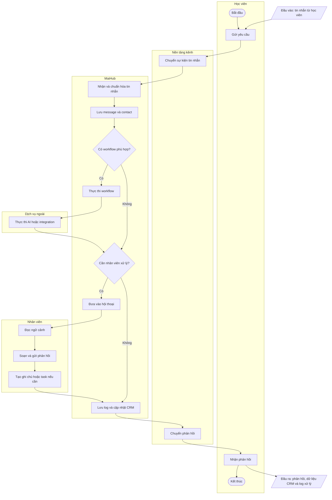

Quy tắc quan trọng: chỉ gửi hành động mà kênh hỗ trợ; quyền employee/account phải hợp lệ; kết quả workflow/integration phải được log; dữ liệu nhạy cảm không đưa vào log không cần thiết.

## 7. Sản phẩm BA 2 — Swimlane workflow theo đối tượng Campaign

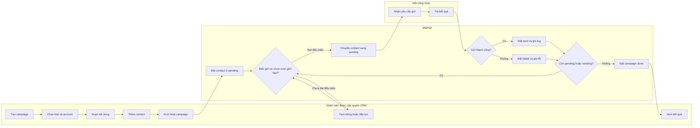

## 8. Sản phẩm BA 3 — Biểu đồ trạng thái

### 8.1 Campaign

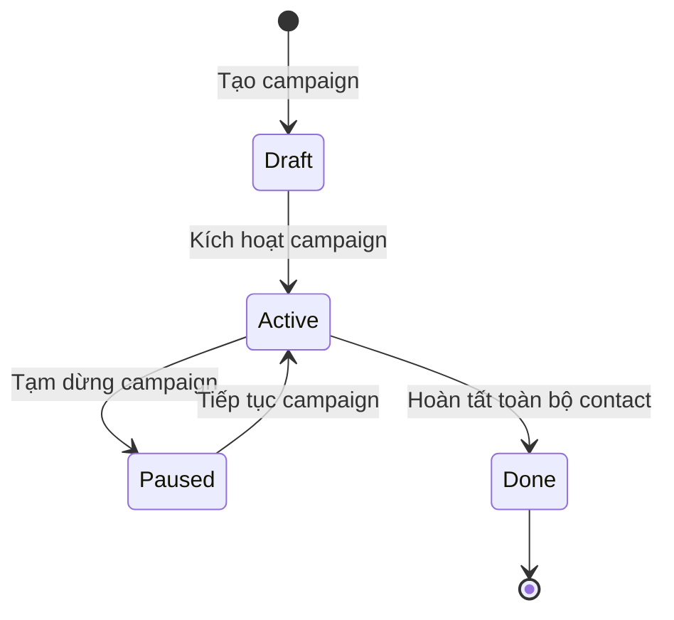

### 8.2 Contact trong campaign

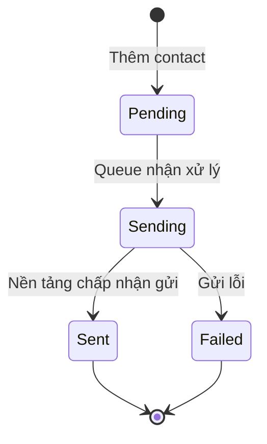

### 8.3 ERP Task

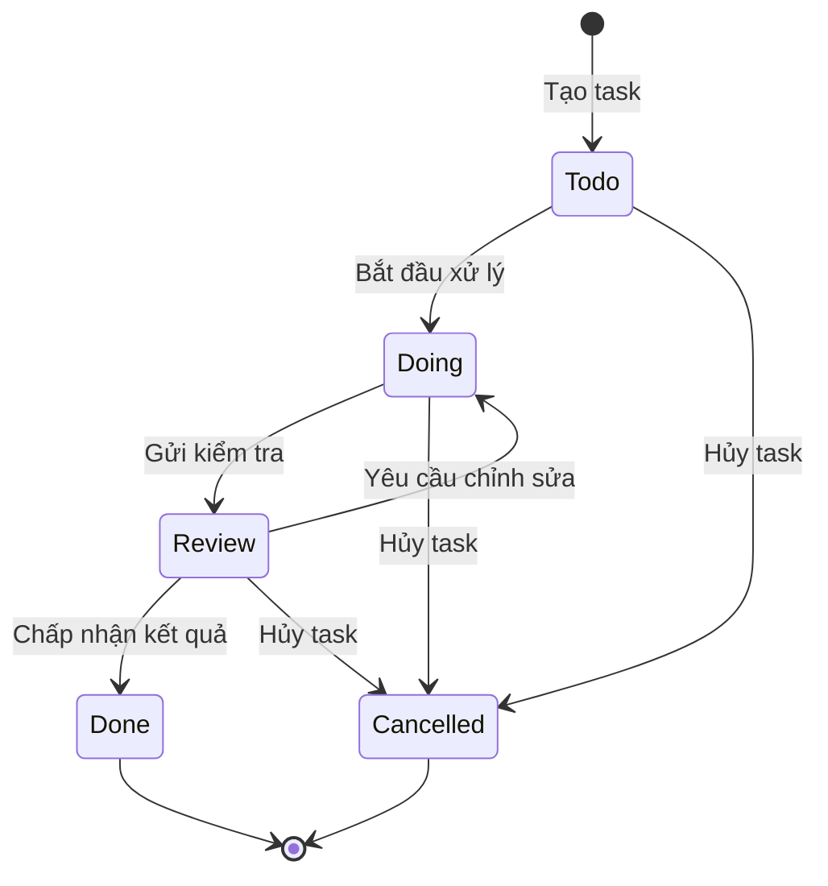

Các chuyển trạng thái campaign cần **Cần xác nhận vận hành** bằng UAT để bảo đảm pause/resume, hoàn tất và trạng thái contact khớp giữa UI, queue và database.

## 9. Sản phẩm BA 4 — Danh sách chức năng

`Size` là ước lượng BA tương đối, không phải estimate cam kết. `Phase` phản ánh mã hiện có.

| Trace code | Data object | Module | Function | Size | Type | Description / Objective / Remarks | Phase |
|---|---|---|---|---|---|---|---|
| FN-AUTH-01 | Account | Authentication | Đăng nhập tài khoản kênh | L | Workflow | QR/cookie/auth/session tùy kênh | Hiện có |
| FN-AUTH-02 | Employee | Authentication | Đăng nhập workspace employee | M | Workflow | Kết nối boss và nạp quyền/account | Hiện có |
| FN-CHAT-01 | Conversation | Chat | Xem danh sách hội thoại | M | Basic | Hợp nhất theo account/kênh | Hiện có |
| FN-CHAT-02 | Message | Chat | Gửi và nhận tin nhắn | L | Workflow | Text/media/action theo capability kênh | Hiện có |
| FN-CHAT-03 | Message | Chat | Reply, reaction, ghim và thu hồi | L | Other | Không đồng nhất giữa các kênh | Hiện có |
| FN-CHAT-04 | Conversation | Chat | Tìm kiếm và lọc hội thoại | M | Basic | Tìm kiếm cục bộ/remote theo mode | Hiện có |
| FN-CHAT-05 | Template | Chat | Quản lý quick message và label | M | Basic | CRUD nội dung dùng lại/phân loại | Hiện có |
| FN-CRM-01 | Contact | CRM | Quản lý contact, tag và note | M | Basic | Danh sách, chi tiết, phân loại, ghi chú | Hiện có |
| FN-CRM-02 | Campaign | CRM | Tạo và cấu hình campaign | L | Workflow | Loại, nội dung, delay, giới hạn ngày/giờ bắt đầu | Hiện có |
| FN-CRM-03 | CampaignContact | CRM | Thêm và theo dõi contact campaign | M | Workflow | Theo dõi pending/sending/sent/failed | Hiện có |
| FN-CRM-04 | SendLog | CRM | Xem log gửi và lỗi | M | Reporting | Phục vụ theo dõi và đối soát | Hiện có |
| FN-CRM-05 | Scan data | CRM | Quét/tổng hợp dữ liệu Facebook | L | Advanced | Phụ thuộc API không chính thức | Hiện có/rủi ro |
| FN-ERP-01 | Project | ERP | Quản lý dự án | M | Basic | Tạo, sửa, xóa, lưu trữ theo quyền | Hiện có |
| FN-ERP-02 | Task | ERP | Quản lý task cộng tác | L | Workflow | Kanban/inbox, assignee, watcher, checklist, comment, file | Hiện có |
| FN-ERP-03 | CalendarEvent | ERP | Quản lý lịch cá nhân và nhóm | L | Workflow | Attendee, reminder, quyền theo vai trò | Hiện có |
| FN-ERP-04 | Note | ERP | Quản lý và chia sẻ note | L | Workflow | Folder, tag, version, share | Hiện có |
| FN-ERP-05 | EmployeeProfile | ERP | Quản lý hồ sơ, phòng ban, chức vụ | L | Basic | RBAC owner/admin/manager/member/guest | Hiện có |
| FN-ERP-06 | Attendance | ERP | Check-in/check-out và tra cứu | M | Workflow | Có quyền xem người khác riêng | Hiện có |
| FN-ERP-07 | LeaveRequest | ERP | Tạo và duyệt nghỉ phép | M | Workflow | pending/approved/rejected/cancelled | Hiện có |
| FN-WF-01 | Workflow | Workflow | Thiết kế workflow node/edge | XL | Advanced | React Flow; nhiều loại trigger/action | Hiện có |
| FN-WF-02 | Workflow | Workflow | Import, export, clone và template | M | Other | JSON có khóa nhận dạng tương thích | Hiện có |
| FN-WF-03 | WorkflowRun | Workflow | Chạy thử, thực thi và xem log | L | Workflow | success/error/partial; kết quả từng node | Hiện có |
| FN-AI-01 | Assistant | AI | Quản lý AI assistant | L | Basic | Provider, model, prompt, file/account binding | Hiện có |
| FN-AI-02 | AIConversation | AI | Dùng AI trong chat/workflow | L | Workflow | Phụ thuộc provider và quota | Hiện có |
| FN-INT-01 | Integration | Integrations | Cấu hình và test adapter | L | Workflow | Credential động theo catalog | Hiện có |
| FN-INT-02 | Webhook | Integrations | Nhận webhook thanh toán/tích hợp | L | Workflow | Server local; chữ ký cần hardening | Hiện có/rủi ro |
| FN-WS-01 | Workspace | Workspace | Quản lý và chuyển workspace | L | Basic | Local/remote; tối đa 5 | Hiện có |
| FN-EMP-01 | Employee | Employee | Quản lý nhân viên và nhóm | L | Basic | Mật khẩu, trạng thái, group | Hiện có |
| FN-EMP-02 | Permission | Employee | Gán module và account | L | Workflow | Hạn chế view/action theo nhân viên | Hiện có |
| FN-AN-01 | Metrics | Analytics | Xem dashboard, báo cáo và KPI | L | Reporting | Cần UAT định nghĩa số liệu | Hiện có |
| FN-NOTI-01 | Notification | System | Xem thông báo/nhắc việc | M | Other | Desktop/in-app/ERP notification | Hiện có |
| FN-SET-01 | Setting | Settings | Cấu hình ứng dụng | L | Basic | Giao diện, hội thoại, proxy, bảo mật, lưu trữ, log | Hiện có |
| FN-OPS-01 | Log | Operations | Xem nhật ký hỗ trợ | S | Other | Điểm thu thập thông tin khi báo lỗi | Hiện có |

Rà soát chức năng phổ biến:

- Có đăng nhập kênh và employee; không coi tự đăng ký/quên mật khẩu end-user là năng lực hiện hành nếu chưa có yêu cầu và UAT tương ứng.
- Có thông báo, dashboard, báo cáo, settings, quản lý nhân viên/tài khoản.
- Hồ sơ ERP có xem/cập nhật; “xác minh tài khoản” chưa được xem là chức năng nghiệp vụ độc lập.
- **Cần xác nhận vận hành** cho mọi khoảng trống trên trước khi đưa vào roadmap.

## 10. Sản phẩm BA 5 — Ma trận phân quyền

### 10.1 Danh sách actor

| STT | Actor Name | Description |
|---:|---|---|
| 1 | Boss/Standalone | Chủ máy hoặc vận hành độc lập; được ánh xạ ERP owner |
| 2 | Employee | Nhân viên remote, có module permission và account assignment |
| 3 | ERP Owner | Toàn quyền cơ sở ERP theo ma trận mặc định |
| 4 | ERP Admin | Quản trị ERP, trừ các giới hạn được mã hóa |
| 5 | ERP Manager | Quản lý đội/việc, không có một số quyền hệ thống/xóa dự án |
| 6 | ERP Member | Thực hiện công việc cá nhân/được giao |
| 7 | ERP Guest | Chỉ truy cập/xem lịch ở mức rất hạn chế |
| 8 | Nền tảng ngoài | Zalo/Facebook/Telegram/API/webhook; không phải user nội bộ |

### 10.2 Quyền module employee

| Function | Boss/Standalone | Employee |
|---|:---:|:---:|
| Truy cập Chat | O | O* |
| Truy cập Bạn bè | O | O* |
| Truy cập CRM | O | O* |
| Truy cập Workflow | O | O* |
| Truy cập Tích hợp | O | O* |
| Truy cập Analytics | O | O* |
| Truy cập AI Assistant | O | O* |
| Truy cập Settings | O | O* |
| Thao tác trên account cụ thể | O | O* |

`O*`: Employee cần `can_access` cho module tương ứng và chỉ được dùng account đã gán. App có guard view; enforcement thực tế phải được kiểm tra thêm tại IPC/service cho từng hành động. Mã `ALL_MODULES` chưa liệt kê `erp`, trong khi renderer có kiểm tra key `erp`; quyền ERP action được điều khiển riêng bằng ERP role. Đây là điểm cần thống nhất mô hình quyền.

### 10.3 Quyền ERP mặc định

| Function | Owner | Admin | Manager | Member | Guest |
|---|:---:|:---:|:---:|:---:|:---:|
| Truy cập ERP | O | O | O | O | O |
| Tạo dự án | O | O | O | X | X |
| Cập nhật dự án | O | O | O | X | X |
| Xóa dự án | O | O | X | X | X |
| Lưu trữ dự án | O | O | O | X | X |
| Tạo task | O | O | O | O | X |
| Cập nhật task | O | O | O | O* | X |
| Tự nhận task | O | O | O | O | X |
| Giao task cho người khác | O | O | O | X | X |
| Sửa mọi task | O | O | O | X | X |
| Xóa task | O | O | O | X | X |
| Bình luận task | O | O | O | O | X |
| Xem lịch | O | O | O | O | O |
| Tạo lịch cá nhân | O | O | O | O | X |
| Tạo cuộc họp | O | O | O | X | X |
| Cập nhật lịch | O | O | O | O* | X |
| Xóa lịch | O | O | O | O* | X |
| Xem lịch đội nhóm | O | O | O | O | X |
| Tạo note | O | O | O | O | X |
| Cập nhật note | O | O | O | O* | X |
| Xóa note | O | O | O | O* | X |
| Chia sẻ note | O | O | O | O | X |
| Sửa note toàn workspace | O | O | X | X | X |
| Quản lý phòng ban | O | O | X | X | X |
| Quản lý chức vụ | O | O | X | X | X |
| Sửa hồ sơ của mình | O | O | O | O | X |
| Sửa hồ sơ người khác | O | O | O* | X | X |
| Xem nhân sự khác | O | O | O | O | X |
| Check-in/check-out | O | O | O | O | X |
| Xem chấm công người khác | O | O | O* | X | X |
| Tạo đơn nghỉ phép | O | O | O | O | X |
| Duyệt nghỉ phép | O | O | O* | X | X |
| Cài đặt ERP | O | O | X | X | X |

`O*`: ma trận action cho phép theo role, nhưng service còn phải giới hạn theo ownership/scope nghiệp vụ (task được giao, sự kiện/note của mình, nhân sự trực thuộc). Cần UAT các điều kiện này. Ngoài ra `extra_json.action_permissions` có thể `allow`/`deny` từng action cho một employee và được áp dụng trước ma trận role. Nguồn sự thật: `src/services/erp/permissions.ts`, `src/services/erp/ErpAuthContext.ts`.

## 11. Sản phẩm BA 6 — Tiêu chí UX và phân tích thiết kế

### 11.1 Người dùng và tác vụ

- Boss/IT cấu hình account, workspace, employee, integration và bảo mật; tần suất thấp nhưng rủi ro cao.
- Nhân viên chăm sóc dùng chat/CRM liên tục; cần tốc độ chuyển account/thread, trạng thái gửi rõ và tránh gửi nhầm.
- Quản lý dùng ERP/Analytics; cần lọc, tổng hợp, quyền và audit rõ.
- Người dùng có thể không có nền tảng kỹ thuật; credential/tunnel/bridge phải có cảnh báo bằng ngôn ngữ vận hành.

### 11.2 Tiêu chí UX

| Tiêu chí | Yêu cầu áp dụng |
|---|---|
| Chính trực | Hiển thị đúng account/kênh/workspace trước hành động gửi hoặc xóa; không giấu lỗi tích hợp |
| Giải pháp | Có retry/khôi phục mạng phù hợp, log lỗi và hướng dẫn tiếp theo |
| Kỳ vọng | Phân biệt rõ “đã lưu”, “đang gửi”, “đã gửi”, “thất bại”, “đã đồng bộ” |
| Đồng cảm | Cảnh báo nguy cơ spam/khóa tài khoản ngay khi cấu hình campaign |
| Cá nhân hóa | Hỗ trợ theme/font size, quick message, label, assistant và workspace |
| Thời gian/công sức | Giảm số bước đổi account, giữ draft, dùng phím tắt và preset |

### 11.3 Phân tích giao diện hiện tại

- Cấu trúc có sidebar, top bar và vùng nội dung; chat dùng layout nhiều panel; ERP dùng top navigation con.
- `App.tsx` đồng bộ theme lên `documentElement`, có nhánh mobile qua `useIsMobile`; nhiều component dùng class dark và một số class `dark:`.
- `DESIGN.md` là nguồn sự thật cho logo và cho hệ thiết kế của toàn bộ giao diện (ngôn ngữ macOS, token light/dark khớp với `src/ui/index.css`), áp dụng từ 02/10/2026.
- Màu trạng thái cần luôn có icon/text, không chỉ dựa vào màu; focus keyboard, contrast, screen reader label và responsive cần test thực.
- **Cần xác nhận vận hành** ở desktop và mobile cho dark/light mode, không overflow ngang, không chồng chữ, thao tác chính mượt, keyboard focus và trạng thái empty/loading/error.

## 12. Sản phẩm BA 7 — Mô tả màn hình

Các bảng dưới đặc tả màn hình trọng yếu. Các màn hình danh sách/chi tiết phụ tái sử dụng cùng quy tắc quyền, loading/error và định dạng dữ liệu.

### 12.1 Màn hình thêm tài khoản

| STT | Tên trường | Kiểu dữ liệu | Bắt buộc | Giá trị khởi tạo | Mô tả ràng buộc |
|---:|---|---|:---:|---|---|
| 1 | Kênh | Single choice | Có | Theo tab đang chọn | Zalo/Facebook/Telegram; phương thức đăng nhập thay đổi theo kênh |
| 2 | Phương thức đăng nhập | Single choice/tab | Có | Phương thức ưu tiên của kênh | QR, credential, cookie, auth JSON hoặc bot/user session tùy kênh |
| 3 | Tên đăng nhập | Free text | Có điều kiện | Rỗng | Email/số điện thoại với Telegram user |
| 4 | Mật khẩu | Password | Có điều kiện | Rỗng | Không hiển thị plaintext |
| 5 | Mã/secret 2FA | Password/free text | Có điều kiện | Rỗng | Chỉ hiện khi kênh yêu cầu |
| 6 | Cookie Facebook | Multiline text | Có điều kiện | Rỗng | Phải có cookie hợp lệ; dữ liệu nhạy cảm |
| 7 | Auth JSON Zalo | Multiline JSON | Có điều kiện | Rỗng | Cấu trúc gồm thông tin auth theo handler |
| 8 | Kết nối | Button | Không | Enabled khi đủ input | Hiển thị loading, success hoặc lỗi có thể xử lý |

Nguồn: `src/ui/components/auth/AddAccountModal.tsx`, `electron/ipc/loginIpc.ts`.

### 12.2 Màn hình Chat

| STT | Tên trường | Kiểu dữ liệu | Bắt buộc | Giá trị khởi tạo | Mô tả ràng buộc |
|---:|---|---|:---:|---|---|
| 1 | Account active | Selector | Có | Account hợp lệ đầu tiên | Employee chỉ thấy account được gán |
| 2 | Hội thoại | List/search | Có | Chưa chọn | Chọn thread trước khi gửi |
| 3 | Nội dung tin | Contenteditable | Có điều kiện | Draft của thread | Enter gửi, Shift+Enter xuống dòng; tránh gửi khi IME đang compose |
| 4 | Reply/mention | Context object | Không | Rỗng | Phụ thuộc capability kênh/thread |
| 5 | Media/file/sticker | File/picker | Không | Rỗng | Kiểm tra loại/kích thước theo kênh |
| 6 | Gửi | Button/keyboard | Không | Disabled khi không hợp lệ | Phải giữ đúng account/thread tại thời điểm gửi |

Nguồn: `src/ui/components/chat/MessageInput.tsx`, `src/ui/components/chat/ChatWindow.tsx`.

### 12.3 Màn hình tạo/chỉnh sửa Campaign

| STT | Tên trường | Kiểu dữ liệu | Bắt buộc | Giá trị khởi tạo | Mô tả ràng buộc |
|---:|---|---|:---:|---|---|
| 1 | Tên chiến dịch | Free text | Có | Rỗng | Không lưu tên rỗng |
| 2 | Loại | Single choice | Có | Theo loại được hỗ trợ | `message`, `friend_request`, `mixed`, `invite_to_group`; capability theo kênh |
| 3 | Hành động mixed | Multi checkbox | Có điều kiện | Theo cấu hình | Mixed phải chọn ít nhất một hành động |
| 4 | Delay giữa liên hệ | Number range/preset | Có | Preset | UI nhận tối thiểu 5 giây và max không nhỏ hơn min; queue thực tế ép tối thiểu 30 giây |
| 5 | Delay giữa tin | Number range/preset | Không | 0/theo preset | Chỉ hiện khi một contact nhận nhiều tin |
| 6 | Giới hạn/ngày | Number | Không | 0 | Min 0; 0 nghĩa không giới hạn theo trường này |
| 7 | Giờ bắt đầu chạy | Time | Không | `08:00` | Nếu đã qua trong ngày, queue có thể chạy ngay |
| 8 | Nội dung | Rich text/blocks | Có điều kiện | Rỗng | Hỗ trợ biến như `{name}` và media tùy kênh |
| 9 | Contact/nhóm đích | Multi select | Có trước khi chạy | Rỗng | Chỉ contact hợp lệ của account/campaign |

Nguồn: `src/ui/components/crm/campaigns/CampaignCreateModal.tsx`, `src/services/crm/CRMQueueService.ts`.

### 12.4 Màn hình Workflow Editor

| STT | Tên trường | Kiểu dữ liệu | Bắt buộc | Giá trị khởi tạo | Mô tả ràng buộc |
|---:|---|---|:---:|---|---|
| 1 | Tên workflow | Free text | Có | Rỗng/tên hiện có | Dùng trong danh sách và run log |
| 2 | Kênh | Read-only context | Có | Kênh workflow | Zalo/Facebook/Telegram user/bot |
| 3 | Tài khoản áp dụng | Multi checkbox | Không | Tất cả account cùng kênh | Rỗng nghĩa áp dụng tất cả, UI phải cảnh báo rõ |
| 4 | Node | Canvas objects | Có | Trigger/action mẫu | Type phải thuộc `NodeType`; config theo từng type |
| 5 | Edge | Graph connection | Có | Rỗng | Phải nối luồng hợp lệ; engine sắp xếp topo |
| 6 | Enabled | Toggle | Không | Theo bản ghi | Chỉ workflow enabled nhận trigger tự động |
| 7 | Import/Export | JSON file | Không | Rỗng | Giữ khóa nhận dạng tương thích khi import/export |

Nguồn: `src/ui/components/workflow/WorkflowEditor.tsx`, `src/services/workflow/WorkflowEngineService.ts`.

### 12.5 Màn hình tạo/chỉnh sửa Task

| STT | Tên trường | Kiểu dữ liệu | Bắt buộc | Giá trị khởi tạo | Mô tả ràng buộc |
|---:|---|---|:---:|---|---|
| 1 | Tiêu đề | Free text | Có | Rỗng | Trim; nút lưu disabled khi rỗng |
| 2 | Dự án | Dropdown | Không | Không thuộc dự án/project context | Chọn từ project hiện có |
| 3 | Trạng thái | Dropdown | Có | `todo` hoặc cột mở modal | `todo/doing/review/done/cancelled` |
| 4 | Độ ưu tiên | Dropdown | Có | `normal` | `low/normal/high/urgent` |
| 5 | Hạn hoàn thành | Datetime local | Không | Rỗng | Lưu timestamp |
| 6 | Người thực hiện | Multi select | Không | Rỗng | Danh sách employee/profile khả dụng |
| 7 | Người theo dõi | Multi select | Không | Rỗng | Không thay thế assignee |
| 8 | Nội dung task | Rich text | Không | Rỗng | Heading/list/code/image theo Quill |
| 9 | Tệp đính kèm | Multi file | Không | Rỗng | Lưu metadata/file theo service |

Nguồn: `src/ui/features/erp/tasks/TaskEditorDrawer.tsx`, `src/models/erp/Task.ts`.

### 12.6 Màn hình cấu hình Integration

| STT | Tên trường | Kiểu dữ liệu | Bắt buộc | Giá trị khởi tạo | Mô tả ràng buộc |
|---:|---|---|:---:|---|---|
| 1 | Loại tích hợp | Catalog selection | Có | Item được mở | Không đổi loại sau khi vào detail |
| 2 | Kích hoạt | Toggle | Không | Bật | Adapter chỉ được load khi enabled |
| 3 | Credential động | Password/free text | Có khi tạo | Rỗng | Khi cập nhật, rỗng/masked giữ secret cũ |
| 4 | Setting động | Text/select | Không | Option đầu tiên nếu có | Theo schema catalog adapter |
| 5 | Lưu cấu hình | Button | Không | — | Mã hóa credential khi OS hỗ trợ |
| 6 | Test kết nối | Button | Không | Disabled trước khi lưu | Trả success/message từ adapter |
| 7 | Webhook URL | Read-only text | Không | Local URL | Public URL chỉ khi tunnel được bật an toàn |

Nguồn: `src/ui/components/integration/IntegrationDetailPage.tsx`, `src/ui/components/integration/IntegrationPage.tsx`.

### 12.7 Màn hình tạo Workspace

| STT | Tên trường | Kiểu dữ liệu | Bắt buộc | Giá trị khởi tạo | Mô tả ràng buộc |
|---:|---|---|:---:|---|---|
| 1 | Icon | Free text/emoji | Không | Theo loại | Chỉ phục vụ nhận diện |
| 2 | Tên workspace | Free text | Có | Rỗng | Không trùng tên; tối đa tổng cộng 5 workspace |
| 3 | Loại workspace | Dropdown | Có | Local | Local hoặc remote |
| 4 | IP/URL Boss | Free text | Có điều kiện | Rỗng | Bắt buộc với remote; hỗ trợ IP/URL theo UI |
| 5 | Port | Number/text | Có điều kiện | `9900` theo service | Port relay hợp lệ |
| 6 | Username | Free text | Có điều kiện | Rỗng | Credential employee remote |
| 7 | Password | Password | Có điều kiện | Rỗng | Không log plaintext |
| 8 | Tự động kết nối | Checkbox | Không | Bật với remote | Dùng ở startup |

Nguồn: `src/ui/components/settings/WorkspaceSettings.tsx`, `src/utils/WorkspaceManager.ts`.

### 12.8 Màn hình tạo/chỉnh sửa Employee

| STT | Tên trường | Kiểu dữ liệu | Bắt buộc | Giá trị khởi tạo | Mô tả ràng buộc |
|---:|---|---|:---:|---|---|
| 1 | Tên đăng nhập | Free text | Có | Rỗng | Duy nhất theo service |
| 2 | Mật khẩu | Password | Có khi tạo | Rỗng | Khi sửa để rỗng nghĩa giữ nguyên; lưu hash |
| 3 | Tên hiển thị | Free text | Có | Rỗng | Hiển thị trên UI/audit |
| 4 | Vai trò | Dropdown | Có | Employee | `boss` hoặc `employee` ở tầng employee |
| 5 | Nhóm | Dropdown | Không | Không nhóm | Chọn từ employee group |
| 6 | Quyền module | Checkbox group | Có | Theo mặc định service | Chỉ bật module cần thiết |
| 7 | Account được gán | Checkbox group | Có điều kiện | Rỗng | Giới hạn dữ liệu/action employee |

Nguồn: `src/ui/components/settings/EmployeeSettings.tsx`, `src/models/employee.ts`.

## 13. Sản phẩm BA 8 — Sitemap

```text
MaiHub
├── Dashboard
├── Chat
│   ├── Account / hội thoại
│   └── Thông tin hội thoại / media / nhóm
├── CRM
│   ├── Tổng quan và contact
│   ├── Campaign
│   └── Search / request / note / tag
├── Công cụ
│   ├── Workflow
│   │   ├── Danh sách / template store
│   │   └── Editor / run log
│   └── Tích hợp
│       ├── POS / Thanh toán / Vận chuyển / Tin nhắn
│       └── AI Assistant
├── Báo cáo
├── Quản lý công việc
│   ├── Của tôi
│   ├── Task
│   ├── Lịch
│   ├── Note
│   ├── Nhân sự
│   └── Báo cáo
└── Cài đặt
    ├── Hội thoại / Giao diện / Thông báo
    ├── Tài khoản / Proxy / Bảo mật / Webhooks
    ├── Nhân viên / Workspace / Lưu trữ
    └── Giới thiệu / Log phiên bản / Nhật ký
```

Menu app không vượt quá ba cấp. Item hiển thị phụ thuộc quyền employee/ERP. Nguồn: `src/ui/components/layout/Sidebar.tsx`, `src/ui/components/settings/Settings.tsx`, `src/ui/features/erp/ErpPage.tsx`.

## 14. Sản phẩm BA 9 — Sơ đồ use case

### 14.1 Nghiệp vụ vận hành

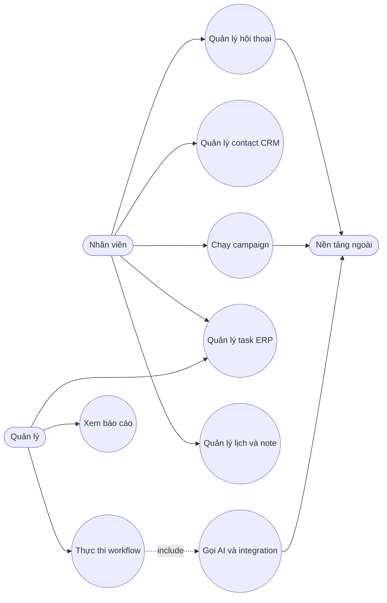

### 14.2 Quản trị hệ thống

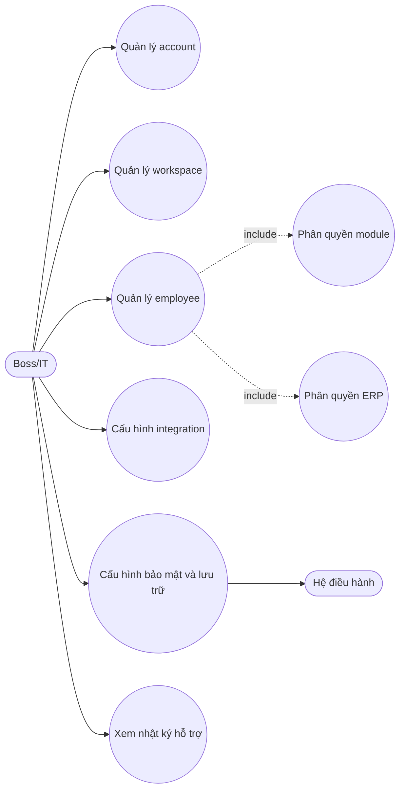

## 15. Sản phẩm BA 10 — Sơ đồ activity

Luồng thực thi một workflow:

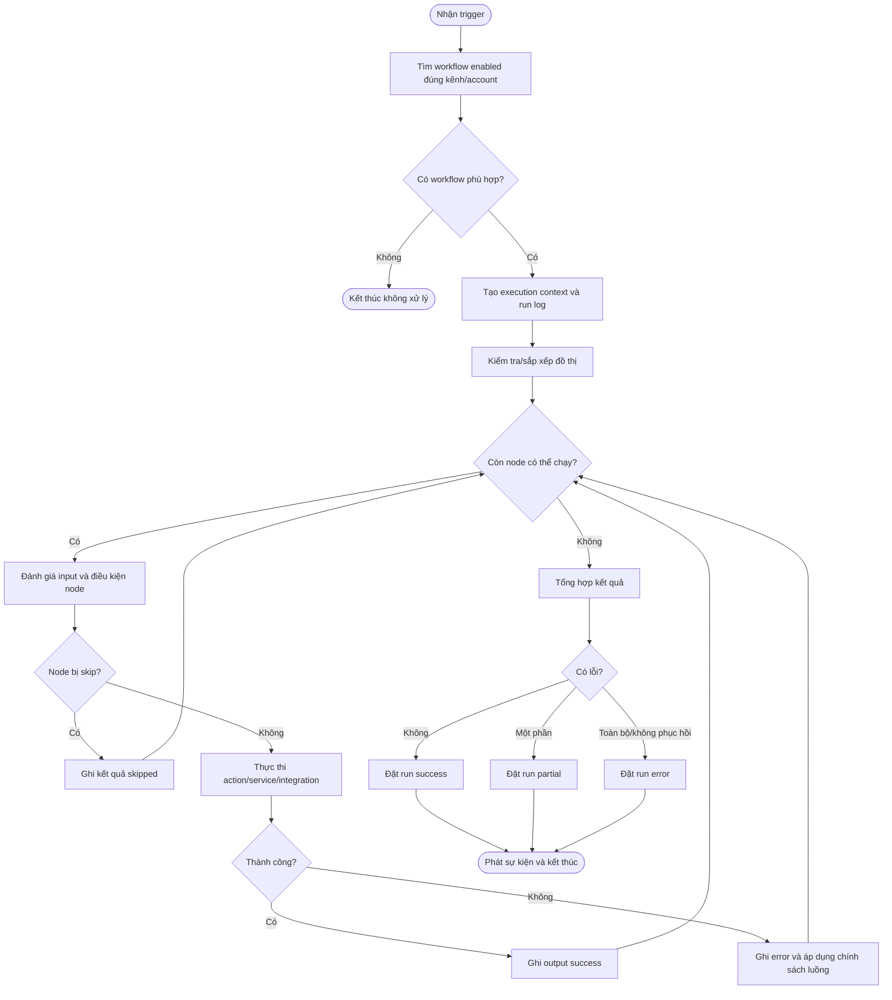

## 16. Sản phẩm BA 11 — Đặc tả use case

### UC-01 — Gửi tin nhắn đa kênh

| Trường | Nội dung |
|---|---|
| Use case name | Gửi tin nhắn đa kênh |
| Use case ID | UC-01 |
| Description | Nhân viên chọn account/thread, soạn nội dung và gửi qua kênh tương ứng |
| Actor | Nhân viên |
| Priority | Cao |
| Trigger | Người dùng nhấn gửi hoặc Enter |
| Pre-condition | Đã đăng nhập; có quyền Chat; account được gán; thread và kênh sẵn sàng |
| Post-condition | Yêu cầu gửi được chuyển tới service; UI/log thể hiện thành công hoặc lỗi |

Business rule: capability tùy kênh; không gửi khi IME đang compose; employee không dùng account chưa được gán. NFR riêng: thao tác không khóa composer quá lâu; lỗi phải chỉ rõ có thể thử lại hay không. **Cần xác nhận vận hành** độ trễ và trạng thái delivery thực tế.

### UC-02 — Chạy campaign CRM

| Trường | Nội dung |
|---|---|
| Use case name | Chạy campaign CRM |
| Use case ID | UC-02 |
| Description | Cấu hình nội dung, contact, delay, giới hạn và xử lý hàng đợi gửi |
| Actor | Nhân viên CRM |
| Priority | Cao |
| Trigger | Người dùng kích hoạt campaign |
| Pre-condition | Có quyền CRM; account/kênh hỗ trợ; campaign có nội dung/contact hợp lệ |
| Post-condition | Contact được gắn trạng thái và send log; campaign done khi không còn pending/sending |

Business rule: tuân thủ delay tối thiểu, giờ bắt đầu và giới hạn ngày; lỗi từng contact không được làm mất log; không coi campaign là công cụ gửi được phép nếu chưa có consent/opt-out. NFR riêng: queue phải phục hồi an toàn sau lỗi và không gửi trùng. **Cần xác nhận vận hành** bằng UAT và stress test.

### UC-03 — Thực thi workflow

| Trường | Nội dung |
|---|---|
| Use case name | Thực thi workflow |
| Use case ID | UC-03 |
| Description | Engine nhận trigger, chạy đồ thị node và ghi run log |
| Actor | Hệ thống/Quản lý workflow |
| Priority | Cao |
| Trigger | Message, schedule, webhook, payment hoặc manual trigger |
| Pre-condition | Workflow enabled, đúng kênh/account, cấu hình node hợp lệ |
| Post-condition | Run có success/error/partial và `node_results`; action ngoài được gọi khi phù hợp |

Business rule: chỉ chạy node reachable theo graph; điều kiện/nhánh quyết định node tiếp theo; secret không được đưa ra renderer/log không cần thiết. NFR riêng: execution phải deterministic với cùng context trừ node ngẫu nhiên/thời gian/API ngoài; cần timeout/retry phù hợp. **Cần xác nhận vận hành** tải đồng thời và idempotency webhook.

### UC-04 — Quản lý task ERP

| Trường | Nội dung |
|---|---|
| Use case name | Quản lý task ERP |
| Use case ID | UC-04 |
| Description | Tạo, phân công, cập nhật trạng thái, cộng tác và hoàn tất task |
| Actor | Owner/Admin/Manager/Member |
| Priority | Cao |
| Trigger | Người dùng tạo hoặc cập nhật task |
| Pre-condition | Có `erp.access` và action permission tương ứng |
| Post-condition | Task và thành phần liên quan được lưu; activity/notification được cập nhật theo service |

Business rule: role và override được kiểm tra phía main; status thuộc tập chuẩn; chỉ actor phù hợp được giao người khác/sửa mọi task/xóa task. NFR riêng: cập nhật phải nhất quán giữa task, assignee, attachment và activity. **Cần xác nhận vận hành** xung đột cập nhật đồng thời.

## 17. Sản phẩm BA 12 — Use scenario

### Scenario A — Nhân viên xử lý học viên mới

Lan mở MaiHub, chọn workspace công ty và tài khoản được phân công. Một học viên gửi câu hỏi qua Zalo; Lan thấy hội thoại mới, đọc lịch sử, dùng mẫu trả lời rồi chỉnh lại cho phù hợp. Lan gắn nhãn “Học viên tiềm năng”, thêm ghi chú và tạo task gọi lại. Học viên nhận được phản hồi, quản lý thấy task và lịch sử xử lý.

### Scenario B — Quản lý chạy chiến dịch nhắc lịch

Minh tạo campaign, chọn đúng tài khoản và danh sách học viên đã đủ điều kiện nhận tin, đặt nội dung cá nhân hóa, khoảng delay, giới hạn/ngày và giờ bắt đầu. Minh xem cảnh báo, kích hoạt rồi theo dõi từng người đang chờ, đang gửi, đã gửi hoặc thất bại. Khi có lỗi, Minh xem log và chỉ thử lại các contact cần thiết.

### Scenario C — Tự động phân loại bằng AI

Quản lý tạo workflow nhận tin nhắn, gửi nội dung tới assistant để phân loại nhu cầu, gắn nhãn CRM và gửi thông báo cho nhóm phụ trách. Khi provider AI lỗi, run log cho biết node lỗi thay vì im lặng; nhân viên vẫn nhận hội thoại để xử lý thủ công.

### Scenario D — Nhân viên remote làm việc qua máy boss

Huy mở workspace remote, đăng nhập bằng tài khoản employee và chỉ thấy module/account được giao. Huy trả lời hội thoại và cập nhật task; yêu cầu được chuyển tới máy boss. Khi mạng gián đoạn, UI hiển thị trạng thái kết nối và không tuyên bố gửi thành công khi chưa có xác nhận. Phần reconnect/offline cần **Cần xác nhận vận hành**.

## 18. Sản phẩm BA 13 — User story và Acceptance Criteria

| User story title | User story | Priority | AC (when, who, how, then) | Note |
|---|---|---|---|---|
| Gửi chat đúng account | Là nhân viên, tôi muốn gửi tin từ account đang chọn để không liên hệ nhầm danh tính | P0 | **When:** đã chọn workspace/account/thread hợp lệ; **Who:** employee có quyền Chat và account assignment; **How:** nhập nội dung và nhấn gửi; **Then:** hệ thống gửi qua đúng channel service và hiển thị kết quả/lỗi | Test Zalo, Facebook, Telegram riêng |
| Quản lý contact | Là nhân viên CRM, tôi muốn gắn tag và note để lưu ngữ cảnh chăm sóc | P1 | **When:** mở contact; **Who:** người có quyền CRM; **How:** thêm tag/note; **Then:** dữ liệu được lưu và hiển thị lại đúng contact/account | Kiểm tra remote workspace |
| Chạy campaign có hàng rào | Là quản lý CRM, tôi muốn đặt delay, giới hạn ngày và giờ bắt đầu để giảm rủi ro gửi dồn | P0 | **When:** campaign hợp lệ; **Who:** người có quyền CRM; **How:** cấu hình và kích hoạt; **Then:** queue không gửi trước giờ/qua giới hạn và ghi trạng thái từng contact | Không thay thế consent/opt-out |
| Thiết kế workflow | Là quản lý, tôi muốn ghép trigger và action để tự động hóa tác vụ lặp lại | P1 | **When:** có account/integration cần thiết; **Who:** người có quyền Workflow; **How:** tạo node/edge và bật workflow; **Then:** trigger phù hợp tạo run log và kết quả node | Validate graph trước bật |
| Xem lỗi workflow | Là người vận hành, tôi muốn thấy node lỗi để khắc phục nhanh | P1 | **When:** một run có lỗi; **Who:** người có quyền Workflow; **How:** mở run log; **Then:** thấy status, error và node result liên quan | Secret phải được redaction |
| Tạo task | Là thành viên ERP, tôi muốn tạo task và gán bản thân để quản lý việc cần làm | P1 | **When:** có quyền `task.create`; **Who:** member trở lên; **How:** nhập tiêu đề và lưu; **Then:** task xuất hiện đúng status/project với activity created | Title là bắt buộc |
| Phân công task | Là quản lý, tôi muốn giao task cho nhân viên để điều phối công việc | P1 | **When:** có quyền `task.assign_others`; **Who:** manager/admin/owner; **How:** chọn assignee; **Then:** task và người nhận được cập nhật/thông báo theo service | UAT notification |
| Phân quyền employee | Là boss, tôi muốn giới hạn module và account để bảo vệ dữ liệu | P0 | **When:** employee tồn tại; **Who:** boss; **How:** chọn permission/account; **Then:** employee chỉ thấy và thao tác trong phạm vi được cấp | Kiểm tra cả UI và IPC |
| Cấu hình integration | Là IT, tôi muốn lưu và test credential để xác nhận kết nối trước dùng | P0 | **When:** mở adapter; **Who:** người được phép quản trị; **How:** nhập credential, lưu, test; **Then:** secret được mask và UI báo kết quả test | safeStorage fallback phải cảnh báo |
| Chuyển workspace | Là người dùng, tôi muốn chuyển không gian làm việc để dữ liệu không trộn lẫn | P0 | **When:** có nhiều workspace; **Who:** người dùng hợp lệ; **How:** chọn workspace; **Then:** DB/store/connection chuyển sang context mới và account active hợp lệ | Stress test chuyển liên tục |
| Khôi phục sau mất mạng | Là nhân viên, tôi muốn biết trạng thái và kết nối lại để không tưởng nhầm tin đã gửi | P0 | **When:** mạng mất rồi phục hồi; **Who:** người dùng đang làm việc; **How:** app health-check/reconnect; **Then:** trạng thái được cập nhật và không gửi trùng | Cần xác nhận vận hành |

## 19. Sản phẩm BA 14 — Yêu cầu phi chức năng

| Nhóm | Yêu cầu/baseline | Hiện trạng bằng chứng | Xác nhận cần có |
|---|---|---|---|
| Xác thực | Tách employee identity, account session và ERP actor | Employee service, WorkspaceManager, ErpAuthContext | UAT hết phiên, đổi mật khẩu, revoke token |
| Phân quyền | Kiểm tra server/main-side cho hành động nhạy cảm, không chỉ ẩn UI | ERP IPC dùng permission guard; module UI có guard | Audit toàn bộ IPC Chat/CRM/Workflow/Integration |
| Secret | Mã hóa bằng OS keychain và mask trên UI | `safeStorage`; credential integration masked | Xử lý plaintext fallback, backup/restore khác máy |
| Renderer security | Cô lập renderer khỏi Node và áp CSP production | `contextIsolation: true`, `nodeIntegration: false`, CSP | Đánh giá `sandbox: false`, CSP broad schemes |
| Webhook | Xác minh chữ ký, giới hạn body/rate, bind interface an toàn | Registry đọc signature nhưng chưa verify trong lớp này | Security test trước public tunnel |
| Audit | Ghi activity/run/send/error cần thiết, redaction secret | Có workflow log, send log, employee message log, ERP activity | Chính sách retention và truy cập log |
| Hiệu suất | Chat/UI không bị khóa bởi I/O; queue có rate control | Async services, queue/token/delay, SQLite WAL | Benchmark startup, sync, 10k+ messages, concurrent workflow |
| Độ tin cậy | Không gửi trùng khi retry/reconnect; không mất draft/log | Có health/reconnect/draft/run log trong mã | Fault injection và crash recovery test |
| Nền tảng | Windows x64, macOS x64/arm64, Linux AppImage/deb theo build config | `package.json` | Test cài đặt và native module trên từng target |
| Responsive | Desktop và mobile-width không overflow/chồng chữ | `useIsMobile`, responsive classes | Screenshot/browser test hai kích thước, dark/light |
| Màu sắc | Logo và UI theo token DESIGN; contrast/focus nhất quán | `DESIGN.md` định nghĩa token light/dark; tương phản được kiểm bằng `src/__tests__/ui/themeTokens.test.ts` | Kiểm tra thực tế từng màn hình cũ chưa rà soát |
| Quốc tế hóa | Nội dung hiện chủ yếu tiếng Việt; format ngày/giờ cần nhất quán | Chuỗi UI nằm trực tiếp trong component | Quyết định locale/timezone và i18n roadmap |
| Dễ sử dụng | Loading/empty/error rõ, cảnh báo thao tác nguy hiểm, phím tắt không xung đột | Có nhiều trạng thái và confirm cục bộ | UAT theo actor, accessibility keyboard/screen reader |
| Backup | Sao lưu DB/config/media trước nâng cấp, có quy trình restore | README nói chưa có backup tự động | Thiết kế backup tự động, mã hóa và diễn tập restore |
| Quan sát | Log đủ chẩn đoán nhưng không lộ credential/cookie/token | Có LogViewer/Logger | Chuẩn log level, rotation, redaction, dung lượng |
| Quyền riêng tư | Không gửi telemetry/backend thượng nguồn theo chủ trương bản nội bộ | README/NOTICE; Tracking/backend bị chặn theo tài liệu | Network inspection bản production |

Không có SLA/latency/tải trọng định lượng được phê duyệt trong repository; các con số phải được owner vận hành xác nhận trước khi trở thành acceptance gate.

## 20. Sản phẩm BA 15 — Quy tắc triển khai và bộ tài liệu dự án

### 20.1 Quy tắc triển khai

1. Phân tích thay đổi, actor, dữ liệu, quyền, migration và rollback trước khi vào sprint.
2. Tách task đủ nhỏ, có độ phức tạp/workload/acceptance criteria và review trước sprint.
3. Hạn chế đổi nghiệp vụ giữa sprint; thay đổi mới đưa vào backlog/sprint sau trừ sự cố P0.
4. Luồng bắt buộc: thay đổi ở dev → test dev → build artifact production → kiểm tra artifact → phát hành artifact; không sửa source trực tiếp trên máy production.
5. BA/UAT ở cuối sprint với dữ liệu đại diện, gồm basic/alternative/exception flow.
6. Thay đổi schema/credential/workspace phải có backup, migration, rollback và diễn tập restore.
7. Thay đổi UI phải kiểm tra desktop/mobile, dark/light, overflow, overlap, keyboard và action chính.
8. Release nội bộ phải ghi version, checksum/kênh phân phối và known issues; không dùng updater thượng nguồn.

### 20.2 Build và phát hành hiện tại

```text
npm install
  -> postinstall patch icon (Windows khi phù hợp)

npm run dev
  -> build bridge E2EE (best effort ở predev)
  -> compile Electron main
  -> chạy Vite + TypeScript watch + Electron

npm run production
  -> build Go bridge E2EE
  -> typecheck/compile Electron production
  -> strip console
  -> Vite build renderer
  -> rebuild better-sqlite3 cho target
  -> electron-builder --publish never
  -> artifact tại dist-electron-build/
```

Target: Windows NSIS/dir x64; macOS dmg/zip x64 và arm64; Linux AppImage/deb. Native `better-sqlite3` phải đúng platform/arch. macOS cần build trên máy Mac; bản hiện chưa ký số theo README/NOTICE. **Cần xác nhận vận hành** quy trình ký, notarization, antivirus/SmartScreen, smoke test và rollback trước phát hành.

### 20.3 Vận hành

- Sao lưu `deplao-tool.db`, config workspace/app và media khi app đã tắt.
- Giám sát dung lượng DB/media/log; định kỳ kiểm tra `PRAGMA integrity_check` trong quy trình bảo trì đã phê duyệt.
- Chỉ dùng tài khoản công việc riêng cho Zalo/Facebook do rủi ro chính sách nền tảng.
- Không public Cloudflare/ngrok/local tunnel khi chưa có xác thực webhook, firewall và giám sát.
- Thu log qua Cài đặt → Nhật ký; redaction credential/cookie/token trước khi chia sẻ.
- Khi nâng cấp, kiểm tra mở DB, đăng nhập kênh, gửi/nhận, campaign nhỏ, workflow mẫu, ERP CRUD và integration test.

### 20.4 Bộ tài liệu dự án phải duy trì

| Tài liệu | Trạng thái/đề xuất |
|---|---|
| Biên bản họp | Lưu quyết định nghiệp vụ, owner và deadline |
| SRS | Dùng tài liệu này làm baseline tổng thể; tách feature spec khi thay đổi lớn |
| URD | Duy trì theo actor/use case/user story đã được stakeholder duyệt |
| BRD | Optional; cần khi mở rộng phạm vi tổ chức/đối tác |
| HDSD | Cần bản theo vai trò Boss/Employee/ERP và quy trình xử lý lỗi |
| Data dictionary | Duy trì cùng migration/schema, không cần sao chép toàn bộ 70+ bảng vào tài liệu tổng thể |
| Runbook vận hành | Backup/restore, release, rollback, log, mất mạng, credential rotation |
| Security checklist | IPC, RBAC, secret, webhook, tunnel, dependency và nền tảng không chính thức |
| Release notes | Version, artifact, checksum, migration, known issues; hiện ở GitHub Releases và `ChangelogSettings.tsx` |
| Intent / spec / plan theo tính năng | `docs/intent/`, `docs/specs/`, `docs/plans/` (được git theo dõi; tên file `YYYY-MM-DD-<tính-năng>.md`). Mỗi tính năng mới đi theo thứ tự intent → spec → plan; plan là nguồn tham chiếu khi triển khai và review |
| Báo cáo spike / kiểm chứng | `docs/reports/` (chỉ file được thêm bằng `git add -f`; thư mục này mặc định bị ignore) |

## 21. Tích hợp bên ngoài và phụ thuộc quan trọng

| Hệ thống/phụ thuộc | Mục đích | Ranh giới/rủi ro |
|---|---|---|
| Zalo qua `zca-js` | Account cá nhân, chat và CRM actions | Không chính thức/rủi ro khóa tài khoản |
| Facebook Messenger/E2EE | Chat Facebook, E2EE qua Go bridge | API/doc_id có thể đổi; một số bridge method chưa wire |
| `playwright-core` 1.62.1 + nhân `fingerprint-chromium` | Tự động đăng bài/bình luận/xin vào nhóm Facebook trên browser profile | Facebook đổi giao diện thường xuyên; đăng cùng nội dung bằng nhiều tài khoản dễ bị coi là spam |
| Telegram user/bot | Chat và bot integration | Session/token nhạy cảm; rate limit nền tảng |
| OpenAI-compatible providers | AI assistant và workflow AI | Chi phí, quota, dữ liệu gửi ra ngoài |
| Google Sheets | Workflow đọc/ghi sheet | OAuth/credential và quota |
| SMTP/Discord/Notion | Node notification | Secret và giới hạn API |
| KiotViet/Haravan/Sapo/Nhanh/Pancake | POS/e-commerce actions | API contract và credential từng nhà cung cấp |
| Casso/SePay | Transaction/payment webhook | Phải xác minh chữ ký và chống replay |
| GHN/GHTK | Tạo vận đơn/tra cứu | Địa chỉ, phí, token, môi trường sandbox/prod |
| Socket.IO/HTTP relay | Boss–employee | LAN/public exposure, JWT/token, reconnect |
| Electron `safeStorage` | Bảo vệ secret bằng OS | Có fallback plaintext khi không khả dụng/lỗi mã hóa |

### 21.1 Nguồn gốc và giấy phép

- MaiHub là bản nội bộ; mã nguồn cấp repository mang giấy phép MIT và phải giữ thông báo bản quyền/giấy phép khi phân phối. Nguồn: `LICENSE`, `NOTICE.md`.
- `src/bridge-e2ee/bridge/` chứa mã có nguồn từ `meta-messenger.js`, được ghi nhận theo AGPL-3.0; `main.go` và Python wrapper được tài liệu bridge mô tả là mã gốc. Nguồn: `src/bridge-e2ee/README.md`.
- Trước khi phân phối artifact ra ngoài phạm vi nội bộ, cần rà soát nghĩa vụ giấy phép của bridge và toàn bộ dependency đi kèm; tài liệu này không thay thế tư vấn pháp lý.

## 22. Bảo mật và quyền riêng tư

### 22.1 Kiểm soát đã có trong mã

- Single-instance lock, context isolation và tắt Node integration cho renderer.
- CSP production và chặn DevTools/context menu trong production UI.
- `safeStorage` cho setting nhạy cảm và integration credential; UI nhận secret đã mask.
- Mật khẩu employee có trường `password_hash` và service dùng `bcryptjs`.
- ERP actor được suy ra tại main process; `requirePermission` chặn action không hợp lệ.
- Relay boss↔nhân viên chỉ thực thi các kênh trong danh sách cho phép (`src/services/http/relayChannelPolicy.ts`: `login:connect`, `zalo:`, `crm:`, `ai:`, `integration:`, `db:`); mọi kênh khác bị từ chối trước khi kiểm quyền module và phạm vi tài khoản. Chức năng chỉ-Boss (Trình duyệt, Đăng Facebook, quản trị relay/nhân viên/workspace/proxy) không gọi được từ nhân viên. Route REST quản lý proxy (`/api/query/proxies`, `/api/command/proxies`, `/api/command/accounts/proxy`) trả 403 với nhân viên; trước 05/10/2026 các route này trả cả mật khẩu proxy cho mọi nhân viên đã đăng nhập.
- SQLite WAL, log nghiệp vụ và tách database theo workspace.
- Tracking và backend thượng nguồn được mô tả là bị chặn trong bản nội bộ.

### 22.2 Rủi ro/việc cần làm

1. `safeStorage` fallback plaintext bảo toàn dữ liệu nhưng giảm bảo mật; cần policy fail-closed hoặc cảnh báo/admin approval cho môi trường thật.
2. Webhook registry chưa tự verify signature, chưa thấy body-size/rate limit tại lớp này.
3. `sandbox: false` và CSP khá rộng; cần threat model renderer compromise.
4. Token/cookie/session tồn tại cục bộ và có thể xuất hiện trong backup/log; cần redaction, permission file và rotation.
5. Public tunnel mở đường vào máy giữ phiên kênh; mặc định vận hành nên tắt.
6. Zalo/Facebook dùng giao thức/thư viện không chính thức, mang rủi ro chính sách và thay đổi API.
7. Bản chưa ký số; cần kênh phân phối và checksum tin cậy.
8. Chưa có backup tự động; mất máy/hỏng DB có thể gây mất dữ liệu.
9. Module permission và ERP permission có hai mô hình khác nhau; cần audit “UI hidden” so với “server denied”.
10. **Cần xác nhận vận hành** bằng network inspection rằng telemetry/backend/updater thượng nguồn thực sự không phát sinh lưu lượng ở artifact production.

## 23. Giới hạn, technical debt và điểm chưa xác nhận

| ID | Nội dung | Tác động | Khuyến nghị |
|---|---|---|---|
| TD-01 | README/NOTICE không khớp mã về daily limit/start time | Vận hành hiểu sai hàng rào campaign | Cập nhật tài liệu và UAT queue |
| TD-02 | Chưa có opt-out/consent thống nhất và `daily_start_time` không phải quiet-hours | Rủi ro spam/tuân thủ | Thiết kế consent/suppression/quiet-hours trước gửi thật |
| TD-03 | Signature webhook chỉ được thu thập ở registry | Giả mạo/replay webhook | Verify theo adapter, timestamp/nonce, body limit |
| TD-04 | `safeStorage` fallback plaintext | Lộ secret khi OS encryption lỗi | Cảnh báo rõ hoặc fail-closed theo policy |
| TD-05 | Không có backup tự động | Mất dữ liệu | Backup có mã hóa + restore drill |
| TD-06 | API Zalo/Facebook không chính thức | Khóa tài khoản/gián đoạn | Tài khoản công việc, canary và runbook |
| TD-07 | Build chưa ký số | Cảnh báo OS, supply-chain trust thấp | Signing/notarization và checksum |
| TD-08 | Đã xử lý 02/10/2026: `DESIGN.md` là hệ thiết kế của toàn UI | Màn hình cũ có thể còn chỗ chưa theo token | Rà soát dần từng màn hình khi sửa |
| TD-09 | `ALL_MODULES` và guard view ERP/settings chưa hoàn toàn đồng nhất | Quyền khó hiểu | Hợp nhất vocabulary và audit IPC |
| TD-10 | Workspace cap 5 là hằng số | Giới hạn mở rộng | Chỉ nâng khi có nhu cầu và test tài nguyên |
| TD-11 | Một số method E2EE có trong bridge nhưng chưa wire qua entrypoint | Capability Facebook không đầy đủ | Chỉ wire khi có use case và test E2EE |
| TD-12 | Đã xử lý 02/10/2026: có `npm test` (jest); ts-jest chỉ chuyển mã, type-check do `tsc --noEmit` | Lỗi kiểu trong file test chỉ bị bắt bởi `tsc`, không bởi jest | Luôn chạy cả `tsc --noEmit` và `npm test` trước khi merge |
| TD-13 | Chưa có SLA/performance baseline | Không thể kết luận tải tối đa | Benchmark theo dataset/workspace thực |
| TD-14 | Di trú `AHV Connect` → `MaiHub` tự động bằng đổi tên thư mục nhưng chưa kiểm chứng trên từng OS; dữ liệu Deplao vẫn chép tay | Linux/macOS mất khóa `safeStorage` nên phải đăng nhập lại; rủi ro thao tác sai khi chép tay | Backup trước nâng cấp và dry-run trên từng OS |
| TD-15 | UI campaign có preset delay 5–15 giây nhưng queue ép tối thiểu 30 giây | Người vận hành hiểu sai nhịp gửi thực tế | Đồng bộ validation/preset với `MIN_DELAY_MS` hoặc hiển thị rõ delay hiệu lực |

## 24. Traceability

### 24.1 Ma trận yêu cầu–mã nguồn

| Trace | Năng lực/claim | Nguồn repo-relative |
|---|---|---|
| ARCH-01 | Electron window, CSP, startup, workspace ordering | `electron/main.ts` |
| ARCH-02 | Hợp đồng renderer–main | `electron/preload.ts`, `electron/ipc/` |
| ARCH-03 | Điều hướng/module UI | `src/ui/App.tsx`, `src/ui/components/layout/Sidebar.tsx` |
| DATA-01 | SQLite schema và WAL | `src/services/database/DatabaseService.ts` |
| WS-01 | Local/remote workspace, cap 5, DB path | `src/utils/WorkspaceManager.ts` |
| AUTH-01 | Standalone/boss/employee | `src/utils/AppModeManager.ts` |
| EMP-01 | Employee module model | `src/models/employee.ts`, `src/services/employee/EmployeeService.ts` |
| ERP-01 | ERP RBAC/override/main-side actor | `src/services/erp/permissions.ts`, `src/services/erp/ErpAuthContext.ts` |
| ERP-02 | Task/project/HRM state và input | `src/models/erp/Task.ts`, `src/models/erp/Project.ts`, `src/models/erp/Hrm.ts` |
| CRM-01 | Campaign/contact status và limit fields | `src/models/crm.ts` |
| CRM-02 | Queue, daily limit/start time, completion | `src/services/crm/CRMQueueService.ts` |
| WF-01 | Node types, execution và run results | `src/services/workflow/WorkflowEngineService.ts`, `src/models/workflow.ts` |
| INT-01 | Adapter registry, encryption/masking, webhook | `src/services/integrations/IntegrationRegistry.ts`, `src/services/integrations/adapters/` |
| SEC-01 | Secure settings và plaintext fallback | `src/services/secure/SecureSettingsService.ts` |
| UI-01 | Campaign form | `src/ui/components/crm/campaigns/CampaignCreateModal.tsx` |
| UI-02 | Workflow editor | `src/ui/components/workflow/WorkflowEditor.tsx` |
| UI-03 | Task editor | `src/ui/features/erp/tasks/TaskEditorDrawer.tsx` |
| UI-04 | Integration config | `src/ui/components/integration/IntegrationPage.tsx`, `src/ui/components/integration/IntegrationDetailPage.tsx` |
| UI-05 | Workspace/employee settings | `src/ui/components/settings/WorkspaceSettings.tsx`, `src/ui/components/settings/EmployeeSettings.tsx` |
| FB-01 | Go E2EE bridge/protocol | `src/bridge-e2ee/README.md`, `src/bridge-e2ee/main.go` |
| BUILD-01 | Runtime dependencies, scripts, targets | `package.json` |
| OPS-01 | Internal-use warnings, data/build notes | `README.md`, `NOTICE.md` |
| BRAND-01 | Logo và hệ thiết kế giao diện (token, lý do) | `DESIGN.md` |
| LEGAL-01 | Nguồn gốc và giấy phép MIT/AGPL của bridge | `LICENSE`, `NOTICE.md`, `src/bridge-e2ee/README.md` |

### 24.2 Ma trận BA deliverable

| # | Sản phẩm | Vị trí |
|---:|---|---|
| 1 | BPMN | Mục 6 |
| 2 | Swimlane workflow | Mục 7 |
| 3 | State diagram | Mục 8 |
| 4 | Danh sách chức năng | Mục 9 |
| 5 | Ma trận phân quyền | Mục 10 |
| 6 | UX + phân tích thiết kế | Mục 11 |
| 7 | Screen specs có bảng trường | Mục 12 |
| 8 | Sitemap | Mục 13 |
| 9 | Use case diagram | Mục 14 |
| 10 | Activity diagram | Mục 15 |
| 11 | Use case specs | Mục 16 |
| 12 | Use scenarios | Mục 17 |
| 13 | User stories + AC when/who/how/then | Mục 18 |
| 14 | NFR | Mục 19 |
| 15 | Quy tắc triển khai + bộ tài liệu | Mục 20 |

## 25. Nguồn tham chiếu

- Tổng quan và cảnh báo nội bộ: `README.md`, `NOTICE.md`.
- Nhận diện logo: `DESIGN.md`, `resources/icons/icon.svg`.
- Runtime/build/dependencies: `package.json`, `electron/main.ts`, `electron/preload.ts`.
- IPC domain: `electron/ipc/`.
- Model: `src/models/`.
- Business services: `src/services/`.
- Workspace/app mode: `src/utils/WorkspaceManager.ts`, `src/utils/AppModeManager.ts`.
- Renderer: `src/ui/App.tsx`, `src/ui/components/`, `src/ui/features/`, `src/ui/store/`.
- Facebook E2EE bridge: `src/bridge-e2ee/README.md`, `src/bridge-e2ee/main.go`.
- Tài liệu tính năng (intent/spec/plan/report):
  - Trình duyệt (Browser Profiles): `docs/intent/2026-10-01-browser-profiles.md`, `docs/specs/2026-10-01-browser-profiles.md`, `docs/plans/2026-10-01-browser-profiles.md`, `docs/reports/2026-10-01-antidetect-chromium-spike.md`.
  - Giao diện macOS: `docs/intent/2026-10-02-macos-ui.md`, `docs/specs/2026-10-02-macos-ui.md`, `docs/plans/2026-10-02-macos-ui.md`.
  - Đổi thương hiệu MaiHub: `docs/intent/2026-10-02-maihub-rebrand.md`, `docs/specs/2026-10-02-maihub-rebrand.md`, `docs/plans/2026-10-02-maihub-rebrand.md`.
  - Đăng Facebook: `docs/intent/2026-10-02-facebook-poster.md`, `docs/specs/2026-10-03-facebook-poster.md`, `docs/specs/2026-10-07-facebook-poster-multi-image-schedule.md`, `docs/specs/2026-10-10-poster-gd2-drafts-design.md`, `docs/reports/2026-10-03-browser-automation-pipe-spike.md` (plan của bản gốc chưa có trong repo).
  - Hộp thư Page Facebook: `docs/intent/2026-10-03-facebook-page-inbox.md`, `docs/specs/2026-10-03-facebook-page-inbox.md`, `docs/specs/2026-10-05-facebook-page-send-business-suite.md`, `docs/specs/2026-10-07-facebook-page-sticker.md`, `docs/reports/2026-10-03-facebook-page-inbox-spike.md`, `docs/plans/2026-10-03-facebook-page-inbox.md`.
  - Tự cập nhật: `docs/specs/2026-10-03-auto-update.md`. Trợ lý AI cho Đăng Facebook (giao diện đã gỡ): `docs/specs/2026-10-09-ai-facebook-content-assistant.md`.
  - Hủy việc Đăng Facebook, sandbox trình duyệt, tài liệu đi cùng code: `docs/intent/2026-10-12-poster-cancel-sandbox-docs.md`, `docs/specs/2026-10-12-poster-cancel-sandbox-docs.md`, `docs/plans/2026-10-12-poster-cancel-sandbox-docs.md`.

## 26. Checklist xác nhận vận hành trước khi dùng thật

- [ ] Cài và smoke-test artifact trên từng OS/architecture được phát hành.
- [ ] Xác nhận DB/media/config path, backup và restore.
- [ ] Kiểm tra đăng nhập, reconnect, revoke và logout mọi kênh.
- [ ] Kiểm tra module permission, account assignment và toàn bộ ERP action/override.
- [ ] Kiểm tra campaign với danh sách test: delay, giờ bắt đầu, giới hạn ngày, pause/resume, retry và không gửi trùng.
- [ ] Phê duyệt consent, opt-out, suppression list và quiet-hours trước campaign thật.
- [ ] Kiểm tra workflow manual/schedule/message/webhook/payment, timeout, partial/error log và redaction.
- [ ] Xác minh webhook signature, replay protection, body/rate limit và bind/tunnel.
- [ ] Network-inspect artifact để xác nhận không telemetry/updater/backend thượng nguồn.
- [ ] Kiểm tra desktop/mobile, dark/light, overflow, overlap, focus, keyboard và screen reader cơ bản.
- [ ] Benchmark với dữ liệu đại diện và xác lập SLA/SLO.
- [ ] Ký/notarize hoặc ban hành checksum và kênh phân phối nội bộ tin cậy.

---

Tài liệu này là snapshot theo mã nguồn. Khi schema, permission, IPC, workflow node, adapter hoặc quy trình release thay đổi, phải cập nhật traceability và các mục BA liên quan trong cùng thay đổi.
